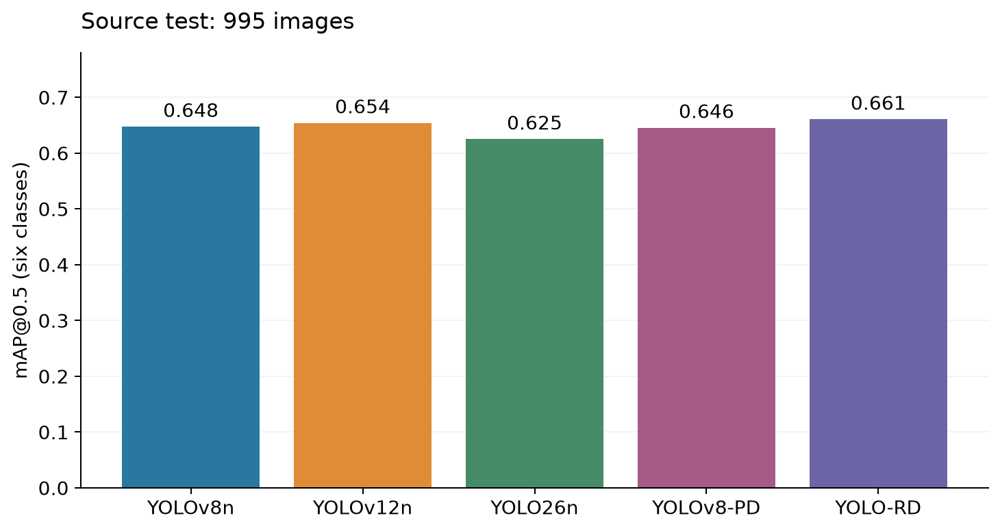
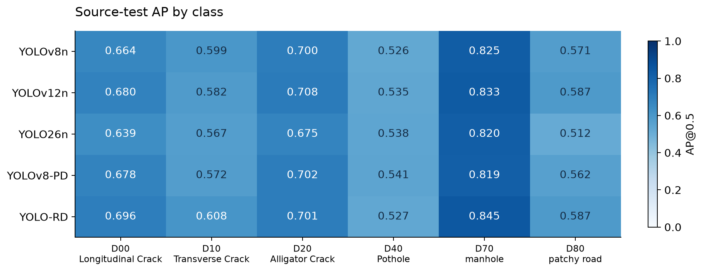
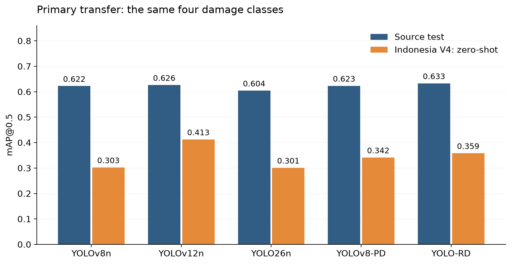
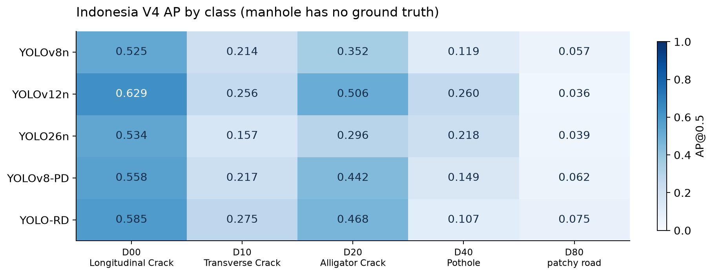
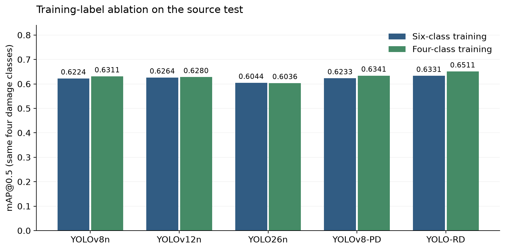
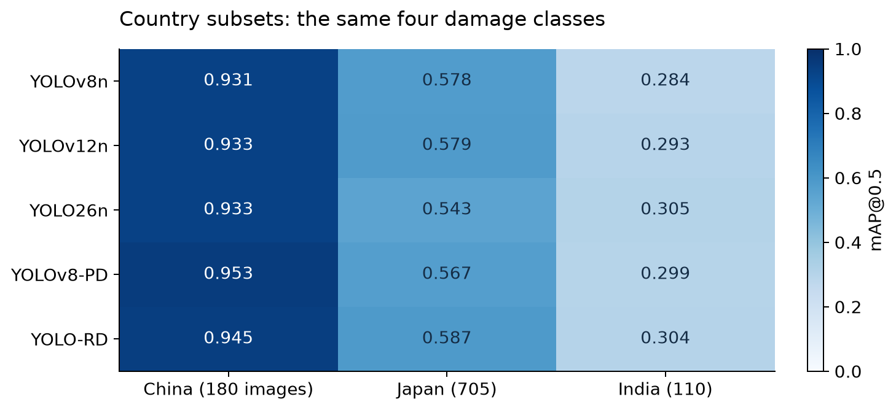
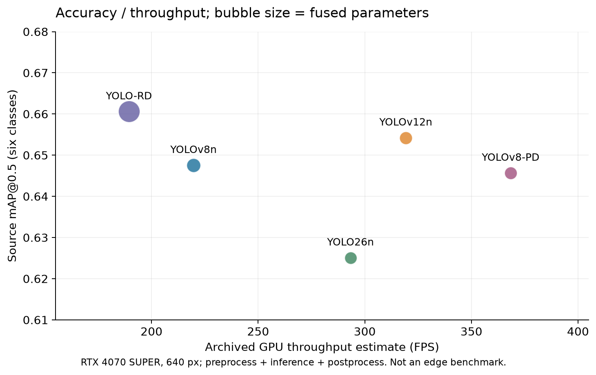
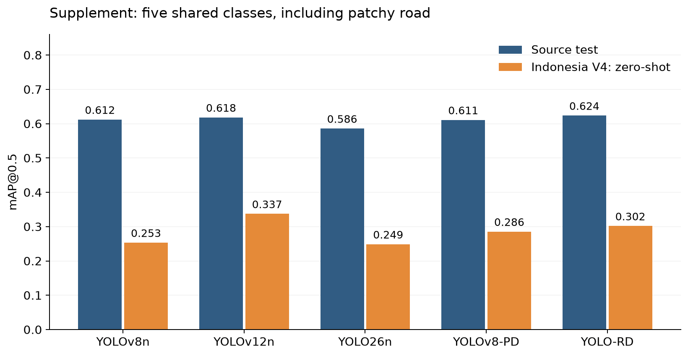

# Hasil final — tabel acuan penelitian

Dibangun dari artefak final yang dipilih di [FINAL_ARTIFACTS.json](FINAL_ARTIFACTS.json), bukan dari konstanta notebook atau angka yang diketik ulang. Generator hanya menghitung ulang agregasi CSV dan membuat visual; tidak menjalankan training atau inferensi. [RESULTS.md](RESULTS.md) tetap menjadi log mentah historis.

**Pisahkan cakupan:** overall sumber memakai enam kelas; transfer utama, ablasi dan perbandingan negara memakai empat kelas kerusakan yang sama. Analisis lima kelas bersama disajikan terpisah sebagai tambahan. Semua hasil berasal dari satu seed per konfigurasi.

## Data dan protokol

- Sumber: N-RDD2024 Asia, split train/val/test 6.777/1.898/995 gambar. Uji sumber enam kelas memiliki 2.425 anotasi; versi empat kelas memiliki 2.035 anotasi pada gambar uji yang sama.
- Target final: Roboflow `rdd-indo-crop` **versi 4**, folder `data/RDD-indo-v4`, split `valid` sebagai uji target: **307 gambar, 502 anotasi, 39 gambar tanpa anotasi**. Empat kelas kerusakan menyumbang 481 anotasi; patchy road 21; manhole tidak memiliki GT.
- Zero-shot berarti menerapkan checkpoint enam kelas tanpa fine-tuning pada target. Seluruh gambar target dan keluaran enam kelas model dipertahankan; agregasi utama memakai ID sumber 0–3.
- Evaluasi AP: imgsz 640, confidence minimum 0,001, NMS IoU 0,6 bila berlaku. Confidence tampilan contoh prediksi 0,25 adalah pengaturan yang berbeda.
- F1 makro berasal dari P/R per kelas pada ambang Ultralytics yang memaksimalkan mean-F1 pada evaluasi asli masing-masing split; bukan F1 pada confidence tampilan 0,25. Agregasi empat/lima kelas memakai P/R yang sudah tersimpan, tanpa memilih ulang threshold khusus subset.
- Kelas tanpa GT tidak dievaluasi dan tidak diisi AP=0. Mapping target→sumber tetap `{0:2, 1:0, 2:5, 3:3, 4:1}`.

## Sumber: uji enam kelas

| Model | Presisi | Recall | mAP@0,5 | mAP@0,5:0,95 | F1 makro | F1 berbobot |
|---|---|---|---|---|---|---|
| YOLOv8n | 0.643 | 0.599 | 0.648 | 0.364 | 0.617 | 0.636 |
| YOLOv12n | 0.638 | 0.608 | 0.654 | 0.371 | 0.619 | 0.637 |
| YOLO26n | 0.642 | 0.580 | 0.625 | 0.358 | 0.606 | 0.622 |
| YOLOv8-PD | 0.675 | 0.591 | 0.646 | 0.362 | 0.627 | 0.640 |
| YOLO-RD | 0.655 | 0.618 | 0.661 | 0.371 | 0.633 | 0.650 |

YOLO-RD memperoleh mAP@0,5 sumber tertinggi pada run ini (0,661). mAP@0,5:0,95 YOLO-RD dan YOLOv12n sama-sama membulat menjadi 0,371. Kedua model custom adalah reimplementasi lokal; peringkat ini bukan bukti superioritas statistik atau efek arsitektur yang terisolasi.

### AP@0,5 per kelas sumber

| Model | D00 | D10 | D20 | D40 | D70 | D80 |
|---|---|---|---|---|---|---|
| YOLOv8n | 0.664 | 0.599 | 0.700 | 0.526 | 0.825 | 0.571 |
| YOLOv12n | 0.680 | 0.582 | 0.708 | 0.535 | 0.833 | 0.587 |
| YOLO26n | 0.639 | 0.567 | 0.675 | 0.538 | 0.820 | 0.512 |
| YOLOv8-PD | 0.678 | 0.572 | 0.702 | 0.541 | 0.819 | 0.562 |
| YOLO-RD | 0.696 | 0.608 | 0.701 | 0.527 | 0.845 | 0.587 |

D00: longitudinal crack; D10: transverse crack; D20: alligator crack; D40: pothole; D70: manhole; D80: patchy road.

## Transfer utama: empat kelas kerusakan yang sama

| Model | Sumber mAP@0,5 | Target V4 mAP@0,5 | Selisih (pp) | Penurunan relatif |
|---|---|---|---|---|
| YOLOv8n | 0.622 | 0.303 | 31.98 | 51.4% |
| YOLOv12n | 0.626 | 0.413 | 21.38 | 34.1% |
| YOLO26n | 0.604 | 0.301 | 30.32 | 50.2% |
| YOLOv8-PD | 0.623 | 0.342 | 28.18 | 45.2% |
| YOLO-RD | 0.633 | 0.359 | 27.45 | 43.4% |

Penurunan relatif = `100 × (1 − target/source)`, dihitung dari AP per kelas tanpa membulatkan terlebih dahulu. Selisih dalam percentage points (pp) adalah `100 × (source − target)`. Angka sumber di bagian ini berbeda dari overall enam kelas karena cakupannya empat kelas.

YOLOv12n memiliki mAP@0,5 target tertinggi (0,413) dan penurunan relatif terkecil (34,1%). Perubahan peringkat sumber→target menggambarkan hasil pada dua dataset ini; besarnya penurunan bukan ukuran kausal tekstur, pencahayaan atau lokasi.

### F1 pada empat kelas yang sama

| Model | F1 makro sumber | F1 makro target | F1 berbobot sumber | F1 berbobot target |
|---|---|---|---|---|
| YOLOv8n | 0.602 | 0.358 | 0.616 | 0.410 |
| YOLOv12n | 0.602 | 0.451 | 0.616 | 0.487 |
| YOLO26n | 0.588 | 0.331 | 0.601 | 0.383 |
| YOLOv8-PD | 0.606 | 0.370 | 0.620 | 0.426 |
| YOLO-RD | 0.613 | 0.400 | 0.628 | 0.456 |

### AP@0,5 per kelas target

| Model | D00 | D10 | D20 | D40 | D80 |
|---|---|---|---|---|---|
| YOLOv8n | 0.525 | 0.214 | 0.352 | 0.119 | 0.057 |
| YOLOv12n | 0.629 | 0.256 | 0.506 | 0.260 | 0.036 |
| YOLO26n | 0.534 | 0.157 | 0.296 | 0.218 | 0.039 |
| YOLOv8-PD | 0.558 | 0.217 | 0.442 | 0.149 | 0.062 |
| YOLO-RD | 0.585 | 0.275 | 0.468 | 0.107 | 0.075 |

D80 dipertahankan sebagai informasi tambahan; tidak dimasukkan ke agregat utama empat kelas.

## Ablasi: training enam versus empat kelas

Kedua rezim dinilai pada empat kelas kerusakan yang sama dan gambar sumber yang sama.

| Model | Training 6 kelas | Training 4 kelas | Δ (4 − 6) | Overlap pothole 6 / 4 |
|---|---|---|---|---|
| YOLOv8n | 0.6224 | 0.6311 | +0.0088 | 3 / 3 |
| YOLOv12n | 0.6264 | 0.6280 | +0.0017 | 2 / 3 |
| YOLO26n | 0.6044 | 0.6036 | -0.0008 | 1 / 2 |
| YOLOv8-PD | 0.6233 | 0.6341 | +0.0108 | 2 / 2 |
| YOLO-RD | 0.6331 | 0.6511 | +0.0180 | 3 / 2 |

Penambahan label manhole/patchy road tidak menunjukkan manfaat yang konsisten untuk mAP empat kelas pada run ini. Overlap adalah **jumlah kotak prediksi pothole**, confidence ≥0,25, yang bertumpang tindih dengan minimal satu GT distractor pada IoU ≥0,5; bukan false-positive rate objek dengan matching unik. Terdapat 390 GT distractor (321 manhole + 69 patchy); jumlah kecil ini tidak mendukung klaim signifikansi dari proxy lama.

## Negara sumber: empat kelas kerusakan bersama

| Model | China (180 gambar) | Japan (705) | India (110) |
|---|---|---|---|
| YOLOv8n | 0.931 | 0.578 | 0.284 |
| YOLOv12n | 0.933 | 0.579 | 0.293 |
| YOLO26n | 0.933 | 0.543 | 0.305 |
| YOLOv8-PD | 0.953 | 0.567 | 0.299 |
| YOLO-RD | 0.945 | 0.587 | 0.304 |

Nilai diturunkan dari tabel `country-four` pada [source paper](../latex/IEEE-Conference/main.tex) **pada presisi pelaporan tiga desimal**; generator tidak mengarang digit tambahan atau menghitungnya dari AP per kelas yang sudah dibulatkan. Ketiga negara ada dalam training. India memiliki hanya enam instance transverse-crack pada test; komposisi/ukuran subgroup membatasi interpretasi.

## Kompleksitas, throughput dan biaya training

| Model | Params fused (M) | GFLOPs | FPS arsip | Training (jam) | Epoch terbaik / akhir |
|---|---|---|---|---|---|
| YOLOv8n | 3.007 | 8.1 | 219.7 | 4.4 | 108 / 148 |
| YOLOv12n | 2.558 | 7.3 | 319.3 | 4.7 | 110 / 150 |
| YOLO26n | 2.376 | 5.3 | 293.3 | 5.3 | 131 / 171 |
| YOLOv8-PD | 2.468 | 7.7 | 368.4 | 6.3 | 150 / 190 |
| YOLO-RD | 7.086 | 12.8 | 189.4 | 11.7 | 238 / 278 |

Kompleksitas mengikuti audit tersimpan: `ultralytics fused model.info(imgsz=640) on final best.pt weights`. Jumlah parameter dalam juta hanya tersedia pada presisi audit tiga desimal; tidak diubah menjadi hitungan parameter eksak. Ini menggantikan nilai unfused/legacy yang tercampur pada tabel lama. FPS dibentuk dari jumlah waktu preprocess + inference + postprocess pada test, dengan RTX 4070 SUPER 12 GB, imgsz 640, Ultralytics 8.4.108, PyTorch 2.5.1+CUDA 12.1 sebagaimana dicatat pada log penelitian. Throughput ini bukan benchmark perangkat edge. Waktu training dan epoch berhenti berbeda antar run, sehingga tidak mengisolasi biaya arsitektur saja.

## Konfigurasi training aktual

| Model | Rezim | Batch | Max epoch | Patience | Seed | AMP | Workers | Warmup bias LR |
|---|---|---|---|---|---|---|---|---|
| YOLOv8n | source_six | 16 | 300 | 40 | 42 | True | 0 | 0.1 |
| YOLOv8n | source_four | 16 | 300 | 40 | 42 | True | 0 | 0.1 |
| YOLOv12n | source_six | 16 | 300 | 40 | 42 | True | 0 | 0.1 |
| YOLOv12n | source_four | 16 | 300 | 40 | 42 | True | 0 | 0.1 |
| YOLO26n | source_six | 16 | 300 | 40 | 42 | True | 0 | 0.1 |
| YOLO26n | source_four | 16 | 300 | 40 | 42 | True | 0 | 0.1 |
| YOLOv8-PD | source_six | 16 | 300 | 40 | 42 | False | 0 | 0.1 |
| YOLOv8-PD | source_four | 16 | 300 | 40 | 42 | True | 0 | 0.1 |
| YOLO-RD | source_six | 16 | 300 | 40 | 42 | False | 0 | 0.1 |
| YOLO-RD | source_four | 16 | 300 | 40 | 42 | True | 4 | 0.0 |

Konfigurasi diambil dari `args.yaml`, bukan sel notebook. Seluruh run memakai input 640, optimizer `auto`, weight decay 0,0005, Mosaic 1,0, MixUp 0,05, flip horizontal 0,5, translate 0,1, scale 0,5, dan rotasi 0. Intervensi imbalance yang terverifikasi adalah bobot kelas effective-number (β=0,999) pada BCE klasifikasi, **bukan Focal Loss**. AMP pada custom empat kelas berbeda dari enam kelas; RD empat kelas juga berbeda pada workers dan warmup bias LR. Perbedaan initialization/pretrained transfer dan pengaturan tersebut membatasi klaim sebab-akibat. Kurva training PD empat kelas tidak tersedia; tidak disubstitusi dengan run lain.

## Tambahan: lima kelas bersama

Bagian ini mencakup D00, D10, D20, D40 dan D80. Manhole dikeluarkan dari kedua domain. Nilai target 0,337 untuk YOLOv12n tetap benar untuk **lima kelas**; tidak bertentangan dengan hasil utama empat kelas 0,413.

| Model | Sumber 5 kelas | Target V4 5 kelas | Penurunan relatif | F1 makro sumber / target | F1 berbobot sumber / target |
|---|---|---|---|---|---|
| YOLOv8n | 0.612 | 0.253 | 58.6% | 0.581 / 0.308 | 0.612 / 0.397 |
| YOLOv12n | 0.618 | 0.337 | 45.4% | 0.584 / 0.383 | 0.613 / 0.471 |
| YOLO26n | 0.586 | 0.249 | 57.5% | 0.570 / 0.281 | 0.598 / 0.370 |
| YOLOv8-PD | 0.611 | 0.286 | 53.3% | 0.594 / 0.312 | 0.617 / 0.412 |
| YOLO-RD | 0.624 | 0.302 | 51.6% | 0.596 / 0.336 | 0.625 / 0.440 |

## Sumber, reproduksi dan batas pembaruan

- Jalankan `python scripts/build_final_results.py`. Entry point lama `python scripts/paper/paper_figs_summary.py` sekarang memanggil generator yang sama dan tidak menimpa gambar LaTeX.
- [Daftar artefak final](FINAL_ARTIFACTS.json) memilih bobot, args dan CSV; [keluaran CSV/JSON](../runs/rdd_yolov8n_local/evaluation/final_report/) menyimpan tabel tanpa pembulatan dan `provenance.json` berisi SHA-256 input.
- [Versi tabel sebelum pembaruan](archive/content-before-update/docs/RESULTS_TABLE.md) dan [generator lama](archive/content-before-update/scripts/paper/paper_figs_summary.py) dipertahankan tanpa perubahan byte.
- Validasi tidak dicampur dengan hasil test. Tabel validasi dan ekspor Indonesia lama tersedia sebagai bukti historis, bukan hasil utama alternatif.
- Notebook, source/PDF LaTeX, CSV run asli dan log mentah tidak diubah oleh generator. Penghitungan ulang UMAP/V4 merupakan pipeline terpisah dan tidak dipalsukan dengan mengganti label grafik V2.
- Semua perbandingan model masih single-seed tanpa confidence interval/uji signifikansi. Sampel target lokal dan satu annotator membatasi generalisasi.
