# Analisis Hasil Eksperimen Deteksi Kerusakan Jalan

Dokumen naratif ini mengikuti artefak final pada [peta artefak](FINAL_ARTIFACTS.json) dan [tabel hasil](RESULTS_TABLE.md). Tabel/grafik akurasi dihitung dari CSV final tanpa training ulang. Regenerasi visualisasi domain V4 disiapkan melalui script terpisah; status pelaksanaannya dijelaskan pada bagian analisis domain. Notebook lama, naskah LaTeX dan PDF submission tidak ditulis ulang.

## Ringkasan temuan

YOLO-RD hasil reimplementasi memperoleh mAP@0,5 tertinggi pada uji sumber enam kelas, yaitu 0,661. Pada transfer empat kelas kerusakan yang sama, YOLOv12n memperoleh nilai target tertinggi 0,413 dari nilai sumber 0,626, dengan penurunan relatif 34,1%. Model yang memimpin di sumber karena itu tidak selalu memimpin pada target yang diuji. Semua perbandingan ini berasal dari satu seed per konfigurasi.

Pelatihan empat versus enam kelas menghasilkan perubahan kecil dan tidak seragam pada mAP empat kelas. Diagnostik overlap hanya menemukan 1–3 kotak pothole yang bertumpang tindih dengan anotasi distractor per konfigurasi. Temuan tersebut belum menetapkan manfaat yang konsisten dari penambahan label manhole dan patchy road.

## Data dan batas perbandingan

N-RDD2024 subset China, Jepang dan India terdiri dari 6.777 gambar latih, 1.898 validasi dan 995 uji, dengan 24.290 anotasi pada inventaris enam kelas. Validasi dipakai untuk pemilihan checkpoint; tabel hasil utama memakai test. Penanganan ketimpangan adalah effective-number weighting pada BCE klasifikasi dengan beta 0,999, bukan Focal Loss.

| Kelas | Latih | Validasi | Uji | Total |
|---|---|---|---|---|
| Retak memanjang | 4555 | 1257 | 635 | 6447 |
| Retak melintang | 3219 | 897 | 446 | 4562 |
| Retak buaya | 4385 | 1245 | 642 | 6272 |
| Lubang jalan | 2192 | 597 | 312 | 3101 |
| Manhole | 2270 | 645 | 321 | 3236 |
| Patchy road | 471 | 132 | 69 | 672 |

Target final adalah ekspor Roboflow rdd-indo-crop versi 4, dengan 307 gambar dan 502 anotasi; 39 gambar memiliki label kosong. Split valid dipakai sebagai uji target, tanpa fine-tuning. Tidak ada anotasi manhole. Semua gambar dipertahankan, termasuk background. Empat kelas kerusakan berjumlah 481 anotasi, sedangkan 21 anotasi patchy road menjadi kelas tambahan.

| Kelas target | Anotasi | Persentase dari 502 |
|---|---|---|
| Retak memanjang | 231 | 46,0% |
| Retak melintang | 132 | 26,3% |
| Retak buaya | 48 | 9,6% |
| Lubang jalan | 70 | 13,9% |
| Patchy road | 21 | 4,2% |

Overall sumber memakai enam kelas. Transfer utama dan perbandingan negara memakai empat kelas kerusakan yang sama (D00, D10, D20, D40). Hasil lima kelas bersama, termasuk patchy road dan tanpa manhole, disajikan terpisah. Mengganti cakupan kelas mengubah rata-rata, sehingga nilai 0,413 empat kelas tidak boleh dilabeli sebagai nilai 0,337 lima kelas atau sebaliknya.

## Akurasi dan biaya komputasi di sumber

| Model | mAP@0,5 | mAP@0,5:0,95 | F1 makro | Parameter fused (juta) | GFLOPs fused | FPS arsip |
|---|---|---|---|---|---|---|
| YOLOv8n | 0,648 | 0,364 | 0,617 | 3,01 | 8,1 | 219,7 |
| YOLOv12n | 0,654 | 0,371 | 0,619 | 2,56 | 7,3 | 319,3 |
| YOLO26n | 0,625 | 0,358 | 0,606 | 2,38 | 5,3 | 293,3 |
| YOLOv8-PD | 0,646 | 0,362 | 0,627 | 2,47 | 7,7 | 368,4 |
| YOLO-RD | 0,661 | 0,371 | 0,633 | 7,09 | 12,8 | 189,4 |

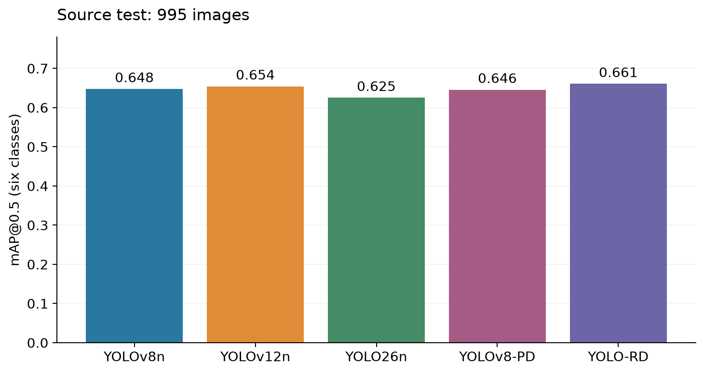

YOLO-RD memimpin mAP@0,5 dan F1 makro pada run sumber ini. mAP@0,5:0,95 YOLOv12n dan YOLO-RD sama-sama membulat menjadi 0,371, sehingga tidak tepat menyebut YOLO-RD unggul mutlak pada seluruh metrik. Model custom merupakan rekonstruksi lokal dengan transfer bobot parsial; perbandingan tidak mengisolasi efek arsitektur.

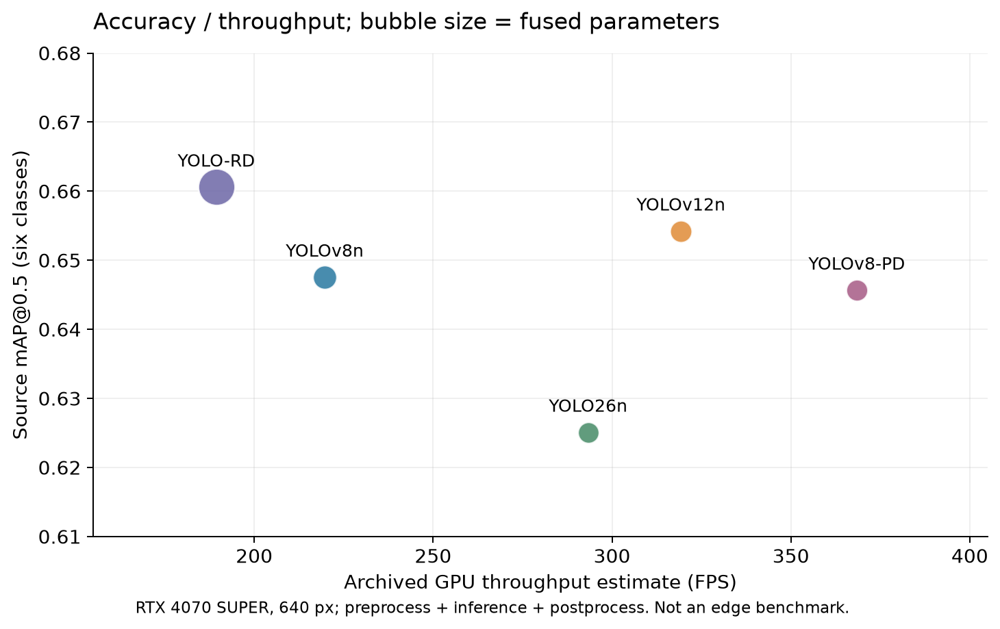

YOLO26n memiliki estimasi parameter dan GFLOPs terendah di antara kelima checkpoint fused. YOLOv8-PD memiliki throughput terukur tertinggi pada perangkat pengujian arsip. FPS berasal dari RTX 4070 SUPER dan protokol preprocessing, inference, serta postprocessing yang tercatat; ini bukan benchmark perangkat edge atau jaminan real-time pada perangkat lain. Kompleksitas mengikuti audit fused model, bukan konstanta lama pada script.

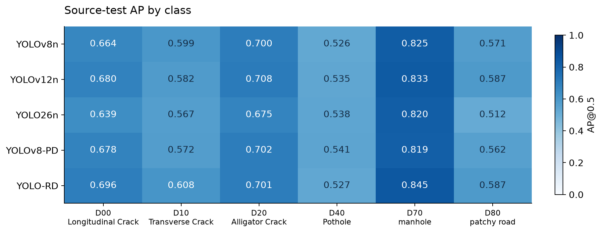

AP pothole sumber berada sekitar 0,526–0,541, sedangkan AP manhole sekitar 0,819–0,845. Perbedaan ini menggambarkan kelas dan split yang diuji; bentuk objek atau mekanisme arsitektur tidak diuji secara terpisah sebagai penyebab. Patchy road hanya memiliki 69 anotasi uji, sehingga interpretasinya memerlukan kehati-hatian.

## Ablasi label dan diagnostik distractor

| Model | mAP empat kelas: training 6 | Training 4 | Delta (4 − 6) | Overlap pothole 6 / 4 |
|---|---|---|---|---|
| YOLOv8n | 0,6224 | 0,6311 | +0,0088 | 3 / 3 |
| YOLOv12n | 0,6264 | 0,6280 | +0,0017 | 2 / 3 |
| YOLO26n | 0,6044 | 0,6036 | -0,0008 | 1 / 2 |
| YOLOv8-PD | 0,6233 | 0,6341 | +0,0108 | 2 / 2 |
| YOLO-RD | 0,6331 | 0,6511 | +0,0180 | 3 / 2 |

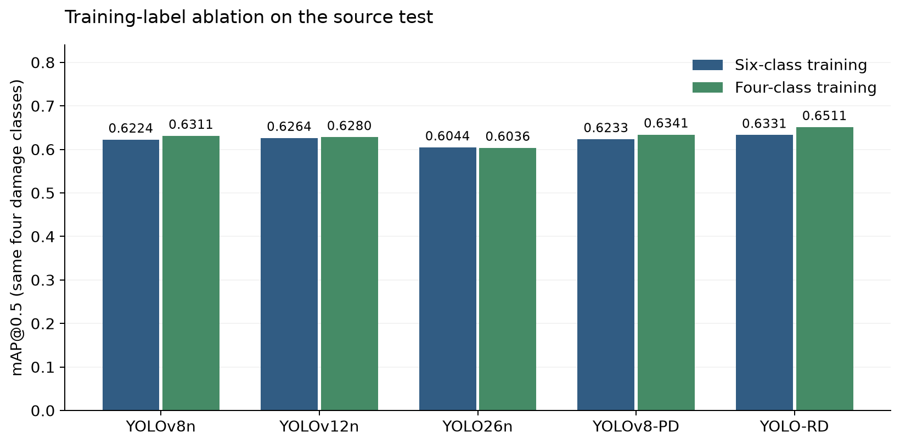

Training empat kelas menghasilkan mAP sedikit lebih tinggi pada empat arsitektur dan sedikit lebih rendah pada YOLO26n. Perubahan YOLO-RD sebesar +0,0180 adalah pengamatan satu pasangan run, bukan hasil uji signifikansi. Konfigurasi AMP custom empat kelas berbeda dari enam kelas; RD juga memiliki perbedaan workers dan warmup, yang dicatat dalam tabel konfigurasi.

Overlap dihitung sebagai jumlah kotak prediksi pothole dengan confidence minimal 0,25 yang menyentuh minimal satu box distractor pada IoU minimal 0,5. Terdapat 321 anotasi manhole dan 69 patchy road. Seluruh overlap yang tercatat melibatkan manhole; patchy road nol. Numerator ini bukan matching unik objek dan bukan false-positive rate. Proxy lama yang menghitung prediksi pada seluruh gambar mengandung distractor tidak digunakan untuk klaim tersebut.

## Perbedaan antarnegara sumber

| Model | China (180 gambar) | Jepang (705) | India (110) |
|---|---|---|---|
| YOLOv8n | 0,931 | 0,578 | 0,284 |
| YOLOv12n | 0,933 | 0,579 | 0,293 |
| YOLO26n | 0,933 | 0,543 | 0,305 |
| YOLOv8-PD | 0,953 | 0,567 | 0,299 |
| YOLO-RD | 0,945 | 0,587 | 0,304 |

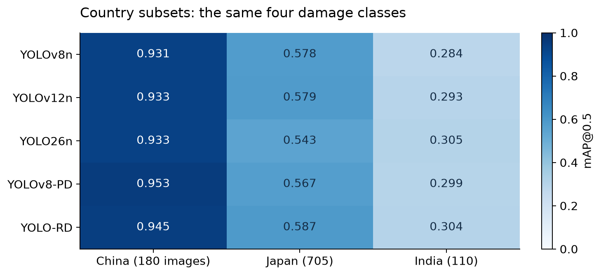

Nilai negara berasal dari tabel paper pada presisi tiga desimal, bukan presisi tambahan yang direka dari log yang telah dibulatkan. China memiliki skor tertinggi dan India terendah pada kelima model. Ukuran subset, distribusi objek dan tampilan citra berbeda; pola ini tidak membuktikan bahwa negara, jumlah data atau satu ciri visual tertentu menyebabkan selisih tersebut.

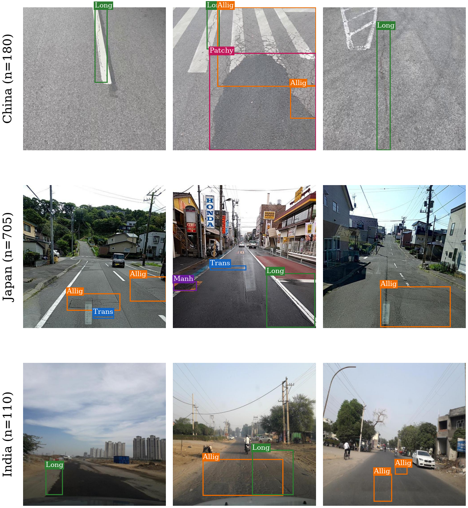

Sampel berlabel memperlihatkan variasi tampilan dari subset sumber. Ini adalah ilustrasi terpilih, bukan pengukuran frekuensi setiap kondisi visual.

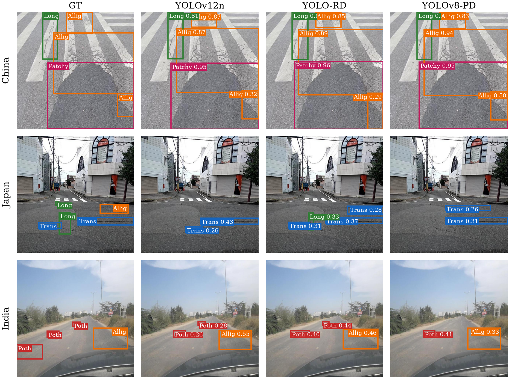

Contoh GT versus prediksi menunjukkan keberhasilan dan kegagalan individual. Contoh tersebut membantu inspeksi, tetapi tidak dapat menggantikan metrik seluruh subset atau membuktikan penyebab perbedaan skor.

## Transfer utama ke Indonesia V4: empat kelas yang sama

| Model | Sumber | Target V4 | Penurunan relatif | F1 makro target (4 kelas) |
|---|---|---|---|---|
| YOLOv8n | 0,622 | 0,303 | 51,4% | 0,358 |
| YOLOv12n | 0,626 | 0,413 | 34,1% | 0,451 |
| YOLO26n | 0,604 | 0,301 | 50,2% | 0,331 |
| YOLOv8-PD | 0,623 | 0,342 | 45,2% | 0,370 |
| YOLO-RD | 0,633 | 0,359 | 43,4% | 0,400 |

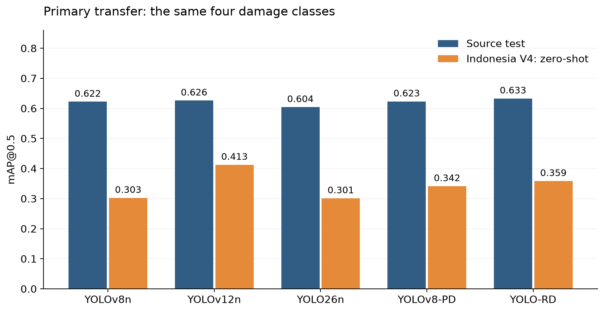

YOLOv12n memperoleh target mAP@0,5 tertinggi pada V4. YOLO-RD yang memimpin empat kelas sumber sebesar 0,633 mencapai 0,359 di target. Penurunan dihitung dari nilai tanpa pembulatan dengan 100 × (1 − target/source). Hasil ini mendukung pemilihan model berdasarkan evaluasi target yang relevan, tetapi belum menetapkan model terbaik untuk seluruh Indonesia.

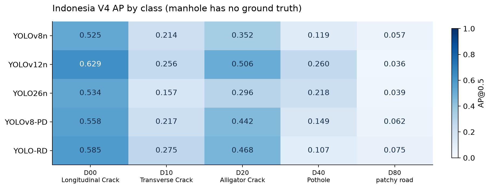

| Kelas YOLOv12n | AP sumber | AP target | Selisih sumber − target | Anotasi target |
|---|---|---|---|---|
| Retak memanjang | 0,680 | 0,629 | 0,051 | 231 |
| Retak melintang | 0,582 | 0,256 | 0,326 | 132 |
| Retak buaya | 0,708 | 0,506 | 0,203 | 48 |
| Lubang jalan | 0,535 | 0,260 | 0,275 | 70 |
| Patchy road | 0,587 | 0,036 | 0,550 | 21 |

Pada YOLOv12n, longitudinal crack mempertahankan AP lebih tinggi dibanding transverse crack dan pothole pada target ini. Patchy road memiliki AP rendah dengan hanya 21 anotasi. Pengamatan permukaan berpori dan pencahayaan dapat menjadi hipotesis untuk pemeriksaan lanjutan, tetapi hasil agregat dan contoh pilihan tidak mengidentifikasi faktor penyebabnya.

## Tambahan: lima kelas bersama

| Model | Sumber (5 kelas) | Target (5 kelas) | Penurunan relatif | F1 makro target (5 kelas) |
|---|---|---|---|---|
| YOLOv8n | 0,612 | 0,253 | 58,6% | 0,308 |
| YOLOv12n | 0,618 | 0,337 | 45,4% | 0,383 |
| YOLO26n | 0,586 | 0,249 | 57,5% | 0,281 |
| YOLOv8-PD | 0,611 | 0,286 | 53,3% | 0,312 |
| YOLO-RD | 0,624 | 0,302 | 51,6% | 0,336 |

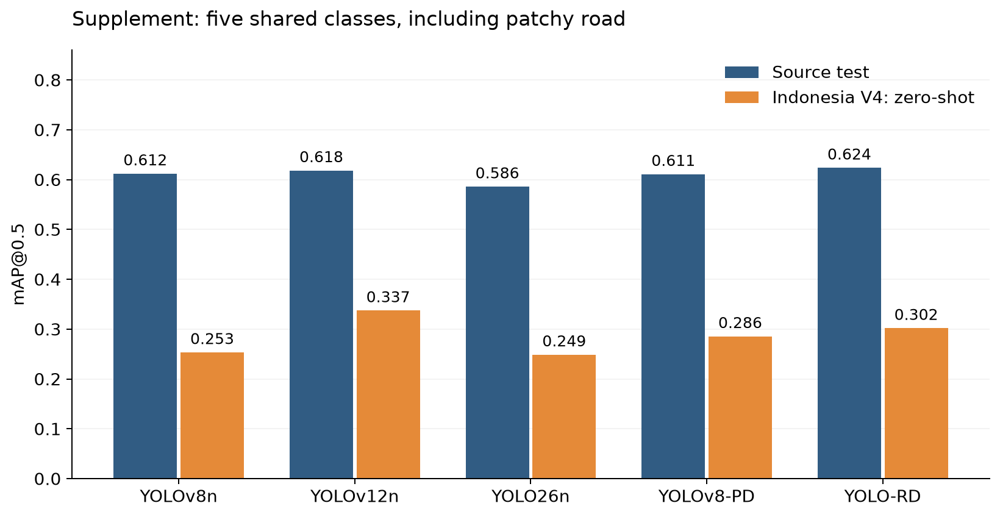

Nilai YOLOv12n 0,337 pada lima kelas tetap valid sebagai hasil tambahan. Perbedaan dari 0,413 pada empat kelas muncul karena penambahan patchy road ke rata-rata. F1 berbobot memakai support GT sedangkan F1 makro memberi bobot sama pada setiap kelas; keduanya harus dibandingkan dalam cakupan kelas yang sama. Ambang P/R/F1 mengikuti ambang mean-F1 optimal split pada Ultralytics, bukan confidence tampilan contoh.

## Karakter citra dan fitur: regenerasi pada V4

Analisis eksploratif ini kini memakai 1.302 gambar: China 180, Jepang 705, India 110, dan Indonesia V4 307. Seluruh sampel sumber dan target dicatat beserta hash gambar/label dalam manifest. Statistik dihitung pada resolusi citra asli; perbedaan resolusi, kamera, framing dan komposisi adegan ikut memengaruhi ukuran ini.

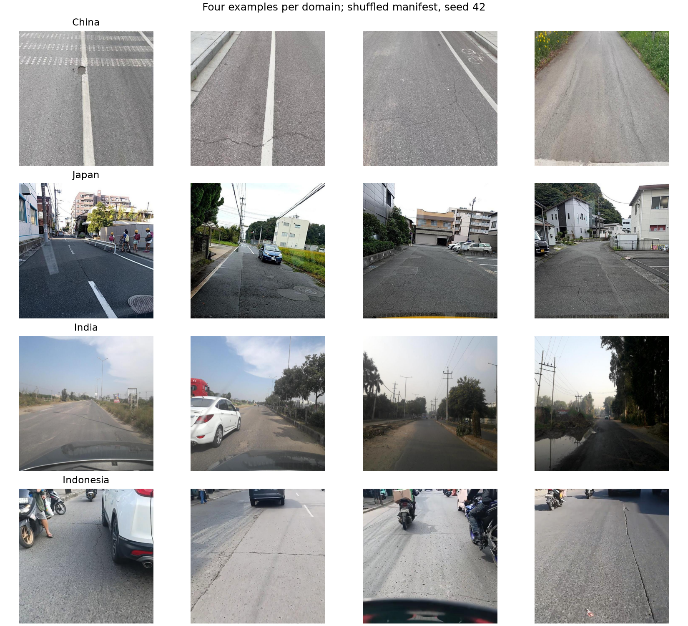

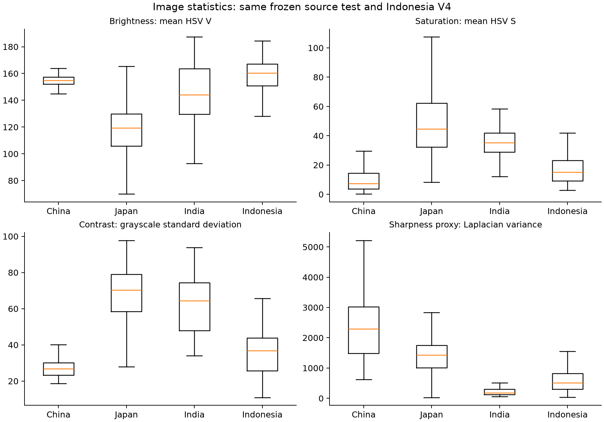

| Domain | Kecerahan: mean V | Kejenuhan: mean S | Kontras: std gray | Ketajaman: var Laplacian | Gambar |
|---|---|---|---|---|---|
| China | 154,8 | 7,3 | 26,8 | 2296,8 | 180 |
| Japan | 119,4 | 44,6 | 70,3 | 1430,9 | 705 |
| India | 144,0 | 35,3 | 64,4 | 181,4 | 110 |
| Indonesia | 160,3 | 15,1 | 36,8 | 514,0 | 307 |

Tabel berisi median antar-gambar atas masing-masing statistik. Varian Laplacian adalah proxy ketajaman yang peka terhadap tekstur dan resolusi, bukan ukuran kualitas kamera yang terisolasi. Statistik ini deskriptif dan tidak menjelaskan selisih AP secara kausal.

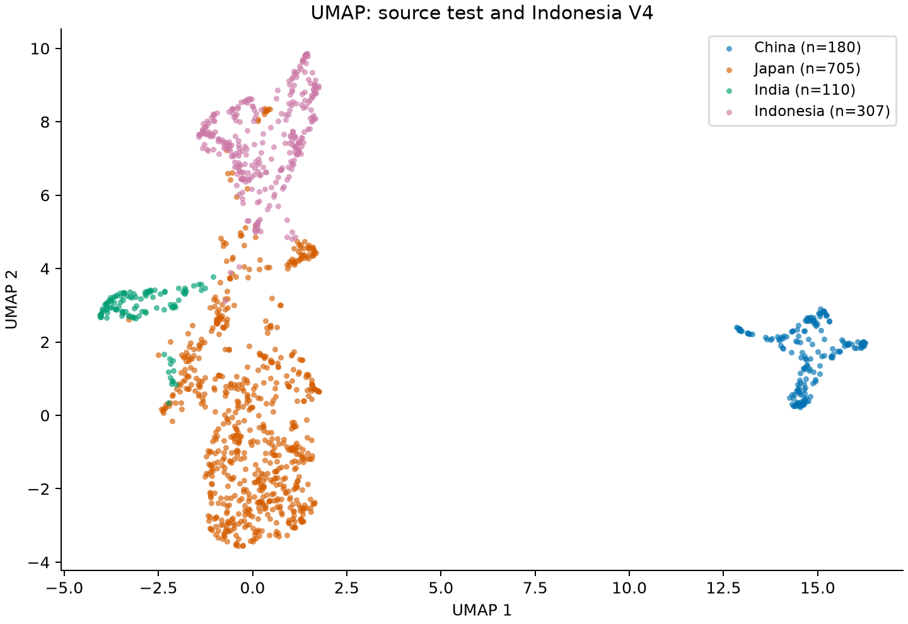

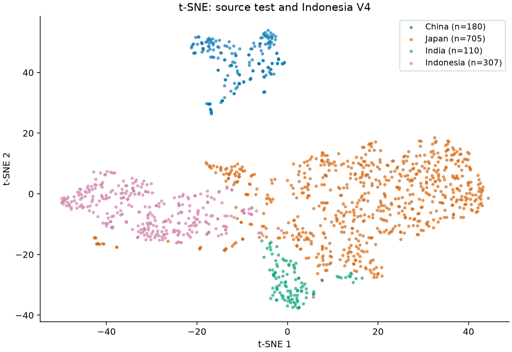

Fitur berdimensi 256 diambil dari layer 21 checkpoint YOLOv8n final, dengan input 640 piksel lalu normalisasi L2. UMAP memakai n_neighbors=15, min_dist=0,1, seed=42; t-SNE memakai perplexity=30, init PCA, seed=42. Silhouette deskriptif pada ruang fitur ternormalisasi adalah 0,199. Koordinat dan jarak dua dimensi tidak merupakan ukuran fisik domain shift atau bukti penyebab kegagalan deteksi. Klaster/tumpang tindih harus dibaca sebagai struktur eksploratif dari fitur model ini.

Regenerasi memakai torch 2.6.0+cu124, Ultralytics 8.4.115 dan device 0. Lingkungan ini dicatat sebagai environment analisis baru, terpisah dari environment training/benchmark arsip. Bundle V2 lama tetap diarsipkan dan tidak ditimpa.

## Contoh kesalahan dan deteksi pada target

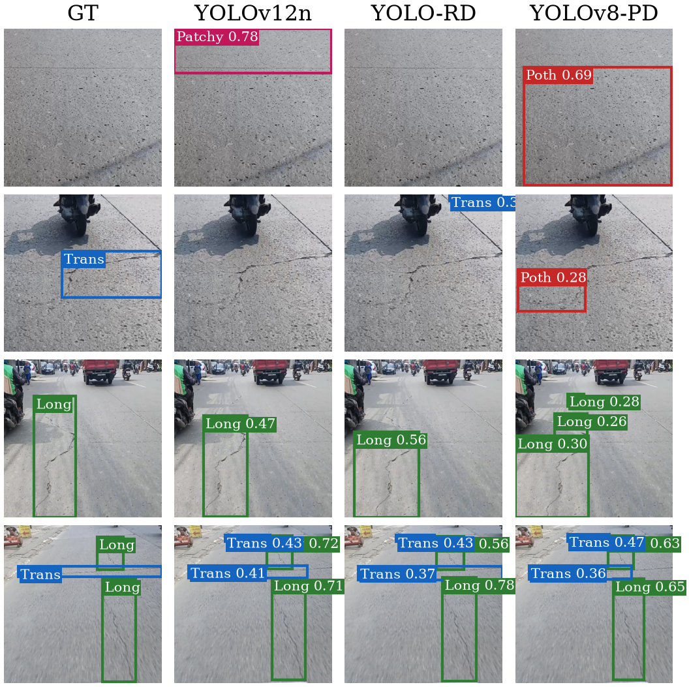

Kolom memperlihatkan GT, YOLOv12n, YOLO-RD dan YOLOv8-PD pada confidence tampilan 0,25. Contoh mencakup prediksi patchy/pothole pada permukaan tanpa anotasi damage, transverse crack yang terlewat atau salah lokasi, serta longitudinal cracks yang terdeteksi dengan kotak tambahan. Patchy road dalam contoh tetap observasi kualitatif di luar rata-rata transfer empat kelas. Contoh terpilih tidak mengukur frekuensi kesalahan dan tidak mengisolasi pengaruh kilau atau tekstur.

## Kesimpulan dan batas bukti

Pada eksperimen yang tercatat, YOLO-RD memimpin akurasi sumber, YOLOv12n memimpin transfer V4, dan YOLOv8-PD memiliki throughput arsip tertinggi. Training empat versus enam kelas tidak menetapkan manfaat yang konsisten dari label distractor. Evaluasi Indonesia mencakup area terbatas dengan satu anotator, dan eksperimen memakai satu seed. Generalisasi geografis, variasi seed serta hipotesis pencahayaan/tekstur memerlukan evaluasi lanjutan. Analisis domain V4 yang diperbarui bersifat eksploratif dan tidak mengubah angka deteksi arsip atau isi paper yang sudah disubmit.

## Reproduksi dan sumber

1. `python3.12 scripts/build_final_results.py` meregenerasi tabel/grafik dari CSV final.
2. `python3.12 scripts/domain_analysis_v4.py --device 0 --resume` menggunakan folder V4 terpisah dan memeriksa kecocokan input cache. Pastikan CUDA tersedia; gunakan direktori output baru untuk eksperimen terpisah.
3. `python3.12 scripts/build_analysis_narrative.py` membangun ulang narasi dari tabel final saat ini; bagian V4 baru ditambahkan setelah bundle domain berstatus lengkap dan hash output terverifikasi.

Detail input, hash, versi dan parameter ada dalam `runs/rdd_yolov8n_local/evaluation/final_report/provenance.json` dan, setelah run V4 berhasil, `domain_viz_v4/provenance.json`. Bukti mentah tetap pada [RESULTS.md](RESULTS.md); catatan lokasi/status tersedia pada [INDEX.md](INDEX.md).
