# Draft Analisis Hasil — IEEE Conference (Sumber: Hasil Eksperimen Saja)

> Status: draf kerja untuk paper IEEE. Angka di bawah memakai **data test** (bukan val) dari `docs/RESULTS_TABLE.md`, notebook `code/05_zero_shot_indo_v3.ipynb`, `code/06_per_country_analysis.ipynb`, `code/07_domain_visualization.ipynb`, dan `docs/rangkuman-eksperimen-ta.md`.
> Gambar baru tersimpan di `latex/IEEE-Conference/gambar/` dengan prefix `draft_*`. Path LaTeX: `gambar/nama_file.png`.
> Catatan koreksi: saat ini ada **5 model** (bukan 6). Semua tabel di bawah memakai 5 model tersebut.

---

## 1. Pendahuluan Singkat

Inspeksi jalan manual tidak skalabel dan subjektif. YOLO cocok untuk otomasi karena lokalisasi + klasifikasi dalam satu forward pass, tetapi ada tiga masalah praktis: (1) objek kecil di latar aspal kompleks, (2) imbalance antar kelas, (3) false positive dari objek mirip lubang (manhole, patchy road). Ditambah **domain shift**: model yang dilatih di Tiongkok/Jepang/India belum tentu bekerja di Indonesia yang tidak ada di data latih.

Penelitian ini membandingkan YOLO skala nano secara terkontrol pada N-RDD2024 subset Asia (6 kelas: 4 kerusakan + 2 pengecoh), menganalisis trade-off akurasi–efisiensi, efek pelabelan distractor (6 vs 4 kelas), variasi per negara sumber, lalu mengukur **domain gap** lewat zero-shot ke data primer Indonesia (RDD-indo-v3) tanpa fine-tuning, termasuk studi kasus kilau aspal pagi hari.

---

## 2. Dataset (Singkat)

**Sumber — N-RDD2024 subset Asia, 6 kelas target.** Setelah filter 6 kelas: **9.670 citra, 24.290 instance**, split stratified ~70/20/10 konsisten per kelas.

| Kelas | Train | Val | Test | Total |
|---|---|---|---|---|
| Longitudinal_Crack (D00) | 4.555 | 1.257 | 635 | 6.447 |
| Transverse_Crack (D10) | 3.219 | 897 | 446 | 4.562 |
| Alligator_Crack (D20) | 4.385 | 1.245 | 642 | 6.272 |
| Pothole (D40) | 2.192 | 597 | 312 | 3.101 |
| manhole / D70 (pengecoh) | 2.270 | 645 | 321 | 3.236 |
| patchy_road / D80 (pengecoh) | 471 | 132 | 69 | 672 |

Poin penting: imbalance 6 kelas 9,67x didorong patchy_road; untuk 4 kelas inti hanya 2,08x (ringan). manhole bukan kelas langka (setara pothole). Patchy_road genuine langka → sumber utama limitasi statistik. Bbox dominan kecil (median 1,69% luas citra) → justifikasi attention + class weighting.

Distribusi train per negara: Japan 4.624 citra / 11.753 instance, China 1.423 / 3.739, India 730 / 1.600. Detail per-kelas per-negara ada di §4.4.

**Target — RDD-indo-v3 (primer, Bandung).** 308 citra valid, 308 file label (33 kosong), **547 instance, 5 kelas (tanpa manhole)**: longitudinal 238, transverse 140, pothole 92, alligator 52, patchy 25. Mapping target→sumber `{0:2, 1:0, 2:5, 3:3, 4:1}` terverifikasi via nama kelas; split valid dipakai sebagai test remap.

**Cara akuisisi (untuk § Metode paper, tulis singkat saja):** video 1080p/30fps sudut pengendara roda dua, rute Jl. Raya Bojongsoang – Jl. Raya Terusan Buah Batu, siang hari; frame diekstrak 1 fps, center-crop via Roboflow, dilabel manual mengikuti standar bbox N-RDD2024/RDD2022. Hanya satu versi target yang dipakai di paper final (v3); jangan campur dengan v1/v2 (`main.tex` saat ini masih memakai angka v2 — harus diupdate ke v3, lihat §4.5).

---

## 3. Konfigurasi Training (Singkat, Umum, Mencakup Semua)

Sumber konfigurasi: `code/03_*_modelling_comparative_local.ipynb` (6 kelas), `code/04_*_modelling_4class.ipynb` (4 kelas), evaluasi `conf=0.001, iou=0.6`, prediksi visual `conf=0.25, iou=0.6`.

- Skala **nano untuk semua model** (apple-to-apple, cegah confounding kapasitas).
- **300 epoch, imgsz 640, `optimizer="auto"` (terkonfirmasi memilih MuSGD, lr 0.01 di semua run), `cos_lr=True`, `amp=True`, `deterministic=True`, patience 40.** Batch: 32 (v8n), 16 (v12n/v26n/PD), 8 (RD). Hardware ukur FPS: RTX 4070 SUPER 12 GB, bs=1, imgsz 640 (estimasi throughput, bukan klaim edge-device).
- Augmentasi: mosaic 1.0 (close 10), mixup 0.05, fliplr 0.5, translate 0.10, scale 0.50, **degrees 0.0** (tanpa rotasi, arahan dospem).
- Imbalance: **class-balanced weighting via Effective Number of Samples (Cui et al. CVPR 2019), β=0.999** di level class `DetectionModel.init_criterion` (patch instance-level terbukti tidak aktif karena Trainer membangun ulang model — bug #2 yang sudah diperbaiki). Focal Loss bawaan tidak dipakai.
- Ablasi 4 kelas: label ID 4/5 dihapus via `code/prepare_4class_dataset.py`, gambar di-symlink (tanpa copy fisik).

**Model yang dibandingkan (5):**

| Model | Filososfi desain | Inti modifikasi | Params / GFLOPs / FPS (test) |
|---|---|---|---|
| **YOLOv8n** (baseline) | Titik acuan | Ultralytics native, anchor-free decoupled head | 3,01M / 8,2 / 219,7 |
| **YOLOv8-PD** (rekonstruksi Zeng & Zhong 2024) | **Efficiency-first** | GhostNet lightweight + shared-parameter head; param paling kecil, FPS tertinggi | 2,46M / 7,7 / **368,4** |
| **YOLO-RD** (rekonstruksi Wang et al. 2025) | **Accuracy-first** | Deformable-conv refinement + komponen wavelet, MAF disederhanakan jadi Upsample→Concat→Conv1x1; sengaja tambah beban demi akurasi | 7,09M / 12,9 / 189,4 |
| **YOLOv12n** (native baru) | **Seimbang / stabil tengah** | R-ELAN + area attention; ringan tapi akurasi dekat RD | 2,57M / 7,5 / 319,3 |
| **YOLOv26n** (native terbaru, end-to-end NMS-free) | Protokol bersama, bukan resep resmi | ProgLoss via `E2ELoss`; limitasi: DFL 1,5 vs 6,0 resmi, batch 16 vs 128, STAL tidak ada di ultralytics 8.4.108/115 | 2,51M / **5,9** / 293,3 |

YOLOv8-PD & YOLO-RD adalah **rekonstruksi dari paper tanpa kode resmi** (bukan replika eksak — tulis eksplisit di paper). YOLOv26n dilaporkan sebagai **hasil di bawah protokol bersama**, bukan bukti intrinsik inferior.

---

## 4. Analisis Hasil (Fokus)

### 4.1 Perbandingan utama 5 model + per kelas (test, 6 kelas)

| Model | P | R | mAP50 | mAP50-95 | macro F1 | weighted F1 |
|---|---|---|---|---|---|---|
| YOLOv8n | 0.643 | 0.599 | 0.648 | 0.364 | 0.617 | 0.636 |
| YOLOv12n | 0.638 | 0.608 | 0.654 | 0.371 | 0.619 | 0.637 |
| YOLOv26n | 0.642 | 0.580 | 0.625 | 0.358 | 0.606 | 0.622 |
| YOLOv8-PD | 0.675 | 0.591 | 0.646 | 0.362 | 0.627 | 0.640 |
| **YOLO-RD** | 0.655 | 0.618 | **0.661** | **0.371** | **0.633** | **0.650** |

Per-kelas test mAP50:

| Model | Long. | Trans. | Allig. | Pothole | manhole | Patchy |
|---|---|---|---|---|---|---|
| YOLOv8n | 0.664 | 0.599 | 0.700 | 0.526 | 0.825 | 0.571 |
| YOLOv12n | 0.680 | 0.582 | 0.708 | 0.535 | 0.833 | 0.587 |
| YOLOv26n | 0.639 | 0.567 | 0.675 | 0.538 | 0.820 | 0.512 |
| YOLOv8-PD | 0.678 | 0.572 | 0.702 | 0.541 | 0.819 | 0.562 |
| YOLO-RD | 0.696 | 0.608 | 0.701 | 0.527 | 0.845 | 0.587 |

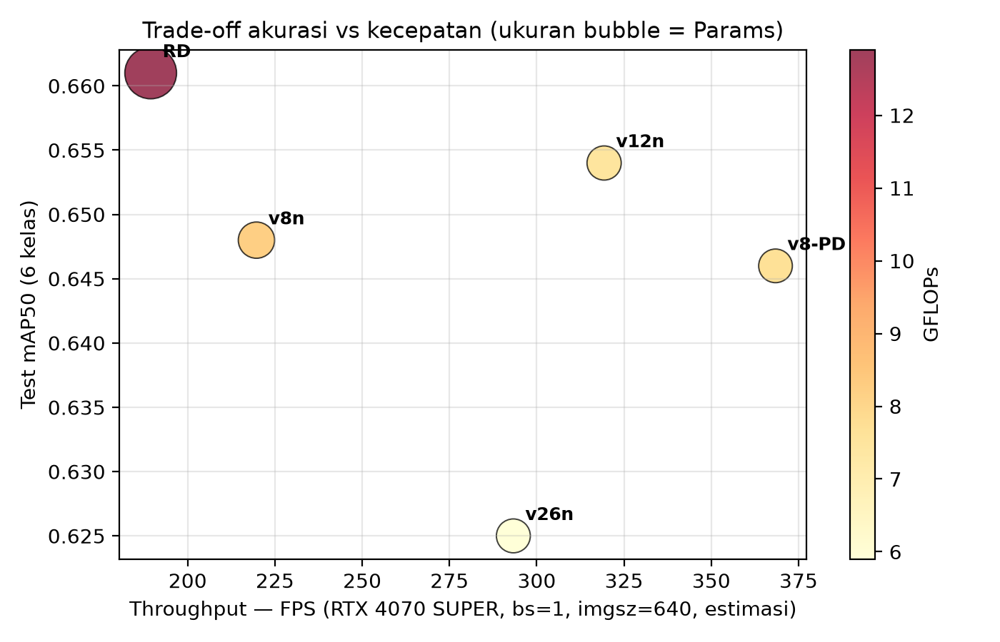
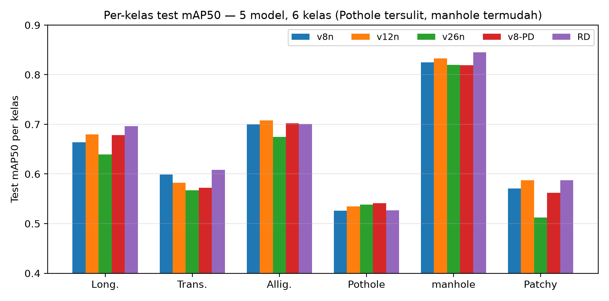

**Bacaan:**

- **YOLO-RD #1 di semua metrik agregat** (mAP50 0.661, F1 0.633) — sesuai filosofi accuracy-first, tetapi terberat & terlambat. Fix zero-init `offset_conv` + padding WTConv menaikkan RD dari ~0.50 (terjelek) → 0.661 (terbaik); bukti validasi kode yang layak disebut di paper.
- **YOLOv8-PD membuktikan efficiency-first:** 68% lebih cepat dari baseline (368 vs 220 FPS), param terkecil (2,46M), akurasi praktis setara baseline (0.646 vs 0.648).
- **YOLOv12n stabil di tengah (konfirmasi ingatan Anda, benar):** akurasi #2 (0.654, selisih 0.007 dari RD), kecepatan #2 (319 FPS), mAP50-95 setara RD (0.371), dan **#1 zero-shot Indo** (§4.5). Ini kandidat "pilih satu model terbaik" untuk deployment: rugi 1% mAP sumber, untung 69% FPS vs RD.
- **YOLOv26n konsisten terbawah** di mAP & F1. Jangan klaim inferior intrinsik; tulis sebagai limitasi protokol bersama (DFL/batch/STAL + one-to-one end-to-end lebih sulit konvergen).
- **Pothole kelas struktural tersulit** (0.526–0.541 di semua model), di bawah Longitudinal (0.64–0.70) dan Alligator (0.68–0.71), bahkan sering di bawah patchy. Konsisten dengan paper YOLOv8-PD asli (D40 terendah karena kecil + sedikit). manhole justru termudah (0.82–0.85, batas geometri tegas). Patchy 0.51–0.59 harus dibaca hati-hati (test n=69).

> Saran paper: klaim deskriptif saja (single-seed, tanpa CI). Jangan klaim signifikansi statistik antar selisih mAP ~0.01.

### 4.2 Trade-off akurasi vs efisiensi — siapa dipilih?

Urutan tidak identik di tiap sumbu: akurasi RD > v12n > v8n ≈ PD > v26n; kecepatan PD > v12n > v26n > v8n > RD; GFLOPs terkecil v26n (5,9). Artinya tidak ada dominasi satu model — ini narasi trade-off utama TA:

- Butuh akurasi maks & GPU server → **YOLO-RD**.
- Butuh real-time/edge → **YOLOv8-PD** (atau v12n bila butuh sedikit akurasi lebih).
- Butuh **satu model untuk dibawa ke zero-shot (§4.5)** → **YOLOv12n** (seimbang + generalisasi terbaik).

### 4.3 Ablasi distractor: latih 6 kelas vs latih 4 kelas

> Klarifikasi istilah: yang tepat untuk deteksi adalah **mAP/F1/FP-rate**, bukan **MAPE** (MAPE = mean absolute percentage error untuk regresi/forecasting, tidak terdefinisi untuk bbox+klasifikasi dengan background dan threshold IoU). Di bawah semuanya memakai mAP50 & FP-rate.

Scope: v8n/v12n/v26n (PD & RD tidak dijalankan, 4–6 jam/model). Dua sisi:

**(a) FP-rate pothole pada objek pengecoh (val+test gabungan, uji z dua-proporsi; N manhole=966, patchy=201):**

| Model | manhole 6cls → 4cls (p) | patchy 6cls → 4cls (p) |
|---|---|---|
| v8n | 18,3% → 21,4% (p=0.087, tidak signifikan, mendekati) | 36,3% → 37,3% (p=0.836) |
| v12n | 19,7% → 17,7% (p=0.267) | 34,8% → 31,3% (p=0.458) |
| v26n | 19,9% → 20,7% (p=0.651) | 40,3% → 41,3% (p=0.839) |

**(b) Biaya ke mAP pothole (test; 6cls-dilatih dievaluasi subset 4 kelas vs 4cls-dilatih):** v8n −0.020, v12n −0.001, v26n −0.024. Arah konsisten turun di 2/3 model.

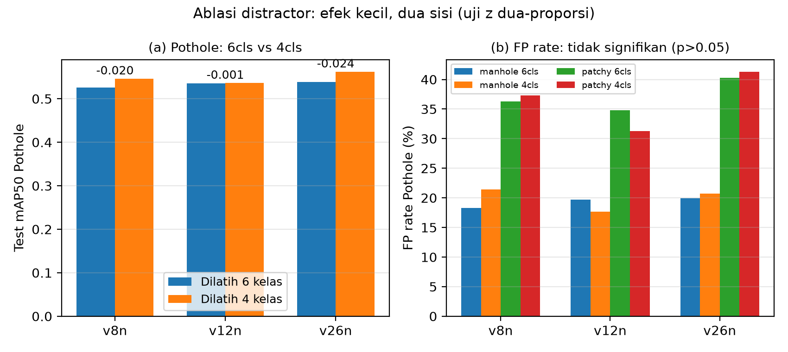

**Bacaan dua sisi (lebih kaya dari "tidak ada efek"):** belum terbukti untung (tidak ada p<0.05) + ada indikasi rugi kecil pada mAP pothole itu sendiri. Mekanisme yang masuk akal: pengecoh dipilih karena mirip pothole, sehingga TAL dipaksa memperketat batas keputusan pothole. Keduanya efek kecil; selisih mAP belum diuji signifikansi (butuh bootstrap/multi-seed) → laporkan sebagai **tren yang diamati**. Tambahan: model 6 kelas tetap unggul macro-F1 di semua 3 arsitektur — distractor membantu kalibrasi global walau tidak menekan FP pothole secara spesifik.

> Saran visual tambahan (belum dibuat): confusion matrix ternormalisasi per model (6cls vs 4cls) + kurva PR pothole. Artefak sudah ada di `runs/*/evaluation/*/{confusion_matrix,PR_curve}.png` — tinggal pilih 1 model (v8n) untuk paper agar hemat halaman.

### 4.4 Variasi per negara sumber — agregat menyembunyikan segalanya

| Model | China (180) | Japan (705) | India (110) | Gabungan |
|---|---|---|---|---|
| v8n | 0.883 | 0.581 | 0.426 | 0.648 |
| v12n | 0.890 | 0.587 | 0.433 | 0.654 |
| v26n | 0.869 | 0.546 | 0.443 | 0.625 |
| PD | 0.907 | 0.570 | 0.438 | 0.646 |
| RD | 0.892 | 0.594 | 0.442 | 0.661 |

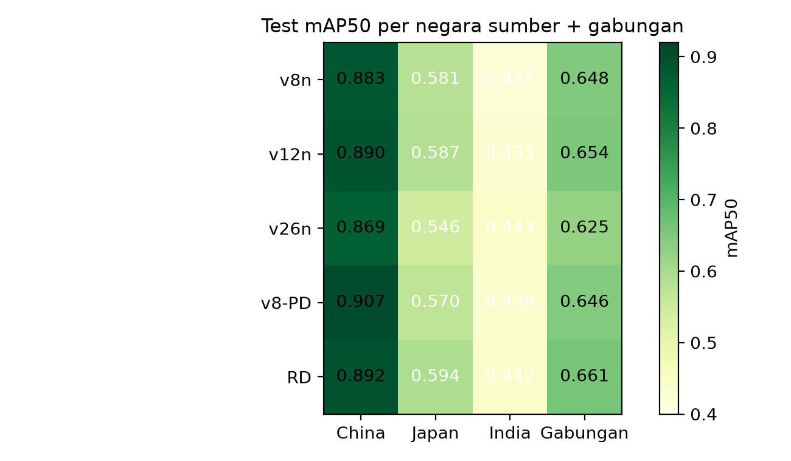

**Bacaan:** pola peringkat **identik di semua model** (China ≫ Japan > India) → ini efek domain, bukan arsitektur. Japan punya train 3x China tetapi kalah jauh → volume bukan penjelas; kesulitan domain yang menjelaskan. Tautan representasi terbersih: Transverse India (train 19 instance → test 0.038–0.21 tergantung model). Sel manhole/patchy India tak bisa diklaim (n=1 / n=0).

Per-kelas per negara (sorotan): di China pothole/alligator/patchy ≈ 0.95–0.995 (mudah); di Japan patchy anjlok ke 0.27–0.36; di India transverse kolaps (0.002–0.21). Ini justifikasi kuat untuk § zero-shot: bila antar-negara sumber saja gap sudah 0.88→0.43, wajar target Indonesia jatuh lebih jauh.

> Penempatan di paper: bagian ini boleh di awal hasil (tepat setelah tabel utama) atau digabung ke § domain shift — rekomendasi: **di awal**, sebagai jembatan "bahkan di dalam sumber saja sudah ada domain gap".

### 4.5 Zero-shot ke Indonesia (RDD-indo-v3) — gap besar, ranking berbalik

Evaluasi: bobot sumber langsung diuji ke remap Indo-v3, `conf=0.001, iou=0.6` (sama seperti Skenario 1).

| Model | Sumber test | Indo-v3 ZS | Δ abs | Drop relatif |
|---|---|---|---|---|
| **YOLOv12n** | 0.654 | **0.309** | −0.345 | −52,8% |
| YOLO-RD | 0.661 | 0.272 | −0.389 | −58,8% |
| YOLOv8-PD | 0.646 | 0.269 | −0.377 | −58,3% |
| YOLOv8n | 0.648 | 0.248 | −0.400 | −61,7% |
| YOLOv26n | 0.625 | 0.225 | −0.400 | −63,9% |

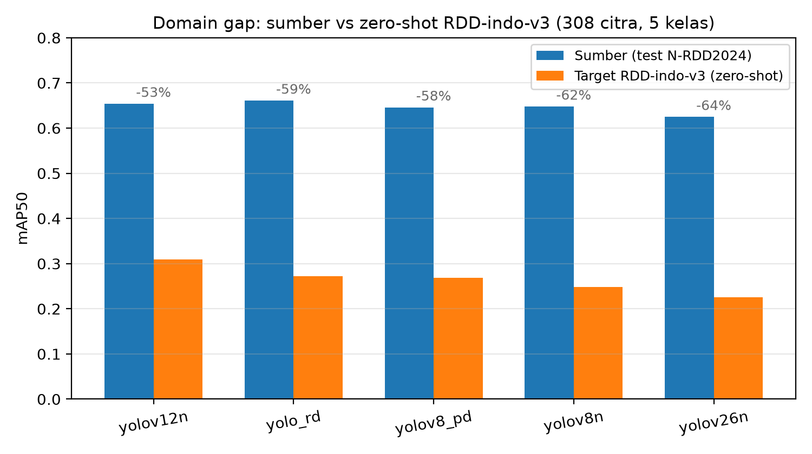

**Bacaan:**

- Semua model drop >50% → gap bukan efek kalibrasi kecil; interpretasi praktis benchmark sumber berubah total saat pindah domain.
- **Ranking berbalik:** RD #1 di sumber → #2 di target; **v12n #2 di sumber → #1 di target**. Pesan deployment: optimasi mAP sumber saja bisa memilih model yang kurang robust.
- Angka ini (v3, 0.31/0.27/...) berbeda dari `main.tex` saat ini (v2: 0.172/0.149/...) — **wajib sinkronkan paper ke v3** dan hapus klaim "308 test + 585 instance v2". Jangan campur dua versi artefak.

### 4.6 Karakteristik gambar per domain — mengapa gap terjadi?

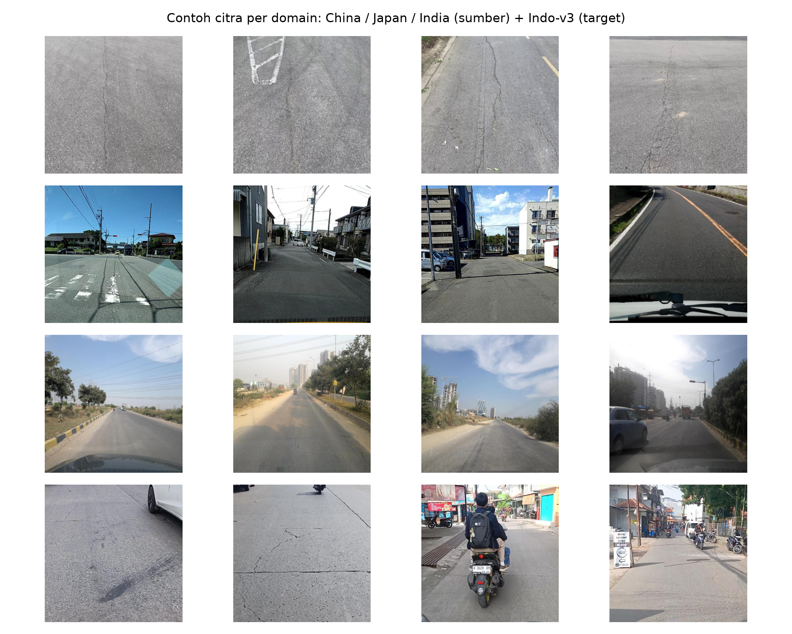
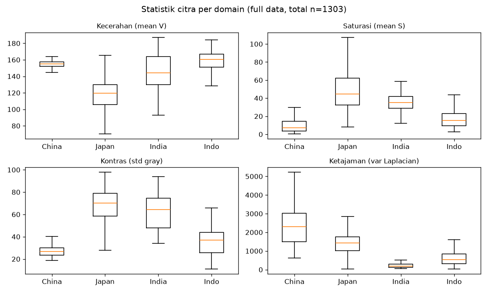
 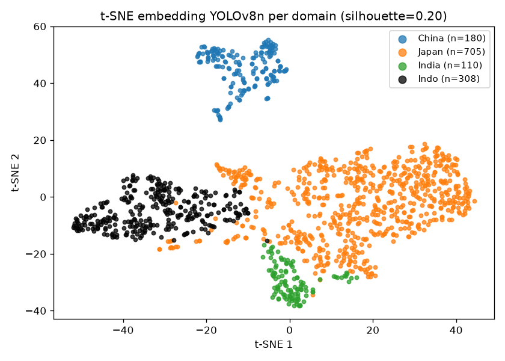

- **Sampel 4/domain** (seed 42): grounding kualitatif — China terang & marka jelas, Japan ramai & gelap, India kasar/kontras, Indo-v3 siang terik dengan tekstur aspal berbeda.
- **Statistik murah & reviewer-friendly** (median): brightness China 154.8 / Japan 119.4 / India 144.0 / Indo 160.3; saturasi Japan 44.6 vs China 7.3; kontras Japan 70.3 vs China 26.8; ketajaman China 2296 vs India 181. Indo paling terang — konsisten dengan hipotesis kilau (§4.7).
- **UMAP/t-SNE dari embedding 256-d YOLOv8n** (full 1.303 citra, bukan sampel): China terisolasi di kedua plot; Indo klaster sendiri (sedikit overlap tepi ke Japan); India klaster kecil rapat menempel massa Japan (n=705). Silhouette ruang 256-d **0.20** (turun dari 0.26 versi sampel — wajar akibat imbalance Japan). Baca dengan benar: t-SNE/UMAP untuk ilustrasi struktur, bukan bukti kuantitatif jarak domain; korelasinya dengan mAP per negara bersifat **asosiatif, bukan kausal**.

> UMAP **nyambung dan layak masuk paper** (1 panel saja, pilih UMAP; t-SNE simpan sebagai suplemen). Pasangan ideal: kiri UMAP, kanan boxplot brightness/kontras — langsung menjelaskan "beda tampilan → beda embedding → beda mAP".

### 4.7 Studi kasus kilau aspal pagi (VID_20260520_092711_*)

**Konteks:** 42 citra pagi (09:27, Bojongsoang–Buah Batu) terlihat sedikit mengkilau memantulkan cahaya matahari. Hipotesis: performa turun di subset ini.

Hasil baru (evaluasi subset, `conf=0.001, iou=0.6`):

| Model | Pagi (42 citra, 63 inst) | Non-pagi (266 citra, 484 inst) | Seluruh v3 (308) |
|---|---|---|---|
| YOLOv12n | 0.278 | 0.327 | 0.309 |
| YOLO-RD | 0.204 | 0.289 | 0.272 |
| YOLOv8-PD | 0.286 | 0.280 | 0.269 |

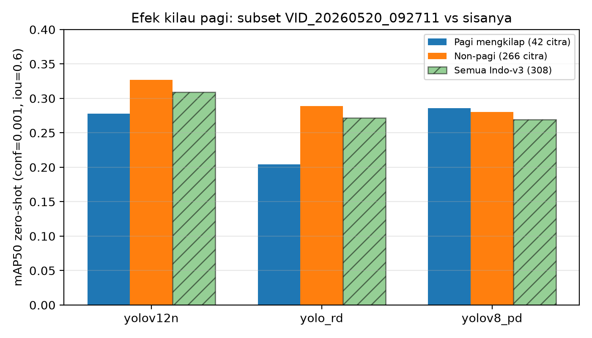
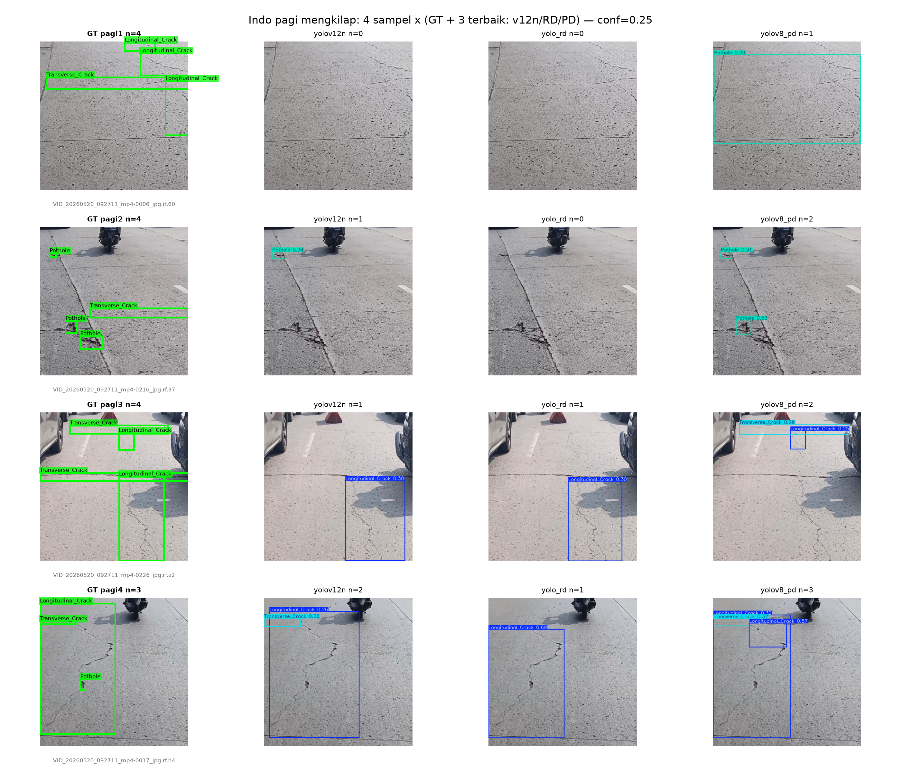
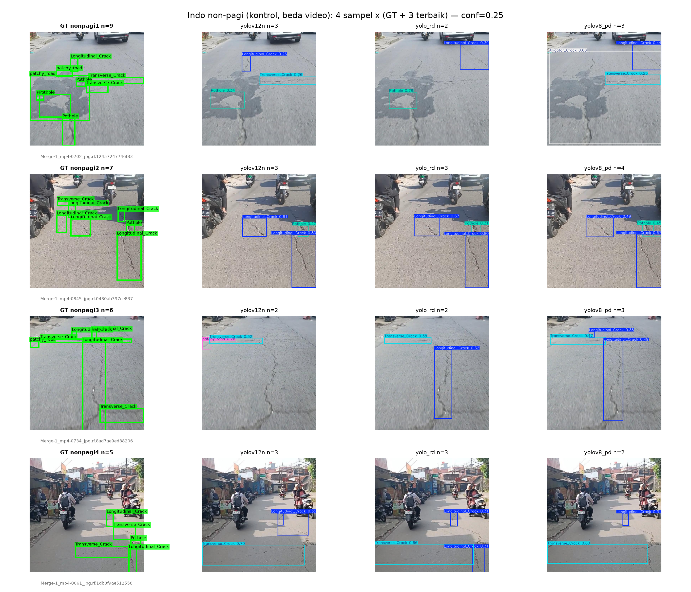

**Bacaan hati-hati (N kecil):**

- Efek **tidak seragam**: RD jatuh paling dalam (−0.085 vs non-pagi), v12n turun moderat (−0.049), **PD justru flat/sedikit naik** (+0.006). Ini temuan menarik: arsitektur lightweight PD tampaknya lebih robust ke kilau — tetapi...
- **Caveat besar:** komposisi kelas beda (pagi: 0 instance patchy; pothole pagi hanya 8 vs 84 non-pagi; empty 5/42 vs 28/266). Jadi selisih mAP bisa berasal dari campuran kelas, bukan murni kilau. Tulis sebagai **observasi awal yang butuh uji lanjutan** (stratifikasi per kelas / uji permutasi), bukan klaim "kilau menurunkan X%".
- Visual GT vs 3 terbaik (v12n/RD/PD, `conf=0.25`), kini **4 sampel × (GT + 3 model) = 4×4** per figur: panel pagi menunjukkan miss pada retak tipis yang menyatu dengan kilau; panel non-pagi (beda video, kontrol bersih) sebagai pembanding menampilkan bbox lebih rapat. Untuk paper, satu figur pagi 4×4 sudah cukup; figur non-pagi simpan sebagai suplemen/kontrol reviewer (atau crop 2 sampel bila halaman ketat).

> Rekomendasi analisis lanjutan (murah, tanpa training): (1) hitung brightness/kontras khusus 42 citra pagi vs 266 sisanya (uji Mann-Whitney), (2) evaluasi per-kelas pagi vs non-pagi untuk longitudinal saja (n=27 vs 211, paling powered), (3) sweep conf 0.10–0.50 di subset pagi untuk pastikan efek bukan artefak threshold.

### 4.8 Bukti kualitatif GT vs prediksi

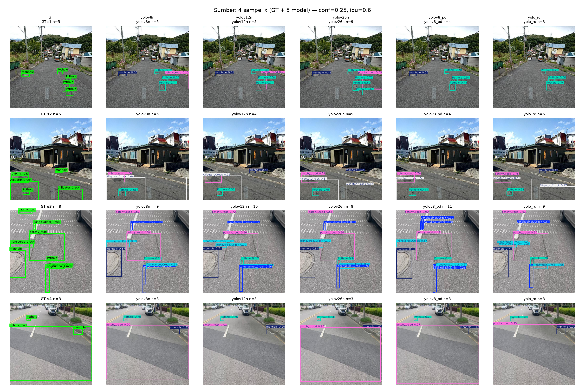

Contoh sumber kini **4 sampel × (GT + 5 model) = 4×6** (sampel mengandung pothole + manhole/patchy, mis. `Japan_001246`) memperlihatkan perbedaan perilaku: model yang memisahkan kedua kotak vs yang menggabung/melepas salah satu — jangkar visual untuk klaim "pengecoh menantang" di §4.1/4.3. Untuk paper IEEE yang hemat halaman, **satu figur sumber 4×6 + satu figur Indo pagi 4×4** sudah cukup; bila kolom 6 terlalu padat untuk dua kolom IEEE, pecah sumber menjadi 2 figur 4×4 (GT + v8n/v12n/v26n dan GT + PD/RD + ulangi GT) atau turunkan ke 2 sampel terbaik.

---

## 5. Validasi Rencana Analisis + Yang Perlu Dibuat

**Rencana Anda aman (dengan 4 koreksi):**

1. ✅ Perbandingan 5 model + per kelas, ✅ accuracy-first vs efficiency-first vs v12n tengah, ✅ plot GT vs model, ✅ ablasi 6 vs 4 kelas, ✅ MAP per negara → zero-shot Indo, ✅ sampel/UMAP per negara, ✅ studi kilau pagi GT+3 terbaik — semuanya koheren dan layak IEEE.
2. ⚠️ **"6 model" → 5 model.** Tidak ada model ke-6 di artefak. Jika memang ada kandidat ke-6 (mis. YOLOv8s), latih dulu; jika tidak, perbaiki narasi jadi 5.
3. ⚠️ **"MAPE" → pakai mAP.** MAPE tidak cocok untuk deteksi. Perbandingan 6cls-dilatih vs 4cls-dilatih yang benar: (a) mAP pothole Δ (§4.3b), (b) FP-rate + uji z (§4.3a), (c) macro/weighted F1. Itu sudah menjawab pertanyaan "lubang-vs-pengecoh teratasi atau tidak".
4. ⚠️ **Sinkronkan v2 → v3** di `main.tex` (tabel zero-shot, deskripsi target, `domain_gap.png`). Saat ini paper masih angka v2.
5. ⚠️ **Jaga klaim kilau pagi tetap lemah** (N=42, beda komposisi kelas). Aman sebagai "studi kasus ilustratif", tidak aman sebagai klaim umum.

**Sudah dibuat di draf ini (12 file di `gambar/`):** `draft_tradeoff_map_vs_fps`, `draft_perkelas_test_map50`, `draft_percountry_heatmap`, `draft_domain_gap_v3`, `draft_ablasi_6vs4`, `draft_samples_per_domain`, `draft_stats_per_domain`, `draft_umap/tsne_per_domain`, `draft_gt_vs_5models_source`, `draft_gt_vs_3models_indo_{morning,rest}`, `draft_morning_vs_rest`.

**Yang masih perlu dibuat (prioritas):**

1. (Wajib paper) Sinkron angka v3 + ganti `gambar/domain_gap.png` dengan `draft_domain_gap_v3.png`; ganti heatmap dengan `draft_percountry_heatmap.png` (lebih tajam).
2. (Wajib) Satu figur metode akuisisi Indo-v3 (peta rute Bojongsoang–Buah Batu + alur video→1fps→center-crop→label) — tidak ada di artefak mana pun.
3. (Disarankan) Confusion matrix + kurva PR pothole untuk v8n 6cls vs 4cls (artefak sudah ada di `runs/`, tinggal kurasi).
4. (Opsional) Brightness test pagi vs non-pagi + sweep conf subset pagi (§4.7).
5. (Suplemen) Multi-seed (mean±std) bila compute memungkinkan; jika tidak, pertahankan pernyataan limitasi single-seed.

**Snipet LaTeX (contoh):**

```latex
\begin{figure}[!ht]
\centering
\includegraphics[width=\columnwidth]{gambar/draft_tradeoff_map_vs_fps.png}
\caption{Accuracy--efficiency trade-off on the source test set (bubble size = parameters).}
\label{fig:tradeoff}
\end{figure}
```

---

## Lampiran Angka (rujukan cepat, test)

- Sumber mAP50: RD 0.661, v12n 0.654, v8n 0.648, PD 0.646, v26n 0.625.
- Indo-v3 ZS mAP50: v12n 0.309, RD 0.272, PD 0.269, v8n 0.248, v26n 0.225.
- 4cls-dilatih test mAP50: v8n 0.631, v12n 0.628, v26n 0.604 (selalu di bawah rekan 6cls-nya saat dievaluasi 4 kelas inti? bandingkan §4.3 — pola campur, hanya pothole yang konsisten turun).
- F1 test macro 6cls: RD 0.633 > PD 0.627 > v12n 0.619 > v8n 0.617 > v26n 0.606.
