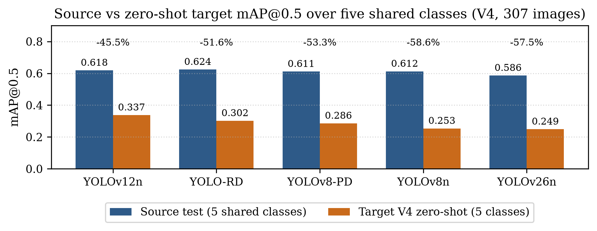
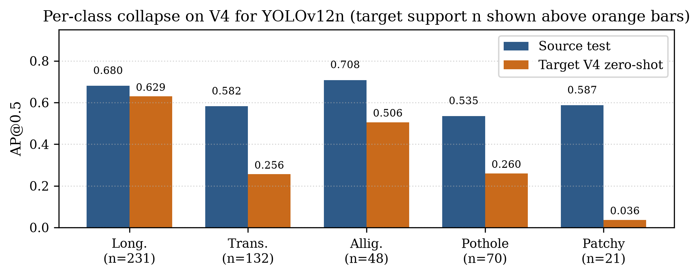

# Draft Analisis Hasil — IEEE Conference (V4 FINAL)

> Status: draf kerja. Semua angka dari **data test** (bukan val).
> Sumber kebenaran angka: `docs/RESULTS_TABLE.md`, `runs/rdd_yolov8n_local/*_test_per_class_metrics.csv`,
> `runs/rdd_yolov8n_local/evaluation/zero_shot_indo_v4/` (`domain_gap.csv`, `zs_per_class_metrics.csv`, `zs_f1_summary.csv`),
> `runs/rdd_yolov8n_local/fp_overlap_6cls_vs_4cls_test.csv`, `docs/progress/2026-09-29-fp-proxy-vs-fp-overlap.md`.
> Model: **5 model** (YOLOv8n, YOLOv12n, YOLOv26n, YOLOv8-PD, YOLO-RD).
> Target: **RDD-indo-V4 saja** (307 citra valid dipakai sebagai test, 502 instance, 5 kelas tanpa manhole).
> V1/V2/V3 tidak dipakai lagi di analisis ini — jangan campur angkanya.
> Gambar paper baru (English, IEEE-ready): `gambar/paper_fig1_domain_gap_v4.png`, `gambar/paper_fig2_perclass_collapse_v12n.png`
> (generator: `scripts/paper/paper_figs_v4.py`, baca langsung dari CSV).
> Gambar diagnostik lama tetap di `runs/` dan dirujuk apa adanya sebagai bahan kurasi.

---

## 1. Pendahuluan Singkat

Inspeksi jalan manual tidak skalabel dan subjektif. YOLO cocok untuk otomasi karena lokalisasi + klasifikasi dalam satu forward pass, tetapi ada tiga masalah praktis: (1) objek kecil di latar aspal kompleks, (2) imbalance antar kelas, (3) dugaan false positive dari objek mirip lubang (manhole, patchy road). Ditambah **domain shift**: model yang dilatih di China/Jepang/India belum tentu bekerja di Indonesia yang tidak ada di data latih.

Penelitian ini membandingkan lima YOLO skala nano secara terkontrol pada N-RDD2024 subset Asia (6 kelas: 4 kerusakan + 2 objek permukaan), menganalisis trade-off akurasi–efisiensi, efek pelabelan distractor (latih 6 kelas vs latih 4 kelas), variasi per negara sumber, lalu mengukur **domain gap** lewat zero-shot ke RDD-indo-V4 tanpa fine-tuning. Analisis kilau aspal pagi (42 citra `VID_20260520_092711_*`) bersifat **studi kasus ilustratif** — komposisi kelasnya beda dari sisa data sehingga tidak boleh diklaim sebagai efek kausal.

---

## 2. Dataset

**Sumber — N-RDD2024 subset Asia, 6 kelas target.** Setelah filter 6 kelas: **9.670 citra, 24.290 instance**, split stratified ~70/20/10 konsisten per kelas.

| Kelas | Train | Val | Test | Total |
|---|---|---|---|---|
| Longitudinal_Crack (D00) | 4.555 | 1.257 | 635 | 6.447 |
| Transverse_Crack (D10) | 3.219 | 897 | 446 | 4.562 |
| Alligator_Crack (D20) | 4.385 | 1.245 | 642 | 6.272 |
| Pothole (D40) | 2.192 | 597 | 312 | 3.101 |
| manhole / D70 | 2.270 | 645 | 321 | 3.236 |
| patchy_road / D80 | 471 | 132 | 69 | 672 |

Poin penting: imbalance 6 kelas 9,67x didorong patchy_road; untuk 4 kelas inti hanya 2,08x (ringan). manhole bukan kelas langka (setara pothole). patchy_road genuine langka (test n=69) → sumber utama limitasi statistik. Bbox dominan kecil (median 1,69% luas citra) → justifikasi class weighting.

Distribusi train per negara: Japan 4.624 citra / 11.753 instance, China 1.423 / 3.739, India 730 / 1.600. Detail per-kelas per-negara ada di §4.4.

**Target — RDD-indo-V4 (satu-satunya target di analisis ini).** Path `data/RDD-indo-v4/` (metadata Roboflow: proyek `rdd-indo-crop` version 3 — nama folder "v4" adalah penamaan lokal, bukan versi dataset ke-4). Isi: **307 citra valid, 307 file label (39 kosong), 502 instance, 5 kelas tanpa manhole**. Mapping target→sumber `{0:2, 1:0, 2:5, 3:3, 4:1}`; split valid dipakai sebagai test remap karena tidak ada folder test.

Komposisi target V4 per kelas target (id: jumlah): alligator 48, longitudinal 231, patchy 21, pothole 70, transverse 132. Subset pagi `VID_20260520_092711_*`: 42 citra, 62 instance (long 26, trans 25, pothole 8, alligator 3, **patchy 0**, 5 citra kosong). Sisa non-pagi: 265 citra, 440 instance (long 205, trans 107, pothole 62, alligator 45, patchy 21, 34 kosong). **Perbedaan komposisi ini (pagi tanpa patchy, pothole 8 vs 62) adalah alasan utama analisis pagi tidak boleh dibaca sebagai efek kilau murni.**

---

## 3. Konfigurasi Training

Sumber konfigurasi: `code/03_*_modelling_comparative_local.ipynb` (6 kelas), `code/04_*_modelling_4class.ipynb` (4 kelas), evaluasi `conf=0.001, iou=0.6`, prediksi visual `conf=0.25, iou=0.6`.

- Skala **nano untuk semua model** (apple-to-apple, cegah confounding kapasitas).
- **300 epoch, imgsz 640, `optimizer="auto"` (terkonfirmasi memilih MuSGD, lr 0.01 di semua run), `cos_lr=True`, `amp=True`, `deterministic=True`, patience 40.** Batch: 32 (v8n), 16 (v12n/v26n/PD), 8 (RD). Hardware ukur FPS: RTX 4070 SUPER 12 GB, bs=1, imgsz 640 (estimasi throughput, bukan klaim edge-device).
- Augmentasi: mosaic 1.0 (close 10), mixup 0.05, fliplr 0.5, translate 0.10, scale 0.50, **degrees 0.0** (tanpa rotasi, arahan dospem).
- Imbalance: **class-balanced weighting via Effective Number of Samples (Cui et al. CVPR 2019), β=0.999** di level class `DetectionModel.init_criterion`. Focal Loss bawaan tidak dipakai.
- Ablasi 4 kelas: label ID 4/5 dihapus via `code/prepare_4class_dataset.py`, gambar di-symlink. Bobot final v8n/v12n/v26n 4-kelas dipulihkan dari PC lab (`runs/rdd_4class_local_pc_lab/` → `runs/rdd_4class_local/experiments/`).

**Model yang dibandingkan (5):**

| Model | Filosofi desain | Inti modifikasi | Params / GFLOPs / FPS (test) |
|---|---|---|---|
| **YOLOv8n** (baseline) | Titik acuan | Ultralytics native, anchor-free decoupled head | 3,01M / 8,2 / 219,7 |
| **YOLOv8-PD** (rekonstruksi Zeng & Zhong 2024) | **Efficiency-first** | GhostNet lightweight + shared-parameter head; param paling kecil, FPS tertinggi | 2,46M / 7,7 / **368,4** |
| **YOLO-RD** (rekonstruksi Wang et al. 2025) | **Accuracy-first** | Deformable-conv refinement + komponen wavelet, MAF disederhanakan jadi Upsample→Concat→Conv1x1 | 7,09M / 12,9 / 189,4 |
| **YOLOv12n** (native baru) | **Seimbang / stabil tengah** | R-ELAN + area attention; ringan tapi akurasi dekat RD | 2,57M / 7,5 / 319,3 |
| **YOLOv26n** (native terbaru, end-to-end NMS-free) | Protokol bersama, bukan resep resmi | ProgLoss via `E2ELoss`; limitasi: DFL 1,5 vs 6,0 resmi, batch 16 vs 128, STAL tidak ada di ultralytics 8.4.108/115 | 2,51M / **5,9** / 293,3 |

Waktu training hingga early stopping: YOLOv8n 4,4 jam (best epoch 108 / total 148), YOLOv12n 4,7 jam (110/150), YOLOv26n 5,3 jam (131/171), YOLOv8-PD 6,3 jam (150/190), dan YOLO-RD 11,7 jam (238/278). Semua run berhenti 39 epoch setelah best epoch, konsisten dengan patience 40.

> Peringatan kompleksitas (dari `rangkuman-v2.md`): angka Params/GFLOPs di `RESULTS_TABLE.md` tidak cocok dengan ringkasan fused di `RESULTS.md` (mis. v26n 2.506M/5.9 vs 2.376M/5.2). Jangan salin Params/GFLOPs ke paper final sebelum rekonsiliasi dengan runtime dan bobot yang sama. FPS selalu cantumkan hardware + protokol.

YOLOv8-PD & YOLO-RD adalah **rekonstruksi dari paper tanpa kode resmi** (bukan replika eksak). YOLOv26n dilaporkan sebagai **hasil di bawah protokol bersama**, bukan bukti inferior intrinsik.

---

## 4. Analisis Hasil

### 4.1 Perbandingan utama 5 model + per kelas (test sumber, 6 kelas)

| Model | P | R | mAP50 | mAP50-95 | macro F1 | weighted F1 |
|---|---|---|---|---|---|---|
| YOLOv8n | 0.643 | 0.599 | 0.648 | 0.364 | 0.617 | 0.636 |
| YOLOv12n | 0.638 | 0.608 | 0.654 | 0.371 | 0.619 | 0.637 |
| YOLOv26n | 0.642 | 0.580 | 0.625 | 0.358 | 0.606 | 0.622 |
| YOLOv8-PD | 0.675 | 0.591 | 0.646 | 0.362 | 0.627 | 0.640 |
| **YOLO-RD** | 0.655 | 0.618 | **0.661** | **0.371** | **0.633** | **0.650** |

Per-kelas test mAP50 (eksak dari CSV, 4 desimal di file):

| Model | Long. | Trans. | Allig. | Pothole | manhole | Patchy |
|---|---|---|---|---|---|---|
| YOLOv8n | 0.664 | 0.599 | 0.700 | 0.526 | 0.825 | 0.571 |
| YOLOv12n | 0.680 | 0.582 | 0.708 | 0.535 | 0.833 | 0.587 |
| YOLOv26n | 0.639 | 0.567 | 0.675 | 0.538 | 0.820 | 0.512 |
| YOLOv8-PD | 0.678 | 0.572 | 0.702 | 0.541 | 0.819 | 0.562 |
| YOLO-RD | 0.696 | 0.608 | 0.701 | 0.527 | 0.845 | 0.587 |

**Bacaan:**

- **YOLO-RD #1 di semua metrik agregat** (mAP50 0.661, F1 0.633) — sesuai filosofi accuracy-first, tetapi terberat & terlambat.
- **YOLOv8-PD membuktikan efficiency-first:** 68% lebih cepat dari baseline (368 vs 220 FPS), param terkecil (2,46M), akurasi praktis setara baseline (0.646 vs 0.648).
- **YOLOv12n stabil di tengah:** akurasi #2 (0.654, selisih 0.007 dari RD), kecepatan #2 (319 FPS), mAP50-95 setara RD (0.371), dan **#1 zero-shot V4** (§4.5). Kandidat satu model untuk deployment: rugi ~1% mAP sumber, untung ~69% FPS vs RD.
- **YOLOv26n konsisten terbawah** di mAP & F1 — limitasi protokol bersama, bukan vonis intrinsik.
- **Pothole kelas struktural tersulit** (0.526–0.541 di semua model). manhole justru termudah (0.82–0.85, batas geometri tegas). Patchy 0.51–0.59 dibaca hati-hati (test n=69).

> Klaim deskriptif saja (single-seed, tanpa CI). Jangan klaim signifikansi antar selisih mAP ~0.01.

### 4.2 Trade-off akurasi vs efisiensi — siapa dipilih?

Urutan tidak identik di tiap sumbu: akurasi RD > v12n > v8n ≈ PD > v26n; kecepatan PD > v12n > v26n > v8n > RD; GFLOPs terkecil v26n (5,9). Tidak ada dominasi satu model:

- Butuh akurasi maks & GPU server → **YOLO-RD**.
- Butuh real-time/edge → **YOLOv8-PD** (atau v12n bila butuh sedikit akurasi lebih).
- Butuh **satu model untuk dibawa ke zero-shot (§4.5)** → **YOLOv12n** (seimbang + generalisasi terbaik).

### 4.3 Ablasi distractor: latih 6 kelas vs latih 4 kelas (VERSI BETUL — FP overlap, bukan proxy)

> Koreksi penting (log `2026-09-29-fp-proxy-vs-fp-overlap.md`): angka FP di draft lama adalah **proxy per-gambar** (semua prediksi Pothole di gambar yang memuat pengecoh ikut terhitung, tanpa cek tumpang tindih box). Proxy itu terbukti menyesatkan: untuk yolov8n 6-kelas, proxy 53/390 = 0.1359 sedangkan TRUE overlap (IoU≥0.5) hanya 3/390 = 0.0077. ~94% angka proxy BUKAN salah-label objek pengecoh. **Uji-z dua-proporsi di draft lama dihitung di atas proxy sehingga tidak valid untuk klaim salah-label dan sudah dibuang dari analisis ini.**
>
> Yang dipakai sekarang: (a) metrik TRUE overlap IoU≥0.5 (test-only, conf=0.25, NMS 0.6; GT manhole=321, patchy=69, gabungan=390; file `runs/rdd_yolov8n_local/fp_overlap_6cls_vs_4cls_test.csv`), (b) mAP pothole 6cls vs 4cls, (c) macro/weighted F1. MAPE tidak dipakai (tidak terdefinisi untuk deteksi).

**(a) TRUE overlap FP pothole pada GT pengecoh (test, conf=0.25, IoU match ≥0.5):**

| Model | nc | TRUE manhole | TRUE patchy | TRUE gabungan |
|---|---|---|---|---|
| yolov8n 6cls | 6 | 0.0093 (3/321) | 0.0000 (0/69) | 0.0077 (3/390) |
| yolov12n 6cls | 6 | 0.0062 (2/321) | 0.0000 | 0.0051 (2/390) |
| yolov26n 6cls | 6 | 0.0031 (1/321) | 0.0000 | 0.0026 (1/390) |
| yolov8-PD 6cls | 6 | 0.0062 (2/321) | 0.0000 | 0.0051 (2/390) |
| yolo-rd 6cls | 6 | 0.0093 (3/321) | 0.0000 | 0.0077 (3/390) |
| yolo-rd 4cls | 4 | 0.0062 (2/321) | 0.0000 | 0.0051 (2/390) |
| yolov8n 4cls | 4 | 0.0093 (3/321) | 0.0000 | 0.0077 (3/390) |
| yolov12n 4cls | 4 | 0.0093 (3/321) | 0.0000 | 0.0077 (3/390) |
| yolov26n 4cls | 4 | 0.0062 (2/321) | 0.0000 | 0.0051 (2/390) |
| yolov8-PD 4cls | 4 | 0.0062 (2/321) | 0.0000 | 0.0051 (2/390) |

Temuan: TRUE gabungan semua model 0.0026–0.0077 (1–3 prediksi dari 390 GT) — **salah-label pengecoh sebagai Pothole hampir tidak pernah terjadi**. TRUE patchy = 0 di SEMUA model (10/10 baris). Pasangan 6cls vs 4cls se-arsitektur identik atau beda ≤1 prediksi (v8: 3=3; v12: 2 vs 3; v26: 1 vs 2; PD: 2=2; RD: 3 vs 2) → **tidak ada bukti efek distractor pada FP beneran**. Deteksi pengecoh 6cls sendiri baik: manhole 0.81–0.92 (RD 0.83), patchy 0.55–0.61 (RD 0.59).
Gambar bukti: `runs/rdd_yolov8n_local/viz_fp_overlap_yolov8n_test.png` (panel A FP beneran / B proxy-saja / C penanganan benar / D kasus kedua) + detail `viz_fp_overlap_detail.csv`.

**(b) mAP pothole 6cls-dilatih vs 4cls-dilatih (test, kelas yang sama, presisi penuh):**

| Arsitektur | 6cls pothole | 4cls pothole | Δ (4−6) |
|---|---|---|---|
| v8n | 0.526 | 0.546 | +0.020 |
| v12n | 0.535 | 0.536 | +0.001 |
| v26n | 0.538 | 0.562 | +0.024 |
| v8-PD | 0.541 | 0.552 | +0.011 |
| YOLO-RD | 0.527 | 0.582 | +0.055 |

**(c) Agregat 4 kelas inti (mAP50 rata-rata D00/D10/D20/D40) + macro-F1:**

| Arsitektur | 6cls mAP50 4-inti | 4cls mAP50 4-inti | Δ | 6cls macro-F1 4-inti | 4cls macro-F1 | Δ F1 |
|---|---|---|---|---|---|---|
| v8n | 0.6224 | 0.6311 | +0.0088 | 0.602 | 0.602 | ~0.000 |
| v12n | 0.6264 | 0.6280 | +0.0017 | 0.602 | 0.606 | +0.004 |
| v26n | 0.6044 | 0.6036 | −0.0008 | 0.588 | 0.595 | +0.007 |
| v8-PD | 0.6233 | 0.6341 | +0.0108 | 0.6057 | 0.6167 | +0.011 |
| YOLO-RD | 0.6331 | 0.6511 | +0.0180 | 0.6129 | 0.6174 | +0.005 |

**Bacaan dua sisi:** tidak ada bukti untung dari label eksplisit pada FP beneran (TRUE overlap nyaris nol di kedua rezim, RD 6cls 3/390 vs 4cls 2/390 — hasil run GPU 2026-10-12, `fp_overlap_6cls_vs_4cls_test.csv` 10 baris) + ada tren rugi kecil yang konsisten pada mAP pothole bila pengecoh dipakai (4cls lebih tinggi di 5/5 pasangan; RD +0.055 terbesar). Keduanya efek kecil, single-seed, belum diuji inferensial → laporkan sebagai **tren yang diamati**, bukan klaim signifikan atau kausal.

### 4.4 Variasi per negara sumber — agregat menyembunyikan segalanya

| Model | China (180) | Japan (705) | India (110) |
|---|---|---|---|
| YOLOv8n | 0.931 | 0.578 | 0.284 |
| YOLOv12n | 0.933 | 0.579 | 0.293 |
| YOLOv26n | 0.933 | 0.543 | 0.305 |
| YOLOv8-PD | 0.953 | 0.567 | 0.299 |
| YOLO-RD | 0.945 | 0.587 | 0.304 |

> Agregat = rata-rata mAP50 4 kelas inti (D00/D10/D20/D40) dari bobot 6-kelas — apple-to-apple antar-negara. Δ dihitung dari presisi penuh lalu dibulatkan (bukan selisih angka 4dp). Angka Ultralytics mentah (6-kelas untuk China/Japan; 5-kelas India 0.426–0.443 yang terdongkrak 1 GT manhole 0.995) tidak dipakai di sini. India transverse test n=6 (train 19); manhole n=1 excluded; patchy n=0. Pola peringkat tetap identik di semua model (China ≫ Japan > India) → efek domain, bukan arsitektur. Sama dengan `main.tex` Tabel country-four (terverifikasi 15/15 sel dari `RESULTS_TABLE.md`).

**Bacaan:** Japan punya train 3x China tetapi kalah jauh → volume bukan penjelas; kesulitan domain yang menjelaskan. Tautan representasi terbersih: Transverse India (train 19 instance → test 0.002–0.21 tergantung model). Sorotan per-kelas per-negara (dari `RESULTS_TABLE.md`): China pothole/alligator/patchy ≈ 0.95–0.995 (mudah); Japan patchy anjlok ke 0.27–0.36; India transverse kolaps. Ini justifikasi § zero-shot: bila antar-negara sumber saja gap sudah 0.93→0.29 (4-kelas inti), wajar target Indonesia jatuh lebih jauh.

### 4.5 Zero-shot ke Indonesia V4 — gap besar, ranking berbalik (ANGKA V4 FINAL)

Evaluasi: bobot sumber langsung diuji ke remap V4, `conf=0.001, iou=0.6`. Perbandingan memakai **5 kelas bersama** (manhole tanpa GT dikecualikan dari rata-rata Ultralytics, bukan dihitung nol — lihat log `2026-10-08-zero-shot-v4-dan-f1-per-kelas.md` bug `class_result` posisional).



| Model | Sumber 5-kelas | V4 ZS 5-kelas | Drop relatif | Sumber macro-F1 | V4 macro-F1 | Sumber weighted-F1 | V4 weighted-F1 |
|---|---|---|---|---|---|---|---|
| **YOLOv12n** | 0.618 | **0.337** | −45.5% | 0.584 | **0.383** | 0.613 | **0.471** |
| YOLO-RD | 0.624 | 0.302 | −51.6% | 0.596 | 0.336 | 0.625 | 0.440 |
| YOLOv8-PD | 0.611 | 0.286 | −53.3% | 0.594 | 0.312 | 0.617 | 0.412 |
| YOLOv8n | 0.612 | 0.253 | −58.6% | 0.581 | 0.308 | 0.612 | 0.397 |
| YOLOv26n | 0.586 | 0.249 | −57.5% | 0.570 | 0.281 | 0.598 | 0.370 |

(Sumber: `evaluation/zero_shot_indo_v4/domain_gap.csv` skema V4. Urutan weighted-F1 identik dengan mAP50: 12n > RD > PD > 8n > 26n. Macro-F1: PD 0.312 vs 8n 0.308 — karena macro memberi bobot sama pada patchy n=21.)

**Bacaan:**

- Semua model drop 46–59% → gap bukan efek kalibrasi kecil; benchmark sumber berubah total saat pindah domain.
- **Ranking berbalik:** RD #1 di sumber (6-kelas 0.661) → #2 di target; **v12n #2 di sumber → #1 di target**. Pesan deployment: optimasi mAP sumber saja bisa memilih model yang kurang robust.
- Weighted-F1 drop (−23 s.d. −38%) lebih kecil dari macro-F1 drop (−34 s.d. −51%) → model kurang parah pada kelas dominan (Longitudinal) namun lebih parah pada kelas langka.
- Jangan campur dengan angka V2 (0.136–0.172) atau run V4 lama (0.239–0.332 pada 514 instance): komposisi anotasi berubah (502 instance) sehingga bandingkan hanya dalam run yang sama. Kenaikan antar-ekspor maupun antar-run adalah efek komposisi dataset, bukan model membaik.

### 4.6 Collapse per-kelas di V4 — jeleknya di mana (YOLOv12n, model terbaik target)



| Kelas | Sumber | V4 | Δ | Support V4 | Makna |
|---|---|---|---|---|---|
| Longitudinal | 0.680 | 0.629 | −0.051 | 231 | Hampir tidak drop — retak memanjang masih ketangkap |
| Transverse | 0.582 | 0.256 | −0.326 | 132 | Kolaps — retak melintang tipis hilang |
| Alligator | 0.708 | 0.506 | −0.202 | 48 | Turun moderat, masih terbaik ke-2 |
| Pothole | 0.535 | 0.260 | −0.275 | 70 | Kolaps — lubang tidak dikenali |
| Patchy | 0.587 | 0.036 | −0.551 | 21 | Hancur total — tapi n=21, baca hati-hati |

(Sumber: `zs_per_class_metrics.csv` + `yolov12n_class_weight_test_per_class_metrics.csv`.)

**Bacaan + concern keterbandingan:** collapse tidak merata — Longitudinal bertahan, Transverse/Pothole kolaps, Patchy hancur. Ini nyambung ke hipotesis tekstur porous Bojongsoang (lubang-lubang kecil merata menyerupai retak/patch) + kilau pagi. Tetapi **support V4 beda jauh dari support sumber** (patchy 21 vs 69; pothole 70 vs 312) dan komposisi kelas beda, sehingga Δ per-kelas bukan efek domain murni — ada komponen ketidakpastian statistik kelas langka. Nilai 4-kelas inti saja (tanpa patchy): sumber 0.626 → V4 0.413 (−34.1%, eksak dari `zs_per_class_metrics.csv`), lebih kecil dari 5-kelas −45.5% → patchy memperbesar gap agregat.

### 4.7 Karakteristik gambar per domain — mengapa gap terjadi

Artefak: `runs/rdd_yolov8n_local/evaluation/domain_viz/` (`samples.png`, `stats.png`, `umap.png`, `tsne.png`, `image_stats.csv`, `manifest.csv`).

- **Sampel 4/domain** (seed 42): China close-up aspal tajam, Japan wide-shot dari mobil + langit/rumah, India dashboard + kap + debu/blur, Indo sudut motor, beton terang, ruko/motor.
- **Statistik median (full data, n=1303: China 180, Japan 705, India 110, Indo 308):** brightness China 154.8 / Japan 119.4 / India 144.0 / Indo 160.3 (Indo paling terang — konsisten hipotesis kilau); saturasi Japan 44.6 vs China 7.3; kontras Japan 70.3 vs China 26.8; ketajaman China 2296.8 vs India 181.4 (India paling blur).
- **UMAP/t-SNE embedding 256-d YOLOv8n:** China terisolasi di kedua plot; Indo klaster sendiri (sedikit overlap tepi ke Japan); India klaster kecil rapat menempel massa Japan. Silhouette ruang 256-d 0.20 (versi sampel seimbang 0.26 — turun wajar akibat dominasi Japan n=705).
- **Concern:** set Indo di visualisasi berjumlah 308 (ekspor lama), belum tentu persis 307 citra V4 yang dievaluasi → jangan klaim UMAP menjelaskan angka V4 secara langsung. t-SNE/UMAP ilustrasi struktur, bukan bukti jarak kuantitatif; korelasi dengan mAP bersifat asosiatif, bukan kausal.

> Untuk paper: 1 panel UMAP + 1 panel boxplot brightness/kontras berdampingan — "beda tampilan → beda embedding → beda mAP". t-SNE simpan sebagai suplemen.

### 4.8 Studi kasus kilau aspal pagi V4 (42 citra `VID_20260520_092711_*`) — ILUSTRATIF SAJA

**Konteks:** 42 citra pagi 09:27 Bojongsoang–Buah Batu terlihat mengkilau memantulkan matahari. Hipotesis: performa turun di subset ini. **Status: belum ada evaluasi subset pagi-vs-sisa pada V4** (angka pagi-vs-sisa di draft lama memakai V3: 42 + 266 = 308 citra — tidak berlaku untuk V4 yang 42 + 265 = 307 citra). Jangan salin angka V3 ke analisis V4.

Komposisi V4 yang terverifikasi filesystem: pagi 42 citra / 62 instance (long 26, trans 25, pothole 8, alligator 3, patchy 0, 5 kosong); non-pagi 265 citra / 440 instance (long 205, trans 107, pothole 62, alligator 45, patchy 21, 34 kosong).

**Bacaan hati-hati:**

- Tanpa evaluasi subset V4, tidak ada angka "pagi turun X%" yang boleh dilaporkan untuk V4. Opsi murah tanpa training bila dibutuhkan: (1) evaluasi subset pagi vs non-pagi pada V4 dengan protokol sama, lalu stratifikasi per-kelas Longitudinal saja (n=26 vs 205, paling powered); (2) uji Mann-Whitney brightness/kontras 42 vs 265; (3) sweep conf 0.10–0.50 di subset pagi.
- Visual `draft_gt_vs_3models_indo_morning.png` / `draft_gt_vs_3models_indo_rest.png` dan `draft_morning_vs_rest.png` memakai V3 — jangan pakai untuk klaim V4. Tunggu list filename kurasi (citra mengkilau + porous + over-prediksi pothole/patchy) lalu generate panel GT vs v12n/RD/PD baru pada V4.
- Sampel acak V4 `zs_samples_gt_vs_pred.png` sudah memberi pola failure yang konsisten: miss retak dalam bayangan + prediksi patchy raksasa conf 0.30 menutupi separuh jalan + pothole benar 0.49. Ini jangkar visual sementara sampai kurasi kilau tiba.

### 4.9 Bukti kualitatif GT vs prediksi

- Sumber: `draft_gt_vs_5models_source.png` (4 sampel × (GT + 5 model) = 4×6, mis. `Japan_001246` memuat pothole + manhole/patchy) — menunjukkan model yang memisahkan kedua kotak vs yang menggabung/melepas salah satu. Untuk 2 kolom IEEE terlalu padat; pecah jadi 2 figur 4×4 atau turun ke 2 sampel terbaik.
- Target V4 acak: `evaluation/zero_shot_indo_v4/zs_samples_gt_vs_pred.png` (GT vs v12n, conf 0.25) + `zs_samples_pred_only.png`.
- Kualitatif V4 pilihan: `gambar/qualitative_surface_v4.png` (Source D00 vs frame `Merge-1_mp4-0562` GT longitudinal → prediksi patchy 0.30) — contoh tekstur porous + over-prediksi patchy.
- **Fig3 DUMMY (baru, `gambar/paper_fig3_qualitative_v4_dummy.png`, generator `scripts/paper/paper_fig3_qualitative_v4.py`):** 4 citra "Salah prediksi" (0453 / 0497 / 0566 / 0572) × (GT + v12n/RD/PD), conf display 0.25. Pola: 0453 → v12n/RD miss, PD Pothole 0.35 raksasa; 0497 → v12n benar 1 (Transverse 0.39), RD/PD miss; 0566 → v12n miss, RD Pothole 0.27, PD 3 box bertumpuk (Pothole 0.47 ×2 + Transverse 0.36); 0572 → v12n/RD miss, PD Pothole 0.42 raksasa. Cadangan baris 5–6: 0571 (GT 1 pothole), 0554 (GT allig+poth+trans), 0570 (GT allig+2 pothole) — jalankan `python3.12 scripts/paper/paper_fig3_qualitative_v4.py 6`. Status DUMMY sampai kurasi kilau final tiba.
- FP overlap: `runs/rdd_yolov8n_local/viz_fp_overlap_yolov8n_test.png` — jangkar visual klaim "salah-label pengecoh hampir tidak pernah terjadi" (§4.3).

---

## 5. Rencana Analisis + Yang Perlu Dibuat

**Rencana aman (dengan koreksi):**

1. Perbandingan 5 model + per kelas, accuracy-first vs efficiency-first vs v12n tengah, plot GT vs model, ablasi 6 vs 4 kelas, mAP per negara → zero-shot V4, sampel/UMAP per negara, studi kilau pagi ilustratif — semuanya koheren dan layak IEEE.
2. **"6 model" → 5 model.** Tidak ada model ke-6 di artefak.
3. **"MAPE" → mAP.** MAPE tidak terdefinisi untuk deteksi.
4. **V1/V2/V3 dan run V4 lama → run V4 baru penuh.** `main.tex` masih campur angka lama — sinkronkan ke `domain_gap.csv` V4 skema baru (307 citra, 502 instance, 5 kelas).
5. **Uji-z proxy §4.3 draft lama dibuang** — diganti TRUE overlap (§4.3 baru). Jangan tampilkan angka proxy/p-value sebagai hasil utama.
6. **Klaim kilau pagi tetap lemah** (belum ada evaluasi subset V4; komposisi kelas beda). Aman sebagai studi kasus ilustratif menunggu kurasi filename.

**Gambar paper baru (English, IEEE-ready, di `gambar/`):** `paper_fig1_domain_gap_v4.png`, `paper_fig2_perclass_collapse_v12n.png` — generator `scripts/paper/paper_figs_v4.py`.

**Gambar diagnostik lama (tetap dirujuk, jangan pakai untuk klaim final tanpa regenerasi):** `draft_tradeoff_map_vs_fps`, `draft_perkelas_test_map50`, `draft_percountry_heatmap`, `draft_domain_gap_v3` (kadaluarsa), `draft_ablasi_6vs4` (angka proxy — regenerasi dari TRUE overlap bila perlu), `draft_samples_per_domain`, `draft_stats_per_domain`, `draft_umap/tsne_per_domain`, `draft_gt_vs_5models_source`, `draft_gt_vs_3models_indo_{morning,rest}`, `draft_morning_vs_rest` (ketiganya V3).

**Yang masih perlu dibuat (prioritas):**

1. (Wajib paper) Sinkron angka V4 di `main.tex` + ganti `gambar/domain_gap.png` dengan `paper_fig1_domain_gap_v4.png`.
2. (Wajib) Panel kualitatif V4 kurasi: 2–3 citra kilau/porous pilihan + GT vs v12n/RD/PD (conf display 0.25, evaluasi 0.001) — menunggu list filename.
3. (Wajib) Figur metode akuisisi V4 (peta rute Bojongsoang–Buah Batu + alur video→frame→crop→label).
4. (Disarankan) Confusion matrix + kurva PR pothole v8n 6cls vs 4cls (artefak `runs/*/evaluation/*/confusion_matrix*.png` tinggal kurasi).
5. (Opsional) Evaluasi subset pagi-vs-sisa V4 + stratifikasi Longitudinal + Mann-Whitney brightness (§4.8).
6. (Suplemen) Multi-seed (mean±std); jika tidak ada compute, pertahankan limitasi single-seed.

**Snipet LaTeX:**

```latex
\begin{figure*}[!t]
\centering
\includegraphics[width=0.83\textwidth]{gambar/paper_fig1_domain_gap_v4.png}
\caption{Source test vs zero-shot target (V4) mAP@0.5 over five shared classes. Relative drops are annotated above each pair.}
\label{fig:domain-gap-v4}
\end{figure*}
```

---

## Lampiran Angka (rujukan cepat — V4 FINAL, test)

- Sumber 6-kelas mAP50: RD 0.661, v12n 0.654, v8n 0.648, PD 0.646, v26n 0.625.
- Sumber 5-kelas bersama: RD 0.624, v12n 0.618, v8n 0.612, PD 0.611, v26n 0.586.
- V4 ZS 5-kelas: v12n 0.337, RD 0.302, PD 0.286, v8n 0.253, v26n 0.249.
- Drop relatif V4: v12n −45.5%, RD −51.6%, PD −53.3%, v8n −58.6%, v26n −57.5%.
- V4 per-kelas v12n: Long 0.629 (n=231), Trans 0.256 (n=132), Allig 0.506 (n=48), Pothole 0.260 (n=70), Patchy 0.036 (n=21).
- 4cls-dilatih test mAP50 (4-inti): v8n 0.631, v12n 0.628, PD 0.634, v26n 0.604.
- Pothole 6→4cls: v8n +0.020, v12n +0.001, v26n +0.024, PD +0.011.
- TRUE overlap FP (test, IoU≥0.5, 390 GT): 1–3 prediksi per model; patchy 0 di semua model.
- F1 test macro 6-kelas: RD 0.633 > PD 0.627 > v12n 0.619 > v8n 0.617 > v26n 0.606.
