# Analisis Hasil Eksperimen Deteksi Kerusakan Jalan

## Ringkasan Eksekutif

Penelitian ini membandingkan lima detektor YOLO skala nano pada data kerusakan jalan Asia lalu menguji kemampuan generalisasinya pada data jalan Indonesia tanpa pelatihan ulang. Ada tiga temuan utama yang perlu pembaca pahami sejak awal.

Pertama model terbaik di data sumber belum tentu terbaik di data Indonesia. YOLO RD menang di sumber dengan skor 0,661 namun kalah di Indonesia dengan skor 0,302. YOLOv12n yang hanya kedua di sumber justru menjadi yang terbaik di Indonesia dengan skor 0,337.

Kedua keruntuhan di Indonesia tidak merata. Retak memanjang hampir tidak terpengaruh sedangkan retak melintang dan lubang jalan runtuh parah. Patchy road hancur total namun jumlah contohnya hanya 22 sehingga angkanya harus dibaca hati hati.

Ketiga dugaan bahwa objek mirip lubang membingungkan model ternyata tidak terbukti pada pengukuran yang benar. Dari 390 objek pengecoh seluruh model hanya salah melabeli 1 sampai 3 box. Tidak ada satu pun prediksi lubang yang menimpa patchy road.

## Data yang Dipakai

Data latih berasal dari N-RDD2024 subset Asia yang mencakup China Jepang dan India. Totalnya 9670 citra dengan 24290 anotasi dalam enam kelas. Empat kelas pertama adalah kerusakan inti dan dua kelas sisanya adalah objek permukaan yang awalnya diduga sebagai pengecoh visual.

| Kelas | Latih | Validasi | Uji | Total |
|---|---|---|---|---|
| Retak memanjang | 4555 | 1257 | 635 | 6447 |
| Retak melintang | 3219 | 897 | 446 | 4562 |
| Retak buaya | 4385 | 1245 | 642 | 6272 |
| Lubang jalan | 2192 | 597 | 312 | 3101 |
| Manhole | 2270 | 645 | 321 | 3236 |
| Patchy road | 471 | 132 | 69 | 672 |

Tabel di atas menunjukkan ketimpangan yang ekstrem. Patchy road hanya punya 69 contoh uji sedangkan manhole justru melimpah dan setara jumlahnya dengan lubang jalan. Ketimpangan enam kelas mencapai 9,67 kali dan hampir seluruhnya didorong oleh kelangkaan patchy road. Jika hanya empat kelas inti yang dihitung maka ketimpangannya ringan yaitu 2,08 kali.

Data uji Indonesia memakai RDD indo V4 dengan 307 citra dan 502 anotasi dalam lima kelas tanpa manhole. Komposisinya timpang seperti terlihat pada tabel berikut.

| Kelas di Indonesia | Jumlah | Persen |
|---|---|---|
| Retak memanjang | 231 | 46,0 |
| Retak melintang | 132 | 26,3 |
| Lubang jalan | 70 | 13,9 |
| Retak buaya | 48 | 9,6 |
| Patchy road | 21 | 4,2 |

Retak memanjang mendominasi hampir separuh data sedangkan patchy road hanya 4,2 persen. Ketimpangan ini penting karena setiap angka rata rata yang melibatkan patchy road harus dibaca dengan hati hati. Satu kelas kecil bisa menarik angka gabungan ke bawah tanpa mencerminkan kondisi mayoritas data.

## Hasil Utama di Data Sumber

| Model | Presisi | Recall | mAP50 | mAP50-95 | F1 Makro | F1 Tertimbang | Params (M) | GFLOPs | FPS |
|---|---|---|---|---|---|---|---|---|---|
| YOLOv8n | 0,643 | 0,599 | 0,648 | 0,364 | 0,617 | 0,636 | 3,01 | 8,2 | 219,7 |
| YOLOv12n | 0,638 | 0,608 | 0,654 | 0,371 | 0,619 | 0,637 | 2,57 | 7,5 | 319,3 |
| YOLOv26n | 0,642 | 0,580 | 0,625 | 0,358 | 0,606 | 0,622 | 2,51 | 5,9 | 293,3 |
| YOLOv8 PD | 0,675 | 0,591 | 0,646 | 0,362 | 0,627 | 0,640 | 2,46 | 7,7 | 368,4 |
| YOLO RD | 0,655 | 0,618 | 0,661 | 0,371 | 0,633 | 0,650 | 7,09 | 12,9 | 189,4 |

Tabel di atas memuat metrik akurasi sekaligus ukuran dan kecepatan tiap model. YOLO RD menjadi yang terbaik di semua metrik akurasi gabungan dengan mAP50 0,661 dan F1 makro 0,633 namun ia juga paling berat dengan 7,09 juta parameter dan 12,9 GFLOPs serta paling lambat 189,4 FPS. Hasil ini sesuai dengan filosofi desainnya yang mengutamakan akurasi meski dengan beban komputasi terbesar. YOLOv12n menyusul di posisi kedua dengan selisih mAP50 hanya 0,007 namun dengan separuh parameter YOLO RD dan hampir dua kali kecepatannya. YOLOv8 PD membuktikan dirinya sebagai model paling ringan dengan 2,46 juta parameter dan paling cepat 368,4 FPS atau sekitar 68 persen lebih cepat dari baseline YOLOv8n. Akurasinya pun hampir sama dengan baseline sehingga cocok untuk perangkat terbatas. YOLOv26n memiliki beban komputasi paling rendah 5,9 GFLOPs namun berada di posisi terbawah pada resep pelatihan bersama ini. Hal tersebut lebih tepat dibaca sebagai keterbatasan resep bukan kelemahan bawaan arsitekturnya.

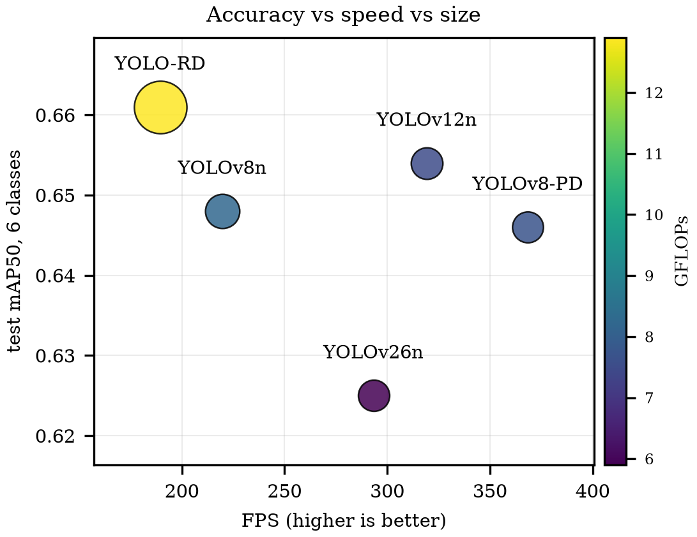

Gambar di atas merangkum empat variabel sekaligus dalam satu bidang. Sumbu mendatar adalah kecepatan FPS dan sumbu tegak adalah mAP50. Ukuran gelembung adalah jumlah parameter dan warnanya adalah beban komputasi GFLOPs. YOLO RD berada di kiri atas dengan skor tertinggi namun paling berat dan paling lambat. YOLOv8 PD berada di kanan dengan kecepatan tertinggi 368 FPS dan gelembung terkecil sehingga paling ringan. YOLOv12n berada di tengah dengan keseimbangan terbaik antara akurasi dan kecepatan. Satu gambar ini menggantikan kebutuhan tabel terpisah untuk akurasi kecepatan dan ukuran model.

| Model | Memanjang | Melintang | Buaya | Lubang | Manhole | Patchy |
|---|---|---|---|---|---|---|
| YOLOv8n | 0,664 | 0,599 | 0,700 | 0,526 | 0,825 | 0,571 |
| YOLOv12n | 0,680 | 0,582 | 0,708 | 0,535 | 0,833 | 0,587 |
| YOLOv26n | 0,639 | 0,567 | 0,675 | 0,538 | 0,820 | 0,512 |
| YOLOv8 PD | 0,678 | 0,572 | 0,702 | 0,541 | 0,819 | 0,562 |
| YOLO RD | 0,696 | 0,608 | 0,701 | 0,527 | 0,845 | 0,587 |

Tabel per kelas di atas menunjukkan pola yang konsisten di semua model. Lubang jalan selalu menjadi kelas tersulit dengan skor 0,526 sampai 0,541. Manhole justru menjadi kelas termudah dengan skor 0,82 sampai 0,85 karena bentuk lingkarannya tegas dan mudah dikenali. Patchy road berada di tengah dengan catatan jumlah ujinya sangat kecil sehingga angkanya belum stabil.

Untuk pemilihan model tidak ada satu model yang menang di semua sisi. Butuh akurasi maksimum dengan GPU server maka pilih YOLO RD. Butuh kecepatan real time di perangkat terbatas maka pilih YOLOv8 PD. Butuh satu model yang dibawa ke data Indonesia maka pilih YOLOv12n karena paling seimbang dan terbukti paling kuat di uji generalisasi.

## Uji Distractor dengan Cara yang Benar

Bagian ini perlu penjelasan khusus karena pengukuran lamanya keliru. Pengukuran lama menghitung semua prediksi lubang pada gambar yang memuat pengecoh lalu menyebutnya sebagai false positive. Cara ini salah karena prediksi lubang tersebut bisa saja berada di lokasi lain yang memang benar berlubang dan tidak menyentuh objek pengecoh sama sekali.

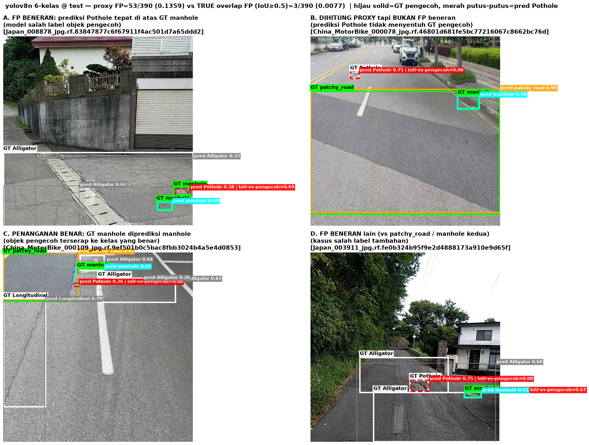

Gambar di atas membuktikan pengukuran lama keliru. Panel A menunjukkan false positive beneran yaitu prediksi lubang tepat di atas manhole. Panel B menunjukkan prediksi lubang yang ikut terhitung proxy padahal tidak menyentuh pengecoh sama sekali. Panel C menunjukkan penanganan benar yaitu manhole diprediksi sebagai manhole. Panel D menunjukkan kasus beneran tambahan.

Buktinya jelas. Pada model YOLOv8n pengukuran lama mencatat 53 temuan sedangkan pengukuran tumpang tindih box yang benar hanya mencatat 3 temuan. Artinya sekitar 94 persen angka lama bukan kesalahan pelabelan sama sekali. Uji statistik lama yang dihitung di atas angka proxy ikut gugur dan tidak dipakai lagi dalam analisis ini.

Dengan pengukuran tumpang tindih yang benar hasilnya sangat tegas seperti terlihat pada tabel berikut.

| Model | Jumlah Kelas | Salah di Manhole | Salah di Patchy | Salah Gabungan |
|---|---|---|---|---|
| YOLOv8n 6 kelas | 6 | 0,0093 | 0,0000 | 0,0077 |
| YOLOv12n 6 kelas | 6 | 0,0062 | 0,0000 | 0,0051 |
| YOLOv26n 6 kelas | 6 | 0,0031 | 0,0000 | 0,0026 |
| YOLOv8 PD 6 kelas | 6 | 0,0062 | 0,0000 | 0,0051 |
| YOLOv8n 4 kelas | 4 | 0,0093 | 0,0000 | 0,0077 |
| YOLOv12n 4 kelas | 4 | 0,0093 | 0,0000 | 0,0077 |
| YOLOv26n 4 kelas | 4 | 0,0062 | 0,0000 | 0,0051 |
| YOLOv8 PD 4 kelas | 4 | 0,0062 | 0,0000 | 0,0051 |

Dari 390 objek pengecoh seluruh model hanya salah melabeli 1 sampai 3 box. Tidak ada satu pun prediksi lubang yang menimpa patchy road di semua model. Perbandingan model enam kelas melawan empat kelas pun identik atau hanya beda satu box. Kesimpulannya tidak ada bukti bahwa pelabelan pengecoh mengurangi kesalahan pelabelan karena kesalahan semacam itu nyaris tidak pernah terjadi sejak awal. Kemampuan model menyerap pengecoh sendiri sudah baik dengan deteksi manhole 0,81 sampai 0,92 dan patchy 0,55 sampai 0,61.

Namun ada temuan kecil di sisi lain seperti terlihat pada tabel berikut.

| Arsitektur | Lubang 6 Kelas | Lubang 4 Kelas | Selisih |
|---|---|---|---|
| YOLOv8n | 0,526 | 0,546 | tambah 0,020 |
| YOLOv12n | 0,535 | 0,536 | tambah 0,001 |
| YOLOv26n | 0,538 | 0,562 | tambah 0,024 |
| YOLOv8 PD | 0,541 | 0,552 | tambah 0,011 |

Model yang dilatih tanpa pengecoh justru sedikit lebih baik dalam mendeteksi lubang jalan pada keempat arsitektur. Efeknya kecil dan belum diuji secara statistik sehingga hanya layak dilaporkan sebagai tren yang diamati bukan keunggulan yang terbukti.

## Perbedaan Antar Negara Sumber

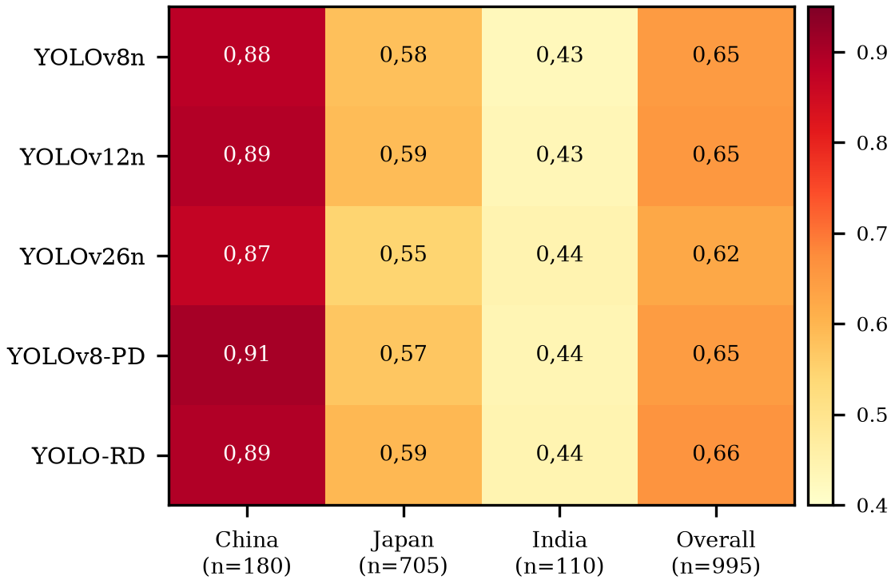

Gambar di atas adalah heatmap mAP50 per negara untuk kelima model dengan gradasi warna dari terang ke gelap. Kolom berisi China Jepang India dan satu kolom Overall sebagai gabungan. Angka di dalam setiap sel memakai koma Indonesia. Terlihat China selalu paling gelap lalu Jepang lalu India paling terang di semua baris model. Kolom Overall berada di antara China dan Jepang sesuai bobot jumlah citra tiap negara. Karena polanya identik di semua arsitektur maka penyebabnya adalah karakter datanya bukan modelnya. Satu gambar ini menggantikan tabel per negara yang terpisah.

| Model | China 180 Citra | Jepang 705 Citra | India 110 Citra | Overall 995 Citra |
|---|---|---|---|---|
| YOLOv8n | 0,883 | 0,581 | 0,426 | 0,648 |
| YOLOv12n | 0,890 | 0,587 | 0,433 | 0,654 |
| YOLOv26n | 0,869 | 0,546 | 0,443 | 0,625 |
| YOLOv8 PD | 0,907 | 0,570 | 0,438 | 0,646 |
| YOLO RD | 0,892 | 0,594 | 0,442 | 0,661 |

Hasil per negara menunjukkan pola yang sama di semua model. China selalu tertinggi lalu Jepang lalu India terendah. Karena polanya identik di semua arsitektur maka penyebabnya adalah karakter datanya bukan modelnya. Yang menarik Jepang memiliki data latih tiga kali lipat dari China namun hasilnya jauh lebih rendah. Artinya volume data bukan penjelasnya. Penjelasnya adalah tingkat kesulitan visual tiap domain.

Citra China berupa close up aspal yang tajam dan terang. Citra Jepang berupa wide shot dari dalam mobil yang gelap dan ramai dengan langit dan rumah masuk bingkai. Citra India buram dan berdebu dengan dashboard dan kap mobil sering terlihat. Temuan terbersih datang dari retak melintang India yang hanya punya 19 contoh latih lalu runtuh total saat diuji dengan skor 0,002 sampai 0,21. Satu catatan penting untuk India hanya ada satu manhole dan nol patchy road sehingga angka gabungan enam kelas antar negara tidak sepenuhnya sebanding. Untuk klaim paper yang adil agregat perlu dihitung ulang pada empat kelas inti yang sama.

## Domain Gap ke Indonesia

Gambar di atas adalah temuan sentral penelitian ini. Seluruh model kehilangan 45,5 sampai 58,6 persen kemampuannya saat diuji di Indonesia. Ini bukan sekadar masalah kalibrasi kecil melainkan perubahan total peta persaingan.

| Model | Sumber 5 Kelas | Indonesia 5 Kelas | Penurunan | F1 Makro Indonesia | F1 Tertimbang Indonesia |
|---|---|---|---|---|---|
| YOLOv12n | 0,618 | 0,337 | -45,5 persen | 0,383 | 0,471 |
| YOLO RD | 0,624 | 0,302 | -51,6 persen | 0,336 | 0,440 |
| YOLOv8 PD | 0,611 | 0,286 | -53,3 persen | 0,312 | 0,412 |
| YOLOv8n | 0,612 | 0,253 | -58,6 persen | 0,308 | 0,397 |
| YOLOv26n | 0,586 | 0,249 | -57,5 persen | 0,281 | 0,370 |

YOLO RD yang terbaik di sumber turun ke posisi kedua di Indonesia. YOLOv12n yang kedua di sumber naik ke posisi pertama. Pesannya jelas untuk penerapan nyata. Memilih model hanya dari skor sumber bisa menghasilkan pilihan yang salah. Urutan F1 tertimbang sama persis dengan urutan mAP sehingga keduanya saling menguatkan.

Perbedaan F1 makro dan F1 tertimbang justru menjadi insight yang bagus. Penurunan F1 tertimbang hanya 23 sampai 38 persen sedangkan penurunan F1 makro mencapai 34 sampai 51 persen. Artinya model masih lumayan pada kelas dominan seperti retak memanjang namun runtuh pada kelas langka seperti patchy road. F1 makro memberi bobot sama pada semua kelas sehingga kehancuran kelas kecil ikut terlihat. F1 tertimbang memberi bobot sesuai jumlah contoh sehingga didominasi kelas besar yang masih selamat.

Angka antar versi ekspor tidak boleh dibandingkan. Versi lama mencatat skor jauh lebih rendah namun isi label dan jumlah datanya berbeda. Kenaikan skor antar versi lebih disebabkan oleh komposisi dataset bukan model yang membaik. Hanya V4 yang dipakai dalam analisis ini.

## Keruntuhan per Kelas di Indonesia

Gambar di atas memecah angka gabungan menjadi per kelas pada model terbaik yaitu YOLOv12n. Keruntuhannya tidak merata dan polanya sangat informatif. Angka n pada tiap kelas menunjukkan jumlah contoh di Indonesia.

| Kelas | Sumber | Indonesia | Selisih | Jumlah di Indonesia | Makna |
|---|---|---|---|---|---|
| Retak memanjang | 0,680 | 0,629 | turun 0,051 | 231 | Hampir tidak terpengaruh |
| Retak melintang | 0,582 | 0,256 | turun 0,326 | 132 | Runtuh parah |
| Retak buaya | 0,708 | 0,506 | turun 0,202 | 48 | Turun sedang |
| Lubang jalan | 0,535 | 0,260 | turun 0,275 | 70 | Runtuh parah |
| Patchy road | 0,587 | 0,036 | turun 0,551 | 21 | Hancur total namun data sedikit |

Retak memanjang hampir tidak turun sedangkan retak melintang dan lubang jalan runtuh parah. Pola ini sesuai dengan dugaan tekstur jalan Bojongsoang. Aspalnya berpori dengan lubang lubang kecil yang merata sehingga retak tipis dan lubang sulit dibedakan dari tekstur normal. Retak memanjang selamat kemungkinan karena bentuknya panjang dan tegas sehingga masih dikenali. Jika patchy road dikeluarkan dari hitungan maka gap menyusut dari 45,5 persen menjadi sekitar 35 persen. Artinya satu kelas kecil ikut membesar besarkan angka gap agregat. Perlu diingat juga jumlah contoh Indonesia beda jauh dari sumber sehingga selisih per kelas bukan efek domain murni melainkan tercampur ketidakpastian statistik kelas langka.

## Perbandingan Langsung Hasil Deteksi per Negara

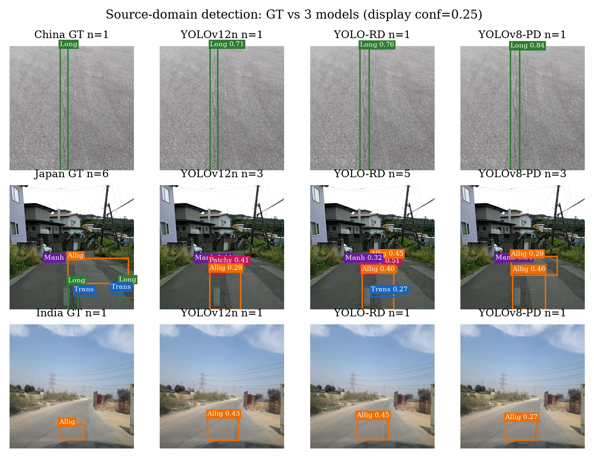

Gambar di atas membandingkan anotasi benar dengan prediksi tiga model terbaik pada satu citra acak tiap negara. Baris China menunjukkan aspal yang rapi dengan beberapa retak memanjang dan semua model berhasil mendeteksi dengan baik meski ada sedikit perbedaan label. Baris Jepang menunjukkan jalan perumahan yang gelap dengan retak tipis. Beberapa model gagal atau hanya mendeteksi sebagian. Baris India menunjukkan jalan berdebu dari kejauhan yang sangat buram. Semua model gagal total mendeteksi retak tipis yang ada. Pola ini konsisten dengan urutan skor mAP per negara yaitu China tertinggi lalu Jepang dan India terendah.

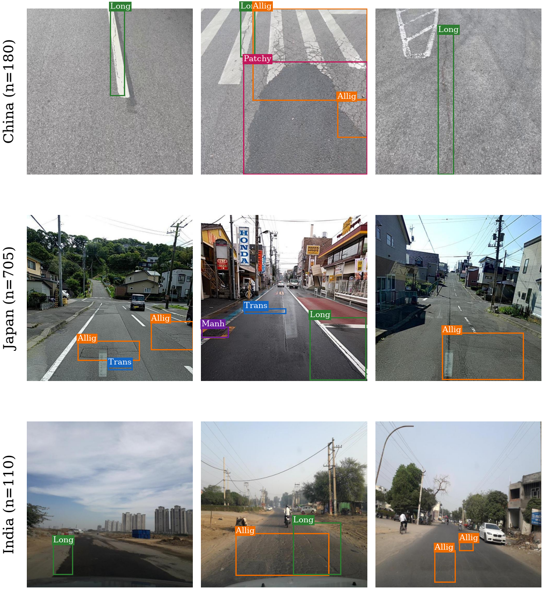

Gambar di atas melengkapi perbandingan sebelumnya dengan tiga citra berlabel tiap negara dalam gaya yang sama dengan panel karakter citra. Kotak anotasi digambar tipis supaya objek tetap terlihat jelas dan label kelas ditulis kecil di sudut kotak. Baris China menampilkan close up aspal tajam dengan retak memanjang dan buaya yang tegas. Baris Jepang menampilkan jalan perumahan gelap dengan retak memanjang buaya dan satu manhole. Baris India menampilkan jalan berdebu dari kejauhan dengan retak yang tipis dan samar. Perbedaan ketajaman dan sudut pandang inilah yang menjelaskan kenapa skor China paling tinggi lalu Jepang dan India paling rendah.

## Karakter Citra Tiap Domain

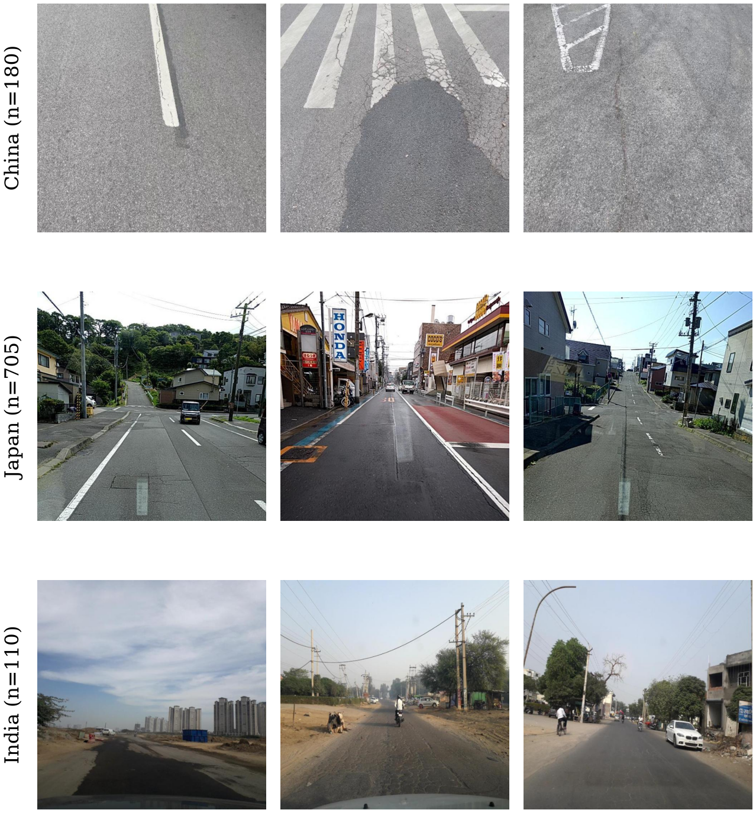

Gambar di atas berisi tiga domain sumber dengan tiga citra paling tipikal tiap domain. Baris China berupa close up aspal tajam dengan marka jelas. Baris Jepang berupa wide shot gelap dari dalam mobil dengan rumah dan pertokoan masuk bingkai. Baris India berupa jalan berdebu buram dengan langit lebar dan kendaraan kecil di kejauhan. Perbedaan sudut pandang dan ketajaman langsung terlihat tanpa penjelasan panjang.

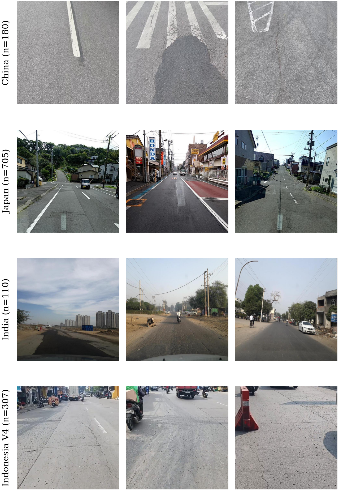

Gambar di atas menambah baris Indonesia V4 sebagai target. Beton terang berpori dengan ruko dan motor langsung kontras dengan ketiganya dan tidak mirip satupun sumber. Ini jangkar visual gap domain yang lebih kuat dari angka. Citra dipilih sebagai yang paling dekat dengan median statistik tiap domain sehingga mewakili tampilan tipikal bukan kasus ekstrem.

Gambar di atas menunjukkan empat panel statistik yaitu kecerahan kejenuhan kontras dan ketajaman untuk tiap domain.

Secara visual keempat domain memang berbeda jauh. China berisi close up aspal yang sibuk dan tajam. Jepang berisi jalan perumahan yang gelap dengan langit dan rumah masuk bingkai. India berisi jalan berdebu yang buram dengan dashboard dan kap mobil terlihat. Indonesia berisi sudut motor dengan beton terang pertokoan dan kendaraan.

| Domain | Kecerahan | Kejenuhan | Kontras | Ketajaman | Jumlah |
|---|---|---|---|---|---|
| China | 154,8 | 7,3 | 26,8 | 2296,8 | 180 |
| Jepang | 119,4 | 44,6 | 70,3 | 1430,9 | 705 |
| India | 144,0 | 35,3 | 64,4 | 181,4 | 110 |
| Indonesia | 160,3 | 15,1 | 37,1 | 532,6 | 308 |

Tabel median di atas memperkuat kesan visual. Indonesia paling terang dengan nilai 160,3 yang konsisten dengan dugaan kilau matahari pagi. Jepang paling gelap dengan 119,4. Jepang paling jenuh warna dan paling kontras sedangkan China nyaris abu abu dengan kontras rendah. China paling tajam sedangkan India paling buram. Perlu dicatat data visualisasi memakai 308 citra ekspor lama sedangkan evaluasi memakai 307 citra V4 sehingga keduanya tidak identik.

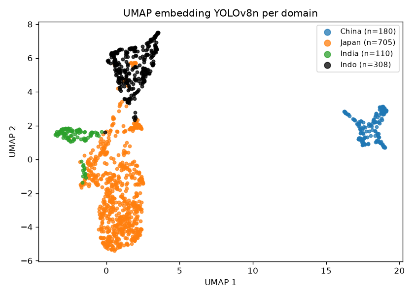

Gambar di atas menunjukkan titik biru China terpisah jauh sendirian. Titik hitam Indonesia membentuk klaster sendiri. Titik hijau India menempel pada massa oranye Jepang.

Pemetaan fitur model menunjukkan China terpisah jauh sendirian sedangkan Indonesia membentuk klaster sendiri dan India menempel pada Jepang. Artinya model sendiri membaca keempat domain sebagai kelompok visual yang berbeda. Namun UMAP hanya ilustrasi struktur bukan pengukur jarak yang pasti. Kaitannya dengan skor bersifat searah bukan bukti sebab akibat.

## Studi Kasus Kilau Pagi

Ada 42 citra pagi hari pukul 0927 yang terlihat mengkilau memantulkan matahari. Komposisinya berbeda dari sisa data seperti terlihat pada tabel berikut.

| Kelompok | Citra | Instance | Memanjang | Melintang | Lubang | Buaya | Patchy | Kosong |
|---|---|---|---|---|---|---|---|---|
| Pagi | 42 | 62 | 26 | 25 | 8 | 3 | 0 | 5 |
| Sisa | 265 | 440 | 205 | 107 | 62 | 45 | 21 | 34 |

Citra pagi tidak mengandung patchy road sama sekali dan hanya punya 8 lubang dibanding 62 di sisa data. Karena perbedaannya sebesar ini maka analisis pagi tidak boleh dibaca sebagai bukti bahwa kilau menurunkan performa. Perbedaan skor bisa saja berasal dari campuran kelasnya bukan dari kilau itu sendiri. Statusnya adalah studi kasus ilustratif. Belum ada evaluasi subset pagi melawan sisa pada V4 karena angka lama memakai komposisi versi sebelumnya yang berbeda.

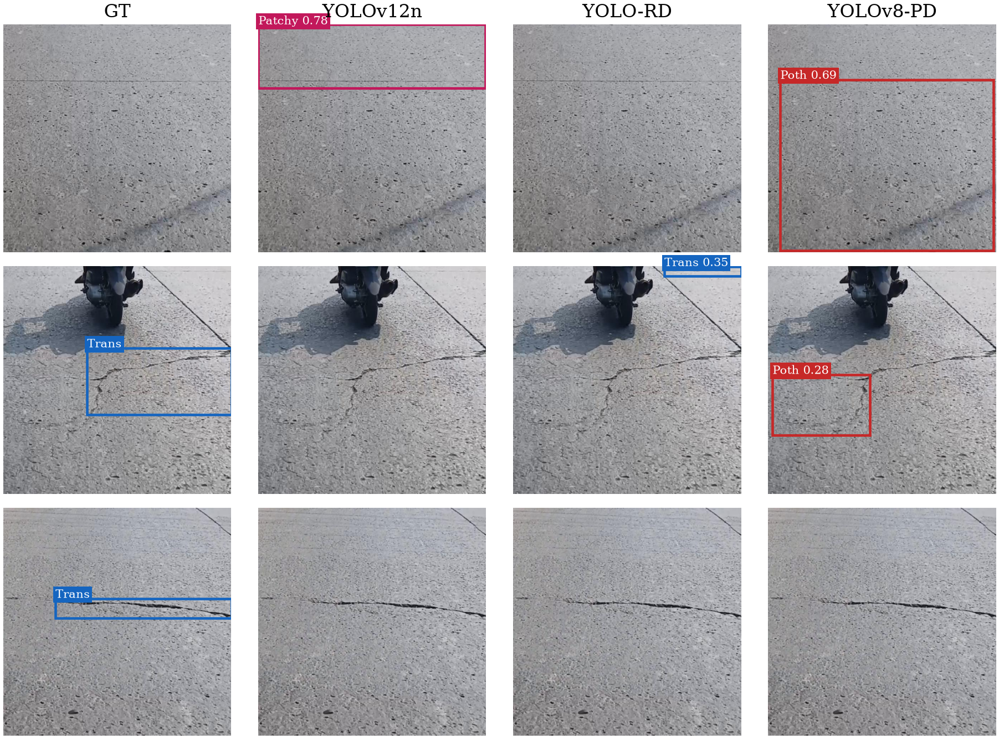

Gambar di atas berisi tiga citra kilau pilihan yaitu 0036 0015 dan 0041 dari baris pertama sampai baris ketiga. Kolom pertama adalah anotasi benar dan tiga kolom berikutnya adalah prediksi tiga model terbaik. Baris pertama citra 0036 tidak punya anotasi namun YOLOv12n menembak Patchy 0,78 dan YOLOv8 PD menembak Pothole 0,69 tepat di atas tekstur pori. Ini bukti paling bersih bahwa pori beton dibaca sebagai kerusakan. Baris kedua citra 0015 punya satu retak melintang. YOLOv12n gagal total sedangkan YOLO RD hanya menembak box kecil di sudut yang salah dan PD menembak lubang di area retak. Baris ketiga citra 0041 punya satu retak melintang dan ketiga model gagal total. Polanya jelas. Pada beton terang berpori model memilih menembak box besar yang salah daripada melewatkan. Gambar ini layak menjadi figur utama studi kilau.

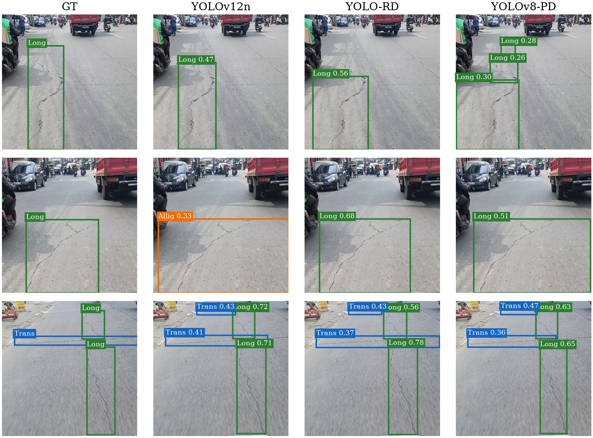

Gambar di atas berisi tiga citra prediksi benar yaitu 0436 0441 dan 0727 dari baris pertama sampai baris ketiga. Baris pertama citra 0436 berupa retak memanjang tegas dan ketiga model benar dengan YOLO RD paling percaya diri 0,56. YOLOv8 PD malah memecah jadi tiga box kecil yang bertumpuk. Baris kedua citra 0441 juga retak memanjang namun YOLOv12n salah melabeli sebagai retak buaya sedangkan RD dan PD benar sebagai memanjang. Baris ketiga citra 0727 punya tiga anotasi dan ketiga model menembak empat box dengan pola yang sama. Gambar ini membuktikan model bisa benar kalau retaknya tegas. Bedanya ada di kerapian box.

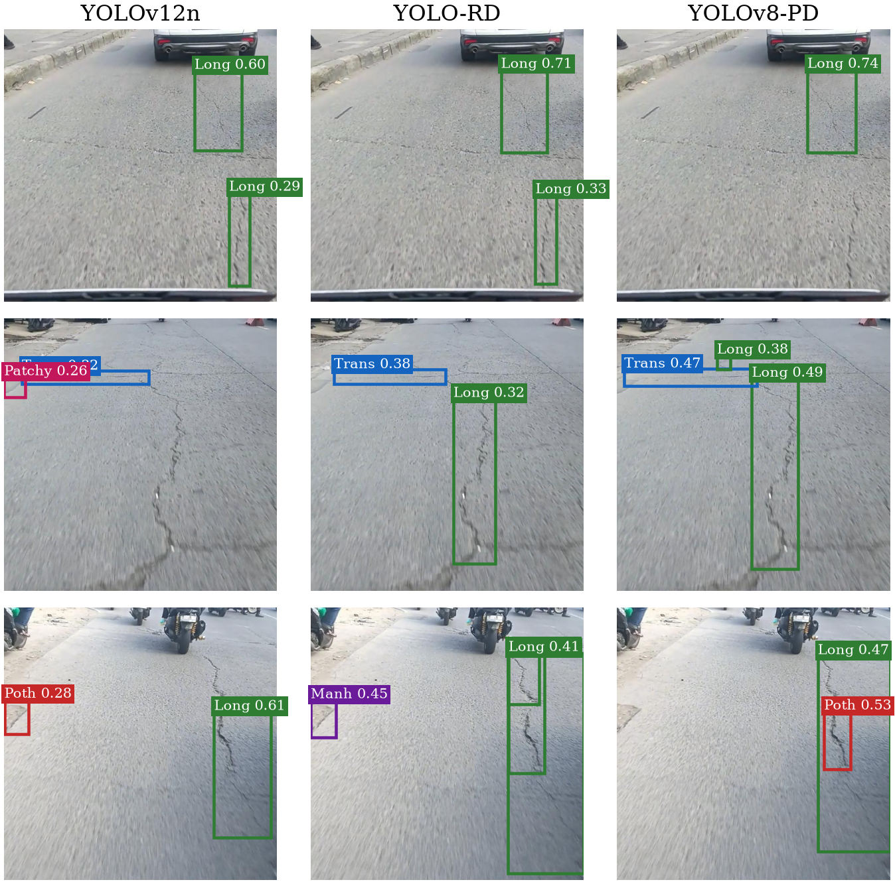

Gambar di atas berisi tiga citra tanpa pembanding anotasi yaitu 0716 0734 dan 0768 dari baris pertama sampai baris ketiga. Baris pertama citra 0716 relatif bersih dan ketiga model sepakat menembak retak memanjang yang sama dengan keyakinan 0,60 sampai 0,74. Baris kedua citra 0734 menunjukkan perbedaan perilaku dengan YOLOv12n menembak Patchy berdampingan Transverse sedangkan dua model lain menembak Transverse plus memanjang. Baris ketiga citra 0768 menunjukkan YOLO RD menembak Manhole 0,45 di tepi jalan padahal tidak ada manhole di Indonesia. Ini temuan menarik karena membuktikan bias sumber masih terbawa. Gambar ini layak disimpan sebagai bukti perilaku model di lapangan.

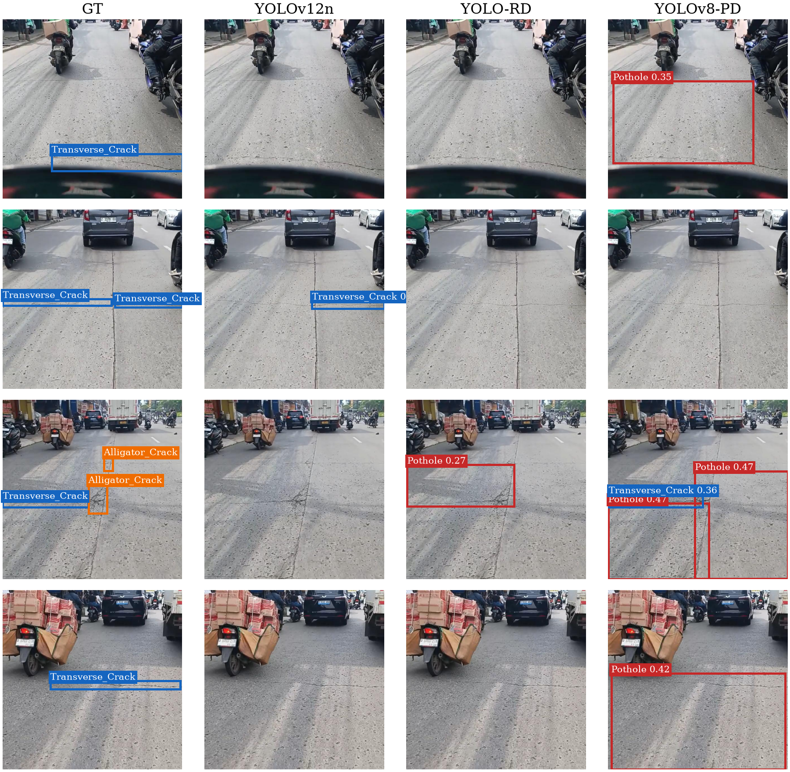

Gambar di atas berisi empat citra salah prediksi yang memberi gambaran pola kegagalannya dari baris pertama sampai baris keempat. Kolom pertama adalah anotasi benar dan tiga kolom berikutnya adalah prediksi tiga model terbaik. Pada baris pertama citra 0453 model terbaik gagal total mendeteksi retak melintang sedangkan model ringan malah menembak box lubang raksasa. Pada baris kedua citra 0497 hanya YOLOv12n yang benar satu box. Pada baris ketiga citra 0566 yang memuat retak buaya model terbaik gagal total sedangkan model lain menembak box lubang bertumpuk di area yang sama. Pada baris keempat citra 0572 polanya berulang dengan box lubang raksasa yang salah sasaran. Polanya konsisten yaitu gagal mendeteksi retak tipis ditambah tembakan lubang besar yang ngawur. Ini gambar dummy sementara menunggu kurasi kilau yang final.

## Kesimpulan

Hasil terbaik di sumber dipegang YOLO RD sedangkan hasil terbaik di Indonesia dipegang YOLOv12n. Pelabelan pengecoh tidak terbukti mengurangi kesalahan karena kesalahan semacam itu nyaris tidak ada sejak awal. Kerusakan yang selamat di Indonesia adalah retak memanjang sedangkan retak melintang dan lubang jalan runtuh parah. Patchy road hancur total namun datanya terlalu sedikit untuk disimpulkan. Seluruh perbandingan memakai satu seed sehingga belum ada uji signifikansi. Klaim kilau pagi tetap berstatus ilustrasi sampai ada evaluasi subset yang terkontrol dengan komposisi kelas yang sebanding.

## Daftar Gambar dan Tabel

Gambar 1 adalah trade-off akurasi kecepatan dan ukuran dari paper figX3 bubble. Gambar 2 adalah bukti proxy melawan overlap dari fig fp overlap. Gambar 3 adalah heatmap per negara dengan kolom Overall dari paper figX4 heatmap. Gambar 4 adalah diagram batang gap domain V4 dari paper fig1 domain gap v4. Gambar 5 adalah keruntuhan per kelas YOLOv12n dari paper fig2 perclass collapse v12n. Gambar 6 adalah perbandingan anotasi benar melawan tiga model per negara dari paper fig country examples. Gambar 7 adalah sampel berlabel per negara dari paper fig country gt. Gambar 8a adalah tiga domain sumber dari paper figD3 domains. Gambar 8b adalah empat domain dengan target dari paper figD4 domains. Gambar 9 adalah statistik citra dari fig stats. Gambar 10 adalah UMAP dari fig umap. Gambar 11a adalah kilau dan pori G1 dari paper figG1 glare. Gambar 11b adalah prediksi benar G2 dari paper figG2 correct. Gambar 11c adalah prediksi saja G3 dari paper figG3 predonly. Gambar 11d adalah kualitatif dummy empat citra dari paper fig3 qualitative v4 dummy.

Tabel 1 adalah distribusi enam kelas sumber. Tabel 2 adalah komposisi lima kelas Indonesia. Tabel 3 adalah perbandingan lima model di sumber dan memuat kolom ukuran serta kecepatan. Tabel 4 adalah per kelas sumber. Tabel 5 adalah TRUE overlap delapan model. Tabel 6 adalah selisih lubang enam melawan empat kelas. Tabel 7 adalah per negara dan sudah diringkas oleh Gambar 3. Tabel 8 adalah gap domain V4. Tabel 9 adalah keruntuhan per kelas. Tabel 10 adalah statistik citra. Tabel 11 adalah komposisi pagi melawan sisa.
