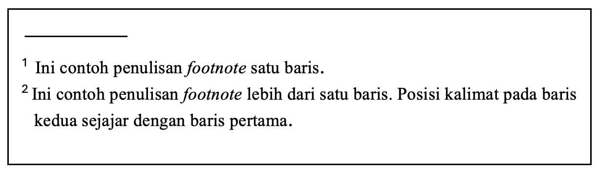
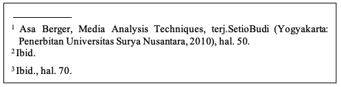
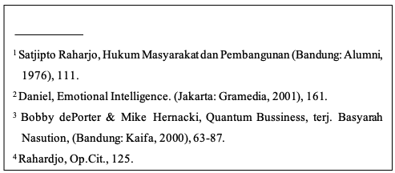

# Pedoman lengkap penulisan buku Tugas Akhir FIF

**Berkas pegangan utama saat mengganti isi LaTeX.** Seluruh aturan dan materi panduan sumber dihimpun dalam satu Markdown ini agar tidak ikut hilang ketika paragraf contoh pada `.tex` dihapus.

- Sumber utama: `TEMPLATE BUKU TA FIF.docx` yang diberikan pengguna.
- Lokasi sumber pada saat penghimpunan: `/home/varys/Downloads/TEMPLATE BUKU TA FIF.docx`.
- Tanggal penghimpunan: **2 November 2026**.
- Berlaku sebagai pegangan untuk folder `latex/buku-ta-template/`.
- Bagian A merangkum aturan agar mudah dipakai; Bagian B memberi contoh LaTeX; Bagian C mencatat perbedaan/typo sumber; Bagian D menyimpan arsip lengkap teks panduan beserta contoh aslinya. Membaca file lain tidak diperlukan untuk mendapatkan seluruh isi panduan tertulis.

**Pembedaan sumber:** aturan yang dinyatakan dalam Word ditandai sebagai aturan sumber. Ukuran/style yang hanya terlihat pada dokumen ditandai sebagai temuan tampilan. Pengaturan atau cara kerja LaTeX ditandai sebagai implementasi. Ketiganya tidak disamakan sebagai peraturan resmi baru. Materi ini bukan pembaruan pedoman kampus di luar dokumen yang diberikan.

## Daftar isi

- [A. Aturan penulisan dan susunan naskah](#a-aturan-penulisan-dan-susunan-naskah)
- [B. Penerapan saat mengedit LaTeX](#b-penerapan-saat-mengedit-latex)
- [C. Perbedaan dan kekeliruan pada sumber](#c-perbedaan-dan-kekeliruan-pada-sumber)
- [D. Arsip lengkap panduan sumber](#d-arsip-lengkap-panduan-sumber)
- [E. Daftar pemeriksaan sebelum menyerahkan naskah](#e-daftar-pemeriksaan-sebelum-menyerahkan-naskah)

## A. Aturan penulisan dan susunan naskah

### 1. Kertas, margin, font, dan paragraf

**Aturan sumber:**

| Unsur | Ketentuan |
| --- | --- |
| Kertas | HVS putih polos, A4; berat kertas disebut 80 pada sumber, dengan kekeliruan satuan yang dicatat pada Bagian C |
| Pencetakan | Satu sisi kertas (*single side*) |
| Margin kiri | 4 cm dari tepi kertas, termasuk 1 cm untuk penjilidan |
| Margin kanan | 3 cm |
| Margin atas | 3 cm |
| Margin bawah | 3 cm |
| Font isi | Times New Roman, Calibri, atau Aptos |
| Ukuran isi | 12 poin |
| Perataan | Rata kiri-kanan (*justify*) |
| Spasi baris | 1,5 baris |
| Warna teks | Hitam pekat dan seragam saat dicetak |

**Temuan tampilan dan implementasi template:** Aptos dipakai untuk isi; Aptos Display bold 14 pt untuk judul bab/halaman awal; judul sampul dan institusi 16 pt; caption 9 pt; jarak sesudah paragraf 6 pt; awal paragraf isi tanpa indent. Angka-angka ini memetakan tampilan DOCX, bukan seluruhnya aturan eksplisit pada paragraf panduan. Isi LaTeX memakai baseline 21,95 TeX pt yang mendekati hasil Word. Catatan kaki contoh memakai 10 pt. Daftar pustaka implementasi memakai 10 pt untuk keterbacaan, sedangkan style Word aktual lebih kecil.

### 2. Penomoran halaman

**Aturan sumber:**

- Nomor halaman tidak diberi imbuhan.
- Bagian awal menggunakan angka Romawi kecil: i, ii, iii, dan seterusnya.
- Nomor bagian awal berada di tengah, 2,5 cm dari tepi bawah kertas.
- Nomor sampul/halaman judul tidak ditampilkan, tetapi halaman judul tetap diperhitungkan.
- Bagian isi dan bagian akhir, termasuk daftar pustaka, menggunakan angka Arab: 1, 2, 3, dan seterusnya.
- Nomor Arab berada di kanan atas, 1,5 cm dari tepi atas dan 3 cm dari tepi kanan.
- Khusus halaman pertama setiap bab, nomor berada di bawah tengah, 2,5 cm dari tepi bawah.

**Implementasi:** `awal` untuk bagian awal, `isi` untuk halaman isi, dan `plain` untuk pembuka bab. Jangan mengetik nomor halaman di paragraf atau caption.

### 3. Susunan buku dan halaman awal

Susunan yang dicontohkan oleh dokumen sumber:

1. Sampul.
2. Lembar pengesahan.
3. Lembar orisinalitas.
4. Abstrak Indonesia.
5. Abstract Inggris.
6. Kata pengantar.
7. Ucapan terima kasih.
8. Daftar isi.
9. Daftar gambar.
10. Daftar tabel.
11. Bab 1 Pendahuluan.
12. Bab 2 Tinjauan Pustaka.
13. Bab 3 Perancangan Sistem.
14. Bab 4 Hasil Percobaan dan Analisis.
15. Bab 5 Kesimpulan dan Saran.
16. Daftar pustaka.
17. Lampiran.

Sampul harus simetris di tengah. Judul tidak berupa kalimat tanya dan tidak diakhiri tanda baca. Singkatan tidak digunakan, kecuali nama/istilah yang lazim pada bidangnya; contoh sumber: MIMO dan WLAN.

Halaman pengesahan contoh memuat judul Indonesia/Inggris, NIM, nama, pernyataan pengesahan, tempat/tanggal, dua pembimbing beserta NIP, dan ketua program studi beserta NIP. Identitas pada Word adalah data contoh dan harus diganti. Sumber tidak menetapkan di bagian panduan bahwa setiap penelitian wajib memiliki dua pembimbing; layout template mencontohkan dua kolom.

Lembar orisinalitas contoh memuat pernyataan karya sendiri, tidak menjiplak, pernyataan bahwa produk TA bukan hasil Generative AI, serta kesediaan menerima risiko/sanksi apabila ditemukan pelanggaran atau klaim keaslian. Redaksi tersebut adalah formulir sumber; penulis harus memeriksa kebenaran pernyataannya dan ketentuan institusi yang berlaku sebelum menandatangani. Jangan menganggap placeholder sebagai pernyataan faktual yang telah disetujui.

### 4. Abstrak Indonesia dan Inggris

**Aturan sumber:**

- Abstrak adalah ikhtisar permasalahan, tujuan, metode, hasil, dan kesimpulan.
- Maksimum **200 kata** untuk abstrak, dengan ukuran font **11 pt**; batas ini berlaku pula pada abstract Inggris.
- Bagi menjadi empat subbagian: **apa masalahnya**, **mengapa penting**, **bagaimana solusinya**, dan **hasil utama/kesimpulan**. Judul tiap subbagian boleh digarisbawahi.
- Jelaskan masukan dan keluaran penelitian secara sangat singkat bila relevan.
- Jelaskan kesenjangan kondisi sekarang dan kondisi yang diharapkan.
- Penjelasan solusi biasanya bagian yang paling panjang.
- Hasil utama ditulis singkat dua–tiga kalimat; kontribusi boleh dinyatakan secara eksplisit di antara solusi dan hasil.
- Abstrak akhir tidak disalin begitu saja dari abstrak proposal. Hindari redaksi rencana seperti “akan dilakukan” ketika menjelaskan pekerjaan yang sudah selesai.
- **Tidak ada sitasi dalam abstrak.**
- Hindari penamaan, simbol, atau istilah yang terlalu teknis; sumber mencontohkan “minsup”.
- Kata kunci menjelaskan isi tulisan, dapat diambil dari judul dan abstrak, maksimal **enam item**, huruf kecil kecuali singkatan.

**Temuan tampilan:** abstract Inggris pada sumber dicetak miring. Template mempertahankan itu. Teks placeholder saat ini belum merupakan abstrak penelitian; hitung ulang kata dan periksa kata kunci setelah diganti.

### 5. Kata pengantar dan ucapan terima kasih

Menurut panduan sumber, kata pengantar berisi:

- Ucapan syukur kepada Tuhan Yang Maha Esa.
- Penjelasan singkat tujuan/latar belakang penulisan serta topik/tema.
- Terima kasih kepada individu atau lembaga yang membantu, membimbing, dan mendukung.
- Harapan agar karya bermanfaat.
- Permohonan maaf apabila ada kekurangan.

Halaman ucapan terima kasih tersedia pada contoh Word tetapi tidak diberi petunjuk isi tambahan. Susunan pihak yang disebut dan redaksi bukan aturan tambahan yang ditetapkan oleh template ini.

### 6. Bab 1 — Pendahuluan

#### Latar belakang

Jawab mengapa penelitian dilakukan: penyebab, pendorong, dasar, atau alasan penelitian. Jelaskan masalah masa lampau, sekarang, atau yang diantisipasi.

- Jika masalah berasal dari lingkungan sekitar, uraikan masalah dan dukung dengan survei, berita, atau laporan ilmiah.
- Jika mengembangkan sistem/alat, jelaskan kondisi awal dan kekurangan yang hendak diperbaiki.
- Jika melanjutkan penelitian, sebutkan penelitian sebelumnya, perbedaan serta hasilnya, dan bagian yang dilanjutkan atau ditingkatkan.

Poin yang diminta sumber:

1. Kondisi umum yang mendukung penelitian.
2. Kondisi bidang spesifik yang ditinjau.
3. Masalah pada bidang tersebut.
4. Penyebab, perilaku/karakteristik, dan dampak masalah terhadap sistem yang lebih luas.
5. Solusi-solusi yang mungkin.
6. Solusi yang dipilih beserta alasannya.
7. Gambaran singkat solusi usulan.
8. Pentingnya solusi, dampak, atau keunggulan dibanding solusi lain.

#### Rumusan masalah

- Jabarkan persoalan yang harus diselesaikan untuk mencapai tujuan.
- Rumuskan masalah yang telah dijelaskan secara ringkas dan tepat.
- Setiap masalah harus mempunyai jawaban pada model sistem, analisis, lampiran, atau kesimpulan.
- Jangan menggantinya dengan kendala teknis yang mungkin dialami selama pengerjaan.
- Boleh berbentuk pertanyaan atau pernyataan positif berkonotasi negatif; pilih satu bentuk dan konsisten.

#### Tujuan dan manfaat

- Jelaskan kondisi yang hendak dicapai dan manfaatnya.
- Usahakan tujuan terukur menggunakan metrik evaluasi yang sesuai.
- Tulis dalam **narasi**, bukan daftar poin.
- Skenario pengujian mengikuti tujuan; kesimpulan harus selaras dengan tujuan.
- Tabel hubungan tujuan–pengujian–kesimpulan dapat dipakai untuk memeriksa keselarasan tersebut.

#### Batasan masalah

- Batasi persoalan agar layak dikerjakan dalam lingkup TA.
- Jelaskan penyederhanaan data atau proses serta alasan pembatasannya, misalnya waktu, ketersediaan data, atau kemampuan komputasi.
- Batasan dapat menjadi dasar saran untuk penelitian berikutnya agar dilonggarkan atau dihilangkan.
- Hindari batasan yang sudah jelas dari judul.

#### Metode penelitian

Nyatakan cara pendekatan untuk menyelesaikan pekerjaan. Sumber memberi contoh studi teori/literatur, pengukuran empiris, analisis statistik, simulasi, perancangan, dan implementasi.

#### Jadwal pelaksanaan

Buat tahapan pekerjaan dan beberapa *milestone* yang menunjukkan pencapaian. Jadwal menjadi acuan evaluasi kemajuan. Tabel sumber mencontohkan enam bulan; durasi contoh bukan ketetapan durasi universal.

### 7. Bab 2 — Tinjauan Pustaka

- Uraikan **pemahaman penulis** terhadap landasan teori, bukan salinan ulang pustaka.
- Bahas sistem, cara kerja, metode, algoritma, pendekatan, dan kasus penerapannya.
- Hindari menjadikan bab ini sekadar daftar spesifikasi alat, board, komponen, sensor, atau aktuator.
- Pisahkan bidang ilmu menurut ruang lingkup dan batasannya; sumber menyebut biasanya tiga–lima bidang dan menyarankan konsultasi dengan pembimbing.

Untuk tiap topik, uraikan teori; asal dan pengembangannya; algoritma/sistem, komponen, diagram, dan cara kerja; penggunaan umum; serta konfigurasi/jenis/komponen yang cocok untuk penelitian.

Bagian format, kutipan, dan catatan kaki yang muncul di Bab 2 dokumen Word adalah **materi panduan penulisan**. Ketika menulis skripsi sebenarnya, ganti bab tersebut dengan tinjauan pustaka penelitian; pedomannya tetap tersimpan dalam Markdown ini.

### 8. Bab 3 — Perancangan Sistem

Uraikan secara rinci cara dan pelaksanaan kerja, pengamatan/percobaan atau pengumpulan data lapangan, serta pengolahan data/informasi.

Subbagian contoh:

1. Desain perancangan sistem.
2. Diagram blok.
3. Fungsi dan fitur.
4. Desain perangkat keras dan lunak.
5. Bagian lain sesuai kebutuhan.

Nama subbagian di atas mengikuti contoh dan dapat disesuaikan dengan penelitian; sumber memuat placeholder “...”.

### 9. Bab 4 — Hasil Percobaan dan Analisis

Struktur contoh memisahkan:

- Skenario percobaan, dengan subbagian tiap skenario.
- Hasil percobaan, dengan subbagian tiap percobaan.
- Analisis, dengan subbagian analisis tiap percobaan.

Isi hasil dan kesimpulan baru ditulis setelah pengujian dilakukan. Contoh skenario bernomor pada sumber bukan hasil penelitian yang boleh dipakai sebagai fakta.

### 10. Bab 5 — Kesimpulan dan Saran

- Kesimpulan ditarik dari analisis eksperimen secara komprehensif.
- Tulis kesimpulan sebagai narasi satu–dua paragraf.
- Jelaskan tingkat ketercapaian tujuan pada Bab 1; ringkasannya menjadi bagian abstrak.
- Saran harus menjelaskan pengembangan yang membuat tujuan lebih tercapai, beserta alasannya.
- Sumber menyebut identifikasi masalah yang lebih baik, penyesuaian teknologi, serta kelemahan penelitian sebagai pertimbangan saran.

### 11. Bahasa dan gaya kalimat

**Aturan/nasihat sumber:**

- Gunakan kalimat lengkap dengan subjek, predikat, objek, dan keterangan bila diperlukan.
- Hindari kalimat majemuk terlalu panjang, terutama pengulangan “yang”. Sumber menyatakan panjang kalimat maksimal **tiga baris**.
- Gunakan kalimat efektif; hindari bahasa berbunga-bunga dan kata yang dapat dihilangkan tanpa mengubah arti.
- Jangan menulis frasa tanpa subjek sebagai kalimat utuh.
- Gunakan tanda baca dengan benar; titik/koma tidak dipisahkan dari kata sebelumnya hingga tersisa sendirian di baris lain.
- Hindari pemakaian atau adopsi istilah asing yang tidak tepat dan pencampuran bahasa yang membingungkan.
- Gunakan padanan Indonesia bila sesuai; sumber menyarankan memeriksa KBBI.
- Istilah asing/teknis yang belum tepat diterjemahkan dapat ditulis dalam bahasa asalnya dengan **italic**.
- Tulis dengan jelas agar pembaca/reviewer memahami maksudnya.

Panjang tiga baris bergantung pada layout akhir. Template tidak dapat memastikan bahwa semua kalimat baru memenuhi nasihat ini; periksa PDF setelah mengisi naskah.

### 12. Gambar

1. Letakkan nomor dan judul **di bawah gambar**.
2. Nomor berbentuk `bab.urutan`, misalnya `Gambar 2.1`.
3. Rujuk gambar di paragraf sebelum atau sesudah peletakannya.
4. **Setelah gambar**, tulis penjelasan tentang arti/isi gambar dan tujuan penggunaannya dalam pembahasan.
5. Caption dan daftar gambar harus diperbarui otomatis setelah perubahan.

**Implementasi:** gunakan `figure`, `includegraphics`, `caption`, `label`, dan `ref`; daftar gambar melalui `listoffigures`. Logo dekoratif pada sampul bukan gambar isi yang harus muncul di daftar gambar.

### 13. Tabel

1. Letakkan nomor dan judul **di atas tabel**.
2. Nomor berbentuk `bab.urutan`, misalnya `Tabel 2.1`.
3. Rujuk tabel pada paragraf sebelum atau sesudah tabel.
4. **Setelah tabel**, jelaskan arti/isi tabel dan tujuan penggunaannya dalam pembahasan.
5. Nomenklatur **Tabel 2.1** dicetak bold, lalu **dua spasi**, lalu judul menggunakan **sentence case**, diakhiri **titik**.
6. *Sentence case* berarti kapital awal kalimat, dengan kapital nama diri/singkatan tetap dipertahankan; bukan kapital pada setiap kata.
7. Header kolom berlatar **hitam**, teks **putih tebal**, mengikuti tampilan tabel sumber dan screenshot yang dikonfirmasi pengguna. Ini temuan tampilan, bukan kalimat aturan eksplisit pada paragraf tabel.

Pola caption: **Tabel 2.1**&nbsp;&nbsp;Contoh karakteristik sistem.

Penomoran, caption, dan daftar tabel tidak diketik manual. `label` ditempatkan setelah `caption`; rujukan melalui `ref` dan daftar melalui `listoftables`.

### 14. Rumus dan persamaan

- Beri nomor pada persamaan yang dianggap penting, berbentuk `bab.urutan`, misalnya `(2.1)`.
- Jelaskan arti rumus/persamaan, simbol yang digunakan, dan tujuan penggunaannya dalam tulisan.
- Petunjuk Word menyebut `Insert >> Equation`; pada LaTeX gunakan lingkungan matematika, bukan gambar rumus atau spasi manual.
- Gunakan `equation`, `label`, dan `eqref` agar penomoran serta rujukan ikut berubah otomatis.

### 15. Kutipan langsung dan tidak langsung

Kutipan harus mengembangkan gagasan penelitian; naskah bukan sekumpulan kutipan. Pertimbangkan kebutuhan setiap kutipan dan variasikan kutipan langsung/tidak langsung.

**Kutipan langsung:**

- Salin apa adanya dari sumber yang benar-benar diperiksa.
- Integrasikan dalam paparan dan beri tanda petik.
- Cantumkan sumber di awal/akhir berupa nomor pustaka.
- Jika bahasa asing/daerah, cetak miring.
- Bagian yang dihilangkan diganti tiga titik di awal/tengah, atau empat titik bila berada di akhir, sesuai uraian sumber.
- Komentar tambahan ditulis di antara tanda kurung, misalnya `(penggarisbawahan oleh penulis)`.

**Kutipan tidak langsung:**

- Gunakan parafrasa penulis sendiri.
- Tetap cantumkan sumber berupa nomor pustaka.

**Implementasi:** nomor berasal dari `cite`, bukan teks `[1]` manual. Teks placeholder kutipan harus diganti dengan kutipan terverifikasi; jangan mengaitkan contoh kalimat dengan sumber yang tidak mendukungnya.

### 16. Sumber referensi dan daftar pustaka

- Sumber dapat berupa buku (*textbook/handbook*), buku TA, prosiding konferensi, jurnal, *datasheet*, *white paper*, majalah ilmiah, atau halaman web.
- Panduan meminta minimal **lima sumber referensi ber-ISSN atau ber-ISBN**.
- Daftar pustaka mengikuti **format IEEE**.
- Data pustaka mengikuti jenis sumber: penulis/editor, judul, edisi bila bukan pertama, volume bila ada, tempat, penerbit, tahun, dan halaman bila diperlukan.
- Untuk penulis tidak lebih dari enam orang, sumber meminta semua nama disebut; bila lebih dari enam, dapat menggunakan *et al.* setelah nama pertama.
- Contoh mencakup buku satu/banyak penulis, buku berseri, penulis lembaga, tesis/disertasi, makalah seminar/prosiding, dan sumber online.
- Untuk sumber online, tanggal akses penting karena isinya dapat berubah. Bila metadata penulis/penerbit tidak tersedia, sumber mencontohkan penggunaan informasi URL.

Contoh lengkap setiap jenis dipertahankan dalam Bagian D. Contoh metadata pada Word belum diverifikasi ulang; bukan daftar pustaka penelitian yang otomatis memenuhi persyaratan jumlah/mutu sumber.

**Implementasi:** simpan metadata dalam `References.bib`, gunakan `cite`, dan proses dengan `IEEEtran.bst`. `ContohPustaka` menampilkan contoh entri lengkap dari database yang sama. Daftar pustaka mengikuti urutan sitasi pada implementasi saat ini. Periksa kelengkapan metadata dan aturan jumlah nama pada hasil akhir, bukan hanya keberhasilan kompilasi.

### 17. Catatan kaki

**Fungsi menurut sumber:** bukti tempat asal kutipan, informasi lanjutan, perluasan konteks pembahasan, serta keterangan/petunjuk.

**Unsur yang dicantumkan:** nama penulis lengkap tanpa gelar, judul sumber, tahun terbit/publikasi, serta halaman kutipan (disingkat `hal.`).

**Format dan penulisan:**

- Font lebih kecil daripada teks utama; sumber mencontohkan **10 pt** jika isi **12 pt**.
- Nomor berupa angka kecil superskrip di awal catatan kaki.
- Baris pertama menjorok ke dalam; baris lanjutan dimulai dari tepi kiri.
- Nama pengarang tidak dibalik dan tanpa gelar.
- Untuk dua–tiga pengarang, sebut seluruh nama; lebih dari tiga, sumber mencontohkan nama pertama diikuti *et al.* atau `dkk.`.
- Judul sumber ditulis lengkap dan **miring**.
- Halaman tempat kutipan diambil harus jelas.

**Pola sumber menurut jenis:**

| Jenis | Unsur yang dicontohkan |
| --- | --- |
| Buku | Nama pengarang, judul buku, kota, penerbit, tahun, halaman |
| Buku terjemahan | Tambahkan nama penerjemah setelah penanda `Terj.` |
| Jurnal/majalah | Nama penulis, judul artikel, jurnal/majalah, volume/nomor, tahun, halaman |
| Makalah | Nama penulis, judul, penerbit/kegiatan, kota/tahun, halaman |
| Skripsi/tesis/disertasi | Nama, jenis karya, judul, kota/penerbit atau institusi/tahun, halaman |
| Koran | Nama penulis, judul tulisan, nama koran, tanggal/tahun, halaman |
| Internet | Nama penulis, judul, URL, tanggal akses/tahun |

Sumber juga memberi uraian dan contoh **Ibid (Ibidem)**, **Op. Cit (Opera Citato)**, dan **Loc. Cit (Loco Citato)** untuk rujukan berulang. Seluruh uraian sumber dan contoh asli disimpan dalam Bagian D; tidak ada redefinisi aturan yang diasumsikan dari singkatannya. Jangan memakai penyingkatan bila sumber/halaman yang dituju menjadi ambigu.

**Implementasi:** gunakan `footnote`, bukan superskrip bernomor manual. Sitasi IEEE dan catatan kaki berbeda fungsi; footnote tidak otomatis menggantikan pencantuman sumber pada daftar pustaka.

### 18. Lampiran

Lampiran dapat memuat kode sumber atau tabel yang diperlukan tetapi kurang relevan untuk dimasukkan dalam bab utama. Lampiran bukan tempat menyembunyikan penjelasan inti yang diperlukan untuk memahami analisis.

Kalimat terakhir di atas adalah saran penggunaan, sedangkan aturan eksplisit sumber hanya menerangkan jenis isi lampiran yang dapat dimasukkan.

## B. Penerapan saat mengedit LaTeX

Bagian ini adalah petunjuk kerja implementasi, bukan kutipan aturan Word.

### Berkas yang digunakan

| Berkas | Peran |
| --- | --- |
| `metadata.tex` | Identitas, judul, tahun/tanggal, pembimbing, kaprodi |
| `format.tex` | Font, margin, spasi, caption, header/footer, format daftar |
| `main.tex` | Urutan semua bagian dan pemanggilan pustaka |
| Berkas per bab | Isi penelitian yang akan menggantikan panduan |
| `References.bib` | Metadata sumber pustaka |
| `gambar/` | Gambar yang dirujuk dari bab |
| `compile.sh` | Kompilasi XeLaTeX/BibTeX hingga rujukan stabil |
| `build/` | Semua berkas antara, log, serta render pemeriksaan |
| `hasil/` | PDF akhir |

Pertahankan pengaturan format ketika mengganti isi. Seluruh pedoman yang dihapus dari bab tetap tersedia dalam file Markdown ini. Tidak perlu mempertahankan paragraf panduan di PDF skripsi final.

### Contoh tabel

```latex
Keterkaitan tujuan dan pengujian diperlihatkan pada
Tabel~\ref{tab:keterkaitan-penelitian}.

\begin{table}[htbp]
  \centering
  \caption{Keterkaitan tujuan dan pengujian.}
  \label{tab:keterkaitan-penelitian}
  \begin{tabularx}{\linewidth}{|X|X|}
    \hline
    \rowcolor{black}
    \HeaderTabel{Tujuan} & \HeaderTabel{Pengujian} \\
    \hline
    [Tujuan penelitian] & [Pengujian yang sesuai] \\
    \hline
  \end{tabularx}
\end{table}

Tabel~\ref{tab:keterkaitan-penelitian} memetakan tiap tujuan
ke pengujian yang menjawabnya. Pemetaan ini digunakan untuk
memeriksa keselarasan rancangan evaluasi.
```

Jangan menulis `Tabel 2.1` di dalam `caption`; LaTeX menambahkan labelnya. Kapitalisasi kalimat dan titik akhir judul tetap ditulis oleh penulis. Separator dua spasi dan label bold diatur di `format.tex`.

### Contoh gambar

```latex
Alur penelitian diperlihatkan pada Gambar~\ref{fig:alur-penelitian}.

\begin{figure}[htbp]
  \centering
  \includegraphics[width=.8\linewidth]{nama-berkas-gambar.png}
  \caption{Alur penelitian.}
  \label{fig:alur-penelitian}
\end{figure}

Gambar~\ref{fig:alur-penelitian} memperlihatkan [isi gambar].
Diagram ini digunakan untuk [tujuan gambar dalam pembahasan].
```

Nama gambar di atas adalah placeholder. Ganti dengan berkas yang tersedia di `gambar/`.

### Contoh persamaan, sitasi, dan catatan kaki

```latex
\begin{equation}
  y = a x + b
  \label{eq:model-contoh}
\end{equation}

Persamaan~\eqref{eq:model-contoh} menyatakan hubungan linear.
Di sini $a$ adalah kemiringan dan $b$ adalah intersep.
Persamaan digunakan untuk [tujuan yang sesuai penelitian].

Gagasan yang telah dibaca dirujuk dengan sitasi~\cite{kunci-sumber}.
Beberapa sumber dapat dirujuk bersama~\cite{kunci-pertama,kunci-kedua}.

Keterangan tambahan\footnote{Tulis penjelasan tambahan di sini.}
```

Kunci sitasi contoh harus diganti dengan entri yang benar pada `References.bib`. Gunakan `chapter`, `section`, dan `subsection` untuk judul, bukan nomor yang diketik manual.

Daftar otomatis menggunakan `tableofcontents`, `listoffigures`, dan `listoftables`. Jangan menyalin daftar beserta nomor halaman dari Word.

### Kompilasi dan pemeriksaan

Dari akar repositori:

```bash
cd latex/buku-ta-template
bash compile.sh
```

PDF: `hasil/Template_Buku_TA_FIF.pdf`. Kompilasi memakai XeLaTeX, bukan pdfLaTeX, karena font sistem dipanggil melalui `fontspec`. Font Aptos dan Aptos Display harus tersedia. Semua intermediate tetap di `build/`.

Periksa PDF setelah mengubah isi: nomor rujukan, posisi objek, caption, pemenggalan halaman, tabel terpotong, serta peringatan sitasi/label tak terdefinisi. Keberhasilan kompilasi tidak memeriksa kebenaran isi, kualitas sitasi, atau keselarasan penelitian.

## C. Perbedaan dan kekeliruan pada sumber

Catatan ini mempertahankan kejelasan antara pedoman dan contoh, bukan mengubah aturan secara diam-diam.

| Temuan | Cara membacanya |
| --- | --- |
| Uraian menyebut A4 “21,5 × 29,7 cm” | A4 standar berukuran 21 × 29,7 cm; implementasi memakai A4 standar. Redaksi asli tetap diarsipkan |
| Berat kertas ditulis “80 gram/cm3” | Satuan itu bermasalah untuk gramatur kertas. Jangan menjadikannya spesifikasi pembelian literal; pastikan ketentuan cetak kampus. Redaksi sumber tetap diarsipkan |
| Footer pada contoh render berbeda dari aturan tertulis | Implementasi mengikuti petunjuk nomor halaman dalam teks: awal bawah tengah, isi kanan atas, pembuka bab bawah tengah |
| Style Word membuat seluruh caption tabel bold | Aturan tertulis merinci nomenklatur bold lalu dua spasi dan judul sentence case; implementasi memakai label bold, judul regular |
| “Tabel 2.1” disebut tetapi tidak ada tabelnya di bagian tersebut | Rujukan harus menunjuk objek nyata melalui `ref`; jangan menyalin nomor yang tidak mempunyai tujuan |
| Nama bab ikut muncul pada label field Word yang rusak | Nomor tabel/gambar harus nomor bab dan urutan, bukan kata “PENDAHULUAN” pada label |
| Materi panduan abstrak Indonesia jauh lebih dari 200 kata | Itu petunjuk pengisian, bukan contoh abstrak final yang memenuhi batas; jangan dipakai sebagai abstrak penelitian |
| Panduan memuat “jurnal TA” di beberapa tempat | Redaksi asli dipertahankan dalam arsip; konteks penghimpunan ini adalah buku TA yang diberikan pengguna |
| Sejumlah contoh bahasa/kalimat panjang tidak mengikuti nasihatnya sendiri | Pertahankan aturannya sebagai pegangan, lalu periksa kalimat naskah yang ditulis sendiri |
| Contoh sumber/footnote belum divalidasi ulang | Contoh menjelaskan bentuk penulisan; jangan menganggapnya otomatis sebagai pustaka penelitian yang sah/terbaca |
| Dua aturan jumlah pengarang berbeda | Bedakan daftar pustaka (sumber menyebut sampai enam nama) dan footnote (sumber menyebut dua–tiga nama, lebih dari tiga boleh dkk.) |
| Style font, ukuran, dan tampilan yang hanya dicontohkan | Dibedakan dari aturan eksplisit; lihat ringkasan A.1 dan A.13 |

**Batas otomatisasi:** isi abstrak maksimal 200 kata, jumlah kata kunci, kebenaran kutipan, minimal lima sumber ber-ISBN/ISSN, panjang kalimat tiga baris, dan keselarasan tujuan–pengujian–kesimpulan tetap harus diperiksa setelah pengisian.

## D. Arsip lengkap panduan sumber

Bagian ini menyimpan seluruh paragraf isi panduan dan contoh dari DOCX, termasuk petunjuk isi bab, bahasa, aturan teknis, footnote, serta contoh daftar pustaka. Ejaan sumber, contoh yang tidak konsisten, dan placeholder sengaja dipertahankan. Ini **arsip sumber**, bukan teks yang harus dimasukkan ke PDF skripsi final.

Identitas pribadi pada sampul/pengesahan, daftar isi/daftar gambar/daftar tabel yang berupa cache nomor halaman, serta halaman kosong tidak disalin karena bukan aturan penulisan. Struktur dan unsur halaman awal telah dihimpun pada A.3. Nomor contoh dalam arsip adalah nomor pada sumber, bukan rujukan aktif dalam Markdown.

### Abstrak Indonesia

Abstrak merupakan ikhtisar suatu Tugas Akhir yang memuat permasalahan, tujuan, metode penelitian, hasil, dan kesimpulan. Abstrak dibuat untuk memudah-kan pembaca mengerti secara cepat isi Tugas Akhir untuk memutuskan apakah perlu membaca lebih lanjut atau tidak.

Panjang abstrak tidak lebih dari 200 kata dengan ukuran font sebesar 11 pts. Abstrak dibagi menjadi empat sub-bagian. Setiap sub bagian bisa diberi judul yang digaris bawahi. Abstrak berisi apa, mengapa, bagaimana, dan hasil utama (kesimpulan).

Apa permasalahan pada topik. Yang juga menjelaskan latar belakang permasalahan topik. Sebaiknya tuliskan juga apa masukan dan keluaran secara sangat singkat.

Mengapa topik menarik atau penting. Sebisa mungkin tuliskan contohnya secara sangat singkat. Pada bagian ini sebaiknya ditulis juga apa masalah/kekurangan yang terjadi unt kondisi saat ini (gap antara kondisi sekarang dengan yang diharapkan)?

Bagaimana solusinya. Jelaskan secara garis besar sistem solusi yang telah dilakukan. Biasanyapenjelasan solusi ini merupakan yang terpanjang pada abstrak.

Hasil utama. Hasil utama dari eksperimen ditulis singkat dua-tiga kalimat. Akan lebih baik (optional), kalau dituliskan secara eksplisit kontribusi yang telah dihasilkan. Kontribusi bisa dituliskan diantara bagian solusi dan hasil eksperimen.

Pastikan abstrak pada jurnal TA tidak copas dari abstrak proposal TA. Pada abstrak proposal kadang ada kata akan, seperti misalnya yang akan dilakukan; sedangkan pada abstrak Jurnal TA tidak ada kata akan spt itu. Tidak boleh ada sitasi pada abstrak. Pada abstrak tidak menggunakan penamaan, simbol atau istilah yang teknis, misalnya minsup untuk menyatakan nilai support minimal.

Kata Kunci: merupakan kata-kata kunci yang menjelaskan isi tulisan, biasanya bisa diambil dari judul dan abstrak. Maksimal enam buah dan ditulis dengan huruf kecil, kecuali singkatan.

### ABSTRACT

### Abstract Inggris

The abstract should state briefly the general aspects of the subject and the main concolusions. The length of abstract should bo no more than 200 words and should be typed be with 11 pts.

Lorem ipsum dolor sit amet, consectetur adipiscing elit, sed do eiusmod tempor incididunt ut labore et dolore magna aliqua. Ut enim ad minim veniam, quis nostrud exercitation ullamco laboris nisi ut aliquip ex ea commodo consequat. Duis aute irure dolor in reprehenderit in voluptate velit esse cillum dolore eu fugiat nulla pariatur. Excepteur sint occaecat cupidatat non proident, sunt in culpa qui officia deserunt mollit anim id est laborum.

Keywords: keyword should be chosen that they best describe the contents of the paper and should be typed in lower-case, except abbreviation. Keyword should be no more than 6 words

### KATA PENGANTAR

### Kata pengantar

Kata pengantar laporan tugas akhir ini berisi ucapan syukur, penjelasan singkat tentang tujuan dan latar belakang penulisan, serta ucapan terima kasih kepada pihak-pihak yang telah membantu proses penyusunan tugas akhir.

Ucapan syukur kepada Tuhan Yang Maha Esa.

Penjelasan singkat mengenai topik dan tema yang dibahas.

Ucapan terima kasih kepada individu ataupun lembaga yang memberikan bantuan, bimbingan dan dukungan yang relevan.

Harapan agar karya tulis dapat bermanfaat.

Permohonan maaf apabila terdapat kekurangan pada tugas akhir.

### PENDAHULUAN

#### Latar Belakang

Bagian ini menjelaskan apa yang melatarbelakangi dilakukannya suatu penelitian. Jelaskan apa yang menjadi penyebab, pendorong, dasar/alasan suatu penelitian. Bagian ini harus bisa menjawab pertanyaan pembaca mengenai “MENGAPA” penelitian dilakukan.

Penelitian biasanya didasari dari suatu masalah (saat lampau, saat ini, saat esok), yang kemudian ingin dicari penyelesaiannya. Jika penelitian berasal dari permasalahan yang ada di lingkungan sekitar, di bagian ini uraikan masalah-masalah yang ada. Lengkapi uraian itu dengan hasil survey, potongan berita, atau laporan ilmiah mengenai masalah tersebut.

Jika penelitian merupakan pengembangan dari suatu sistem atau alat, uraikan di bagian ini mengenai kondisi sistem/alat tersebut dan kekurangan-kekurangan yang dianggap perlu untuk dikembangkan lebih lanjut.

Jika penelitian ini adalah pengembangan dari penelitian-penelitian sebelumnya, jelaskan pada bagian latar belakang ini, penelitian-penelitian apa yang dimaksud, sebutkan apa perbedaan dan hasil dari penelitian-penelitian tersebut, dan bagian apa/mana yang akan anda lanjutkan/tingkatkan. Latar Belakang HARUS berisi poin-poin berikut ini:

Apa kondisi umum (yang mendukung) saat ini

Apa kondisi suatu bidang spesifik (yang anda tinjau)

Masalah apa yang terjadi di bidang spesifik itu (past, present, future)

Deskripsi masalah tersebut:

kira-kira apa penyebabnya

apa prilaku/karakteristik dari masalah itu

dampak masalah itu terhadap sistem yang lebih luas

Deskripsikan solusi-solusi yang mungkin mengatasi masalah itu

Apa solusi pilihan anda, mengapa ?

Deskripsikan solusi yang anda usulkan. (sedikit/sekilas saja)

Ungkapkan pentingnya solusi anda (dampak/keunggulan) dibanding solusi lain.

Contoh: Peningkatan efisiensi sel surya sudah banyak diteliti, mengenai bahan [1][2], lapisan pelindung [3][4], dan kualitas konduktor [5][6]. Namun belum ada yang meneliti masalah ...... nya. Di penelitian ini kami mengusulkan algoritma baru sistem tracking berdasarkan model SURYO [9].

#### Rumusan Masalah

Menjabarkan permasalahan-permasalahan yang harus diselesaikan dalam mencapai tujuan. Setiap masalah dalam rumusan masalah akan mempunyai jawaban, baik di model sistem, lampiran, analisis, maupun kesimpulan.

Pada bagian "Rumusan Masalah" ini, masalah yang sudah disebutkan sebelumnya itu di’rumus’kan, dijadikan satu "rumus", dijadikan suatu (atau beberapa) pernyataan yang ringkas dan tepat.

Ringkasan permasalahan tersebut BUKAN masalah/ kendala yang (mungkin) ada dalam usaha anda ketika melakukan penelitian, perancangan, implementasi sistem dan sejenisnya.

Rumusan masalah mempunyai fungsi sebagai penjelasan tentang topik TA yaitu apa isu/permasalahan yang akan dikerjakan. Rumusan masalah dapat berupa kalimat pertanyaan atau kalimat positif dengan konotasi negatif. Pilih salah satu jenis dan konsisten.

Contoh:

Bagaimana desain dan implementasi penggunaan algoritma ABC dalam klasifikasi jenis penyakit tanaman XYZ?

Penggunaan algoritma ABC pada pada klasifikasi jenis penyakit tanaman XYZ dapat menghasilkan performansi di atas 90% tetapi memerlukan waktu komputasi yang sangat lama.

#### Tujuan dan Manfaat

Bagian ini menjelaskan tujuan dari penelitian yang dilakukan. Manfaat dari perangkat tersebut diharapkan dapat dipakai guna meningkatkan efisiensi waktu dan produktivitas.

Tujuan ini menerangkan kondisi apa yang hendak dicapai atau pertanyaan yang hendak dicari jawabannya. Sebisa mungkin tuliskan kondisi yang hendak dicapai yang terukur (bisa diukur dengan metrik evaluasi yang ditetapkan).

Penulisan diupayakan dalam bentuk narasi (bukan berupa poin-poin).

Tujuan-tujuan yang ditetapkan menjadi bahan untuk menentukan skenario eksperimen yang dilakukan, atau dengan kata lain eksperimen dilakukan sesuai dengan tujuannya. Kemudian, kesimpulan pada jurnal TA harus selaras dengan tujuan. Hal ini bisa diilustrasikan pada Tabel 1.1.

Tabel 1.1. Tabel keterkaitan antara tujuan, pengujian dan kesimpulan.

| No. | Tujuan | Pengujian | Kesimpulan |
| --- | --- | --- | --- |
| 1 | Tujuan 1 | Pengujian 1 | Kesimpulan 1 |
| 2 | Tujuan 2 | Pengujian 2 | Kesimpulan 2 |
| 3 | Tujuan 3 | Pengujian 3 | Kesimpulan 3 |

#### Batasan Masalah

Batasan adalah kondisi-kondisi penyederhaan permasalahan, sehingga membuat pekerjaan semakin jauh dari ideal. Batasan masalah berisi pembatasan-pembatasan permasalahan agar menjadi lebih sederhana sehingga bisa/layak dikerjakan sebagai TA yang empat SKS dalam satu semester. Batasan diperlukan karena keterbatasan sumber daya saat pengerjaa TA, misalnya keterbatasan waktu pengerjaan yang hanya satu semester, keterbatasan data pendukung (misalnya tidak tersedianya korpus pengetahuan yang diperlukan) dan keterbatas kemampuan (misalnya untuk implementasi algoritma yang kompleks, dalam implementasinya diimplementasikan bentuk penyederhanaan). Salah satu ciri batasan yang bisa dipakai adalah bila bisa digunakan pada sub-bagian Saran (pada bagian Kesimpulan) agar TA berikutnya melonggarkan atau meniadakan batasan tersebut. Penyederhanaan yang dituliskan untuk batasan, antara lain meliputi data yang ditangani/digunakan, misalnya jumlah data yang digunakan relatif sedikit, dan proses yang dikerjakan, misalnya ada satu subproses yang dikerjakan secara manual. Sebaiknya setiap batasan diberi alasan, misalnya jumlah data yang digunakan hanya 500 buah (relatif sedikit dibandingkan banyak penilitian unt topik sejenis) karena keterbatasan kemampuan komputer yang tersedia. Contoh lain, misalnya proses pelabelan peran semantik pada kalimat Bahasa Indonesia dilakukan secara manual, karena saat ini belum ditemukan alat bantu otomatis unt pelabelan peran semantik untuk Bahasa Indonesia yang efektif. Contoh batasan masalah yang tidak perlu misalnya sudah jelas tercerminkan pada judul.

#### Metode Penelitian

Menyatakan cara pendekatan atau metode dalam menyelesaikan pekerjaan di dalam Tugas Akhir. Pekerjaan penelitian dilakukan dengan pendekatan: studi teoritis/studi literatur, pengukuran empirik, analisis statistik, simulasi, perancangan, dan implementasi.

#### Jadwal Pelaksanaan

Berisi jadwal pelaksanaan pengerjaan Tugas Akhir. Perlu ditetapkan beberapa milestone untuk menentukan pencapaian pekerjaan.

Jadwal pelaksanaan akan menjadi acuan dalam mengevaluasi tahap-tahap pekerjaan seperti yang tertuang dalam milestone yang sudah ditetapkan.

Tabel 1.2. Contoh Jadwal Pelaksanaan Tugas Akhir.

| No. | Deskripsi Tahapan | Bulan 1 | Bulan 2 | Bulan 3 | Bulan 4 | Bulan 5 | Bulan 6 |
| --- | --- | --- | --- | --- | --- | --- | --- |
| 1 | Studi Literatur |  |  |  |  |  |  |
| 2 | Pengumpulan Data |  |  |  |  |  |  |
| 3 | ... |  |  |  |  |  |  |
| 4 | ... |  |  |  |  |  |  |
| 5 | ... |  |  |  |  |  |  |
| 6 | Penyusunan Laporan/Buku TA |  |  |  |  |  |  |

### TINJAUAN PUSTAKA

Bab ini berisi uraian dari pengertian anda mengenai landasan teori yang didapat dari pustaka, BUKAN merupakan pengetikan (‘copy-paste’) ulang dari sumber pustaka.

Berisi uraian mengenai sistem, cara kerja, metode, algoritma, pendekatan, dan deskripsi kasus penerapannya. Misalnya Sistem Kendali xxx, Algoritma Pengontrolan yyy, Metode Identifikasi zzz dan sejenisnya. BUKAN membahas uraian atau spesifikasi suatu ALAT (Board, Komponen, Sensor, Aktuator, dslb).

Bab ini dibagi menjadi bidang-bidang ilmu yang berkaitan dan dianggap perlu terhadap sistem yang diusulkan. Bidang ilmu itu dipisahkan atau dibedakan berdasarkan ruang-lingkup dan batasan dengan ilmu sejenis (dapat ditanyakan ke pembimbing), dan biasanya terdiri dari 3-5 bidang ilmu.

Susunan uraian pada tiap topik:

Penjelasan teori.

Diturunkan dari teori apa, kemudian dapat dikembangkan ke teori apa.

Deskripsikan teori itu algoritma/sistemnya:

algoritma/sistemnya

komponen penyusun

diagram sistem

cara kerjanya

Dimana biasanya teori ini dipakai

Pada kasus penelitian anda konfigurasi/jenis/komponen apa yang (cocok) digunakan.

#### Penggunaan Bahasa Indonesia yang Baik dan Benar

Beberapa kesalahan yang sering terjadi dalam penulisan Tugas Akhir dapat dilihat pada uraian di bawah ini:

Membuat kalimat yang panjang sekali (kalimat majemuk) sehingga tidak jelas mana subyek dan predikat. Biasanya kesalahan ini muncul dengan menggunakan kata “yang” berulang kali. Sebaiknya, gunakan kalimat sederhana yang lengkap. Kalimat terdiri dari Subyek, Predikat, Obyek dan Keterangan (SPOK). Panjang kalimat maksimal 3 baris.

Menggunakan bahasa yang “berbunga-bunga” dan tidak langsung to the point. Pembaca akan lelah membacanya. Mengapa penulis tidak hemat dengan kata-katanya?. Jadi, kalimat yang baik adalah kalimat efektif. Cirinya yaitu apabila ada kata-kata yang dihilangkan, maka kalimat tidak berubah arti.

Membuat kalimat yang tidak ada subyeknya. Sebenarnya, ini bukan kalimat utuh, namun masih frasa.

Kurang tepat dalam menggunakan tanda baca. Misalnya, ada tanda baca titik (atau koma) yang lepas sendirian pada satu baris. (Hal ini karena tanda titik tersebut tidak menempel pada sebuah kata.)

Salah dalam cara menuliskan istilah asing atau dalam cara mengadopsi istilah asing. Mencampur-adukkan istilah asing dan bahasa Indonesia sehingga membingungkan.

Menuliskan dalam kalimat yang membingungkan (biasanya dalam jurnal-jurnal). Apakah tujuannya adalah mempersulit para reviewer makalah sehingga makalahnya diloloskan?

Dokumen teknis biasanya penuh dengan istilah-istilah. Apalagi di dunia ke-teknik-elektroan dimana komputer, telekomunikasi, dan Internet sudah ada dimana-mana, istilah komputer sangat banyak. Masalahnya adalah apakah kita terjemahkan istilah tersebut, atau kita biarkan, atau kombinasi?.

Ada juga istilah asing yang sebenarnya ada padan katanya di dalam Bahasa Indonesia. Namun mahasiswa sering menggunakan kata asing tersebut dan meng-Indonesia-kannya. Contoh kata yang sering digunakan adalah kata “existing” yang diterjemahkan menjadi “eksisting”. Penggunaan kata “eksisting” ini juga kurang tepat. Jika terjadi kebingungan gunakan Kamus Bahasa Indonesia online yang dapat diakses di https://kbbi.web.id/ .

Ada beberapa kata asli Indonesia yang menurut masih terasa asing antara lain: tunak, mangkus, sangkil. Untuk hal-hal demikian lebih baik menggunakan kata dalam bahasa Inggrisnya. Istilah asing atau teknis yang tidak dapat diterjemahkan (atau akan menyulitkan pembahasan jika diterjemahkan) dapat ditulis dalam bahasa aslinya dengan menggunakan italics.

#### Format Penulisan Tugas Akhir

Penampilan merupakan faktor penting untuk mewujudkan Tugas Akhir yang rapi dan seragam. [1]. Berikut ini adalah beberapa aspek yang distandarkan.

##### Kertas

Spesifikasi kertas yang digunakan adalah kertas berjenis HVS berwarna putih polos dengan berat 80 gram/cm3 dan berukuran A4 (21,5 cm x 29,7 cm).

##### Pengetikan

Pengetikan dan/atau pencetakan dilakukan pada satu sisi kertas (single side), dengan posisi penempatan teks pada tepi kertas adalah:

Batas kiri: 4 cm (termasuk 1 cm untuk penjilidan) dari tepi kertas

Batas kanan: 3 cm dari tepi kertas

Batas atas: 3 cm dari tepi kertas

Batas bawah: 3 cm dari tepi kertas.

Huruf menggunakan jenis huruf Times New Roman/Calibri/Aptos 12 poin (ukuran sebenarnya) dan diketik rapi (rata kiri kanan – justify). Pengetikan dilakukan dengan spasi 1,5 (Line spacing = 1.5 lines), dan huruf yang tercetak dari printer harus berwarna hitam pekat dan seragam.

##### Penomoran Halaman

Penomoran halaman tidak diberi imbuhan apa pun. Jenis nomor halaman ada dua macam, yaitu angka Romawi kecil seperti i, ii, iii dst dan angka Arab seperti 1, 2, 3, … dst.

Angka Romawi kecil digunakan untuk bagian awal Tugas Akhir kecuali Halaman Sampul. Letak horizontal di tengah, 2,5 cm dari tepi bawah kertas. Khusus untuk halaman Judul, penomorannya tidak ditulis tetapi tetap diperhitungkan.

Angka Arab digunakan untuk bagian isi Tugas Akhir dan bagian akhir Tugas Akhir yaitu Daftar Pustaka. Letaknya di sudut kanan atas; 1,5 cm dari tepi atas kertas dan 3 cm dari tepi kanan kertas. Khusus untuk halaman pertama setiap bab, penomoran diletakkan di tengah, 2,5 cm dari tepi bawah kertas.

##### Halaman Sampul

Halaman sampul diketik simetris di tengah (center). Judul tidak diperkenankan menggunakan singkatan, kecuali nama atau istilah telah lazim digunakan di bidang ilmu tersebut MIMO, WLAN,  dan tidak disusun dalam kalimat tanya serta tidak perlu ditutup dengan tanda baca apa pun.

#### Ketentuan Penggunaan Gambar, Tabel dan Persamaan

##### Penyisipan Gambar

Nomor urut dan judul gambar ditulis di bawah gambar yang dijelaskan dengan nama gambar. Angka pertama pada nomor urut gambar merujuk pada bab berapa gambar itu muncul. Angka kedua merujuk pada urutan gambar ke berapa pada bab tersebut. Untuk mudahnya, semua judul gambar pada dokumen ini telah diformat sesuai ketentuan, anda tinggal mengganti tulisan keterangan gambar lalu sorot keseluruhan baris judul gambar, klik-kanan dan pilih ‘Update Field’.

Gambar yang disisipkan harus dirujuk dalam kalimat pada paragraf sebelum atau sesudah gambar itu diletakkan. Misalnya, penggunaan gambar dan penulisan nomor urut serta judul gambar seperti ditunjukkan pada Gambar 2.1. Pada paragraf setelah penyisipan gambar, harus ada tulisan yang menjelaskan tentang maksud/arti gambar dan tujuan penggunaannya pada tulisan.

Gambar 2.1. Logo Universitas Telkom dengan tulisan di bawah.

##### Penyisipan Tabel

Nomor urut dan judul tabel ditulis di atas tabel. Angka pertama pada nomor urut tabel merujuk pada bab berapa tabel itu muncul, dan angka kedua merujuk pada urutan table keberapa pada bab tersebut. Untuk mudahnya, semua judul tabel pada dokumen ini telah diformat sesuai ketentuan, anda tinggal mengganti tulisan keterangan tabel lalu sorot keseluruhan baris judul tabel, klik-kanan dan pilih ‘Update Field’

Tabel yang disisipkan harus dirujuk pada paragraf sebelum atau sesudah tabel itu diletakkan. Misalnya sistem yang akan dirancang memiliki karakteristik sebagai dijelaskan pada Tabel 2.1. Setelah penyisipan tabel, harus ada tulisan yang menjelaskan tentang maksud/arti tabel dan tujuan penggunaannya pada tulisan. Penulisan nomenklatur judul tabel mengikuti buku terbitan IEEE, yaitu nomenklatur dicetak tebal (Bold) “Tabel 2.1” diikuti 2 spasi, kemudian tulis judul sebagai Sentence case dan diakhiri tanda baca titik.

##### Penulisan Rumus dan Persamaan

Pada Microsoft office, rumus dapat ditulis menggunakan fasilitas yang disediakan (Insert >> Equation).

Persamaan sumber (nomor contoh 2.1):

$$
f(x)=\alpha_0+\sum_{n=0}^{\infty}\left(a_n\cos\frac{n\pi x}{L}+\beta_n\sin\frac{n\pi x}{L}\right).
$$

Keterangan simbol pada sumber: $\alpha_0$ = konstanta alfa di indeks ke-0; $\beta_n$ = konstanta beta di indeks ke-n.

dimana:

= Konstanta alfa di indeks ke-0

= Konstanta beta di indeks ke-n.

Setiap rumus atau persamaan yang dianggap penting diberi idetitas nomor yang penulisannya seperti pada contoh rumus (2.1) di atas, artinya rumus di Bab 2 urutan ke 1. Kemudian dijelaskan tentang maksud dan arti rumus atau persamaan itu serta tujuan penggunaannya pada tulisan.

#### Penulisan Kutipan format IEEE

Walaupun penulis diperkenankan mengutip, bukan berarti tulisannya sarat dengan kutipan. Tulisan hasil penelitian harus merupakan hasil gagasan asli penulisnya bukan kumpulan kutipan pendapat pihak lain. Jika akan mengutip, pertimbangkan jangan sering mengutip dengan cara langsung, variasikan dengan cara tidak langsung. Kutipan seharusnya dapat mengembangkan gagasan penelitian.

Kutipan dapat dibedakan menjadi kutipan langsung dan tidak langsung. Kutipan langsung merupakan salinan yang persis sama dengan sumbernya tanpa penambahan. Kutipan tidak langsung adalah ide/konsep orang lain yang dikutip dengan menggunakan kata-kata penulis/peneliti sendiri.

##### Kutipan Langsung

Cara melakukan kutipan langsung:

Dikutip apa adanya;

Diintegrasikan ke dalam teks paparan penulis;

Dibubuhi tanda kutip (“….”);

Sertakan sumber kutipan di awal atau di akhir kutipan, yakni nomor urut referensi di Daftar Pustaka, misalnya [12].

Jika berbahasa lain (asing atau daerah), kutipan ditulis dimiringkan (italic);

Jika ada bagian kalimat yang dihilangkan, ganti bagian itu dengan tanda titik sebanyak tiga buah jika yang dihilangkan itu ada di awal atau di tengah kutipan, dan empat titik jika di bagian akhir kalimat;

Jika ada penambahan komentar, tulis komentar tersebut di antara tanda kurung, misalnya, (penggarisbawahan oleh penulis).

Contoh: Ada beberapa pendapat mengenai hal ini. Nugraha mengatakan "Sistem sensor warna berbasis LDR mampu mengenali dan membedakan jenis warna yang diprioritaskan...." [10].

##### Kutipan Tidak Langsung

Cara melakukan kutipan tidak langsung adalah sebagai berikut:

Menggunakan redaksi dari penulis sendiri (parafrasa);

Mencantumkan sumber (urutan referensi di Daftar Pustaka)

Contoh: Pendekatan penggunaan LDR sebagai sensor warna telah terbukti dapat digunakan dengan cukup efektif [10].

#### Penggunaan Referensi

Sumber referensi dapat menggunakan Buku (Textbook, Handbook, dll), Buku TA, Proceeding Konferensi, Jurnal, Datasheet, White Paper, Majalah Ilmiah, Halaman Website. Untuk Tugas Akhir, menggunakan minimal 5 sumber referensi yang ber-ISSN atau ber-ISBN.

#### Penggunaan Footnote

Footnote atau catatan kaki adalah keterangan yang dicantumkan pada margin bawah halaman buku (biasanya dicetak dengan huruf lebih kecil daripada huruf di dalam teks yang berfungsi untuk menambahkan rujukan uraian di dalam naskah pokok). Footnote juga dapat berupa keterangan yang menjelaskan terkait dengan sumber kutipan diambil. Dengan memberikan sumber kutipan tersebut dapat menjelaskan kepada pembaca terkait informasi atau pedoman bagi pembaca terkait informasi lanjutan dari kutipan yang diambil.

Footnote juga dapat berfungsi sebagai berikut:

Sebagai bukti

Dengan adanya catatan kaki atau footnote pada kutipan dari pernyataan maupun data yang dilampirkan. Akan memberikan penjelasan kepada pembaca terkait karya tulis atau jurnal yang dibuat menunjukkan tempat dimana kutipan pernyataan mauapuan data tersebut diambil.

Informasi lanjutan

Dengan memberikan catatan kaki atau footnote pada penyataan ataupun pembahasan tertentu akan memberikan informasi lanjutan kepada pembaca. Dengan demikian pembaca dapat mencari informasi yang lebih luas dari yang dibahas maupun yang lebih terperinci terkait dengan studi kasus tertentu.

Memperluas konteks pembahasan

Dengan melampirkan footnote pada pembahasan yang dikutip akan memperluas pembahsana yang dapat dipelajari oleh pembaca ketika menghadapi studi kasus yan sesuai dengan kutipan yang dilampirakn didalam karya tulis kita.

Keterangan dan petunjuk

Fungsi selanjutnya adalah sebagai petunjuk dan keterangan untuk memberikan lampiran terkait dengan pernyataan, data maupun fakta-fakta tertentu. Sehingga, pembaca dapat mempelajari terkait dengan persoalan, halaman, sub-bab dari karya ilmiah atau jurnal yang terkait.

Dalam membuat footnote, terdapat beberapa unsur yang perlu diperhatikan, yaitu:

Nama penulis atau pengarang

Nama penulis/pengarang dituliskan secara lengkap dari kutipan yang diambil tanpa perlu menuliskan gelar dari penulis tersebut.

Judul tulisan

Judul dari sumber tempat kutipan dituliskan dengan jelas dan lengkap serta memperhatikan kaidah EYD dalam menuliskan footnote.

Tahun terbit

Salah satu hal yang perlu dituliskan adalah tahun penerbitan dari kutipan yang ditulis, atau tahun publikasi jika kutipan tersebut berbentuk jurnal atau tulisan lainnya.

Nomor halaman kutipan

Nomor halaman kutipan dilampirkan pada halaman tempat kutipan tersebut diambil. Penulisan halaman tempat kutipan tersebut diambil, disingkat menjadi “hal.” dan dilanjutkan dengan menulis nomor halaman kutipan.

Beberapa syarat yang harus diperhatikan dalam menuliskan kutipan yang diambil, adalah sebagai berikut:

Setiap penulisan footnote ditulis atau diketik dengan ukuran font yang lebih kecil. Sebagai contoh, jika bagian utama ditulis menggunakan font 12, maka footnote ditulis menggunakan font 10.

Pada awal penulisan footnote1 terdapat angka atau penomoran yang berukuran lebih kecil dan posisi sedikit lebih tinggi dari footnote. Untuk membuat itu, perintah “superscript” pada word atau wps dapat digunakan.

Awal penulisan footnote selalu diawali dengan tulisan yang menjorok ke dalam atau sama dengan saat memulai paragraf baru. Jika penulisan satu footnote lebih dari satu baris, maka baris selanjutnya dimulai dari tepi sisi kiri.

Gambar 2.2. Contoh Penulisan footnote.

Saat menuliskan nama pengarang dari kutipan yang diambil, harus menuliskan nama asli pengarang dan tidak perlu membalik nama belakang dan nama depan, serta tidak perlu mencantumkan gelar dari pengarang tersebut.

Setiap penulisan nama pengarang harus lengkap dan jelas. Apabila nama dari suatu karangan yang dikutip terdiri dari 2 sampai 3 orang, maka seluruh nama pengarang harus dicantumkan tanpa gelar.

Jika pengarang lebih dari 3 orang, maka cukup nama pertama yang dicantumkan. Nama pengarang berikutnya selanjutnya cukup disingkat dengan et. al. atau dkk.

Penulisan judul karangan harus jelas dan lengkap serta dengan menggunakan cetak miring.

Ketika menuliskan footnote, terdapat beberapa istilah khusus yang dapat digunakan,.ibid; op. cit; dan loc. cit. Hal ini bertujuan untuk mempermudah dalam membaca footnote dari kutipan yang dibuat pada sisi bawah halaman.

Ibid (Ibidem)

Ibid atau biasa disebut dengan ibidem. Merupakan singkatan yang menunjukkan bahwasanya kutipan masih berada dalam halaman yang sama dengan sebelumnya. Penggunaan ibid pada footnote atau catatan kaki digunakan saat memberikan sumber kutipan dengan kutipan sebelumnya masih berada dalam satu sumber dan halaman tanpa dipisah oleh halaman atau sumber lainnya.

Gambar 2.3. Contoh penggunaan Ibid di dalam footnote.

Op. Cit (Opera Citato)

Op.cit atau .cit merupakan singkatan dari Opera Citato. Op.cit merupakan arti dari al yang telah disebut. Dimana, suatu keterangan dalam footnote yang digunakan untuk menunjukkan bahwasanya sumber kutipan sama dengan sumber yang telah disebut sebelumnya dengan lengkap dan masih berada dalam satu halaman. Tetapi, telah disela oleh satu sumber kutipan baru yang berbeda sumber atau berbeda halaman.

Gambar 2.4. Contoh penggunaan Op. Cit pada Footnote

Loc. Cit (Loco Citato)

Loc. cit atau bisa disebut dengan loco citato merupakan singkatan kutipan yang berada pada tempat yang sama dengan sumber kutipan yang telah disebut sebelumnya. Singkatan ini digunakan untuk menunjukkan kepada sumber dan halaman yang sama dan telah ditulis pada footnote terakhir. Tetapi, telah diselingi dengan sumber dan halaman yang lain.

Contoh:

1Sarwiji Suwandi, “Peran Guru dalam Meningkatkan Kemahiran Berbahasa Indonesia Berbasis Kompetensi”, Kongres Bahasa Indonesia VIII, (Jakarta : Pusat Bahasa Departemen Pendidikan Nasional Republik Indonesia, 2003), 1-15.

2Suwandi, Loc.Cit

Setiap penulisan footnote dari sumber yang berbeda seperti buku, karyatulis, artikel, makalah, internet dan sumber lainnya. Terdapat perbedaan yang harus diperhatikan dalam menulis footnote. Beberapa contoh cara membuat footnote adalah sebagai berikut:

##### Cara Membuat Footnote dari buku

Buku merupakan salah satu sumber rujukan yang paling banyak dipakai dalam mengambil kutipan terkait dengan studi kasus mauapun penelitian yang sedang dilakukan. Cara membuat footnote dari buku adalah dengan mengikuti skema penulisan dibawah ini:

Satu Pengarang

Saat kutipan dari buku terdiri dari satu pengarang. Maka, struktur penulisan catatan kaki adalah Nomor kutipan Nama Pengarang, Judul Buku (Kota Penerbit: Nama Penerbit, Tahun, Penerbitan), hal. Nomor halaman.

Contoh:

1Sartono Suryadiningrat, Pendekatan Ilmu-ilmu Agama Dalam Muamalah Masyarakat (Jakarta: Asy-Syariah, 2003), hal. 14.

2Ibrahim Ruhaili, Sejarah Perkembangan Islam Di Eropa (Jakarta: PT. Gramedia, 2010), hal. 35.

3Agung Dahar, Teori-Teori Relativitas (Jakarta: Depdikbud, 2001), hal. 18.

4Nurhadi Surya Pratama, Membaca Cepat dan Efektif (Bandung: Sunar Surya, 1995), hal. 22.

5Ibid., hal. 30.

Dua atau Tiga Pengarang

Ketika menulis footnote yang terdiri dari dua atau tiga pengarang dalam satu sumber tulisan. Maka, format penulisan yang benar adalah Nomor kutipan Nama Pengarang 1 dan Nama Pengarang 2, Judul Buku (Kota Penerbit: Nama Penerbit, Tahun, Penerbitan), hal. Nomor halaman.

Contoh:

1Joko Budiman dan Armand Setiadi, Struktur Atom (Jakarta: Bina Sanjaya, 1996), hal. 50-68.

2Patrick Wesell dan Arnold Jonathan, Anatomy of Atom (New Zealand: Light Pen, 1989), hal. 36-40.

3Ahmad Nurhadi dan Ismail dan Iskandar Muda, Pengaruh Molekul Dalam Perkembangan Benda (Bandung: CV. Sinar Bakti), hal. 25.

Lebih dari tiga pengarang

Saat suatu sumber kutipan terdiri dari lebih dari tiga pengarang. Maka, dalam format hanya perlu menulis satu nama pengarang saja kemudian ditulis dkk. Dengan format penulisan adalah Nomor kutipan Nama Pengarang dkk, Judul Buku (Kota Penerbit: Nama Penerbit, Tahun, Penerbitan), hal. Nomor halaman.

Contoh:

1Sri Utami dkk, Bahasa Inggris Level 5 (Yogyakarta: PT. Gramedia, 2003), hal. 5.

Buku Terjemahan

Format penulisan catatan kaki untuk buku terjemahan adalah Nomor kutipan Nama Pengarang, Judul Buku, Terj. Nama Penerjemah (Kota Penerbit: Nama Penerbit, Tahun, Penerbitan), hal. Nomor halaman.

Contoh:

1Muhammad Rab’i, Sejarah Penaklukan Konstantinopel, Terj. Muhammad Afifuddin dan Mukhtar Rifa’i (Jakarta: Asy-Syariah, 1998), hal. 23.

##### Cara Membuat Footnote dari Jurnal

Dalam pembuatan footnote terkadang kita mengambil sumber dari jurnal yang menjadi rujukan dan kutipan yang dimuat dalam karya tulis. Dalam membuat footnote pada kutipan dari jurnal maupun majalan mengikuti format penulisan sebagai berikut:

Nomor Kutipan Nama penulis, “Judul artikel”(dicetak miring), Nama jurnal Atau Majalah berserta volume dan nomornya, Tahun Penerbitan, Nomor halaman.

Contoh:

1Mc. Preganent, “Representative of Natural Habits with Prulal Educaton”. Educational Evaluation and Alanytics. Vol. 4 No. 3, Summer 2003, hal. 120.

2Yahya Saputra, “Kekerasan terhadap Wanita Dalam Hukum Islam” Asy-Syariah, Edisi 6, April 2016, hal. 15.

##### Cara Membuat Footnote dari Makalah

Format penulisan footnote pada sumber yang berasal dari makalah adalah:

Nomor kutipan Nama Penulis, “Judul Sumber dicetak miring” (Penerbit, Kota Penerbit, Tahun), Halaman.

Contoh:

1Muhammad Adnan, “Peran Serta Orang Tua, Guru dan Lingkungan Dalam Mendidik Moral Anak Studi Kasus Babakan, Yogyakarta” (Paper presented at Seminar Lokakarya Pendidikan MIPA se-Indonesia, Mataram, 2003), Hal. 15.

##### Cara membuat footnote dari Skripsi/Tesis/Disertasi

Format penulisannya adalah Nomor kutipan Nama Penulis, Jenis karya tulis: “judul karya tulis dicetak miring” (Kota Terbit: Penerbit, Tahun Terbit), Halaman sumber kutipan.

Contoh:

1Muryid Rahman, Skripsi: “Perkembangan Struktur Ekonomi Menengah Kebawah Setelah Mempelajari Kecakapan Teknologi Informasi” (Yogyakarta: UGM, 2005), Hal. 85.

2Adnan Syarief, Skripsi: “Sistem Pendaftaran Praktikum Berbasi Laravel” (Yogyakarta: UMY, 2017), Hal 30.

##### Cara membuat footnote dari koran

Format Penulisan adalah Nomor kutipan Nama Penulis, “Judul Tulisan dicetak miring” (Sumber kutipan, Tanggal Terbit, Tahun), Halaman

Contoh:

1Bambang, “Peran Keluarga Dalam Pendidikan Anak” (Kompas, 30 April, 2016), Hal. 14.

2Ibrahim, “Mengajak Anak Ke Masjid” (Antara, 14 Mei, 2016) Hal. 3.

##### Cara membuat footnote dari internet

Format penulisan catatan kaki ketika bersumber dari internet adalah Nomor kutipan Author, “Judul Artikel dicetak miring” (URL web, Tanggal Akses, Tahun)

Contohnya:

1Surya Pratama, “Contoh CV” (https://enjiner.com/contoh-cv/, Diakses pada 12 Desember 2017, 2017)

#### Format Penulisan Referensi pada Daftar Pustaka

Daftar Pustaka mengikuti format IEEE. Berikut ini dijelaskan beberapa tipe penulisan pustaka.

##### Buku

Format standar:

[#] A.A. Penulis/editor, Judul: Subjudul, Edisi (jika bukan yang pertama), Vol. (jika dibuat beberapa volume). Tempat publikasi: Publisher, Tahun, halaman (jika diperlukan).

Contoh:

Jika satu penulis:

[20] R. R. Yager, Multiple objective decision-making using fuzzy sets, International Journal of Man-Machine Studies, Vol. 9, No. 4, pp.375-382, Jul. 1977.

Lebih dari satu penulis:

[11]R. Hayes, G. Pisano, D. Upton, and S. Wheelwright, Operations, Strategy, and Technology: Pursuing the competitive edge. Hoboken, NJ : Wiley, 2005.

Penulis tiga orang atau lebih. Jika tidak lebih dari enam orang, maka semua nama penulis harus disebutkan. Jika lebih dari enam, bisa digunakan “et al.” setelah nama penulis pertama.

[7]R. Hayes, G. Pisano, D. Upton, and S. Wheelwright, Operations, Strategy, and Technology: Pursuing the competitive edge. Hoboken, NJ : Wiley, 2005.

Buku berseri:

[21]M. Bell, et al., Universities Online: A survey of online education and services in Australia, Occasional Paper Series 02-A. Canberra: Department of Education, Science and Training, 2002.

Penulis Lembaga:

[32]World Bank, Information and Communication Technologies: A World Bank group strategy. Washington, DC : World Bank, 2002.

Thesis / disertasi:

[43]H. Zhang, "Delay-insensitive networks," M.S. Thesis, University of Waterloo, Waterloo, ON, Canada, 1997.

##### Artikel dari Proceeding (Seminar, Workshop)

Contoh untuk paper yang dipresentasikan dalam sebuah seminar:

[1]H. A. Nimr, "Defuzzification of the outputs of fuzzy controllers," presented at 5th International Conference on Fuzzy Systems, Cairo, Egypt, 1996.

##### Sumber Online

Sebuah sumber elektronik atau online terkadang tidak disertai dengan informasi penulis/publisher yang jelas. Sehingga, informasi yang digunakan hanya URL dari sumber tulisan tersebut.

Sama seperti sumber publikasi lainnya, tanggal akses informasi online adalah suatu hal yang penting. Tanggal pengaksesan juga dicantumkan karena sumber online bisa berubah isinya antara pada saat diakses, dengan pada saat pembaca mengaksesnya.

[1]J. Riley, "Call for new look at skilled migrants,"The Australian, p. 35, May 31, 2005. Available: Factiva, http://global.factiva.com. [Diakses 31 May 2005, 23:59:59 WIB].

### PERANCANGAN SISTEM

#### Desain Peracangan Sistem

Dalam bab ini diuraikan secara rinci cara dan pelaksanaan kerja, hasil pengamatan percobaan atau pengumpulan data dan informasi lapangan, pengolahan data dan informasinya.

#### Diagram Blok

#### Fungsi dan Fitur

#### Desain Perangkat Keras dan Lunak

#### ...

### HASIL PERCOBAAN DAN ANALISIS

#### Skenario Percobaan

##### Skenario 1 ...

##### Skenario 2 ...

#### Hasil Percobaan

##### Hasil Percobaan 1 ...

##### Hasil Percobaan 2 ...

#### Analisis

##### Analisis Percobaan 1 ...

##### Analisis Percobaan 2 ...

### KESIMPULAN DAN SARAN

#### Kesimpulan

Bab ini memuat elaborasi dan rincian simpulan yang kemudian menjadi bagian abstraks. Simpulan ditarik dari hasil analisis secara komprehensif atas eksperimen yang telah dilakukan dan dinyatakan dalam bentuk narasi satu dua paragraf. Dalam Simpulan menggambarkan tingkat ketercapaian atas Tujuan Tugas Akhir yang telah dinyatakan dalam Bab 1.

#### Saran

Di dalam Saran, untuk pengembangan penelitian sebelumnya, pembuatan sistem disarankan untuk lebih xxx, sehingga tujuan dapat lebih tercapai. Alasannya :

Harus lebih mengidentifikasi masalah.

Harus menyesuaikan dengan teknologi yang ada.

Kelemahan-kelemahan yang terjadi.

### Contoh daftar pustaka dari sumber

B. N. Eason, and I.N. Sneddon, “On certain integrals of Lipschitz-Hankel type involving products of Bessel functions,” Phil. Trans. Roy. Soc. London, vol. A247, pp. 529-551, April 1955. (references)

J. C. Maxwell, A Treatise on Electricity and Magnetism, 3rd ed., vol. 2. Oxford: Clarendon, 1892, pp.68-73.

I. S. Jacobs and C.P. Bean, “Fine particles, thin films and exchange anisotropy,” in Magnetism, vol. III, G.T. Rado and H. Suhl, Eds. New York: Academic, 1963, pp. 271-350.

K. Elissa, “Title of paper if known,” unpublished.

R. Nicole, “Title of paper with only first word capitalized,” J. Name Stand. Abbrev., in press.

Y. Yorozu, M. Hirano, K. Oka, and Y. Tagawa, “Electron spectroscopy studies on magneto-optical media and plastic substrate interface,” IEEE Transl. J. Magn. Japan, vol. 2, pp. 740-741, August 1987 [Digests 9th Annual Conf. Magnetics Japan, p. 301, 1982].

M. Young, The Technical Writer’s Handbook. Mill Valley, CA: University Science, 1989.

### Lampiran

Lampiran dapat berisi kode sumber, tabel-tabel yang diperlukan dalam penelitian tapi kurang relevan untuk dimasukkan dalam bab-bab dalam Tugas Akhir.

### Ilustrasi contoh yang menyertai panduan sumber

Gambar berikut berasal dari DOCX dan sudah tersedia di folder template. Ilustrasi merupakan contoh tampilan; catatan kaki pada naskah baru tetap dibuat dengan `footnote`.







## E. Daftar pemeriksaan sebelum menyerahkan naskah

- [ ] Identitas, judul, tanggal, pembimbing, dan kaprodi sudah benar; placeholder telah dihapus.
- [ ] Urutan bagian buku sesuai; halaman kosong tak disengaja tidak ada.
- [ ] Margin, A4, font, ukuran, justify, dan spasi 1,5 tetap terjaga.
- [ ] Nomor halaman awal, isi, dan pembuka bab berada pada posisi yang benar.
- [ ] Judul sampul di tengah, bukan pertanyaan, tanpa tanda baca akhir, dan singkatan sesuai ketentuan.
- [ ] Abstrak Indonesia/Inggris masing-masing maksimal 200 kata, font 11 pt, tanpa sitasi, dengan empat unsur isi dan maksimal enam kata kunci.
- [ ] Kata pengantar dan ucapan terima kasih telah diganti dengan isi yang sesuai.
- [ ] Latar belakang menjawab mengapa penelitian dilakukan dan didukung sumber.
- [ ] Rumusan masalah jelas, konsisten, dan dijawab dalam naskah.
- [ ] Tujuan terukur, berbentuk narasi, dan selaras dengan pengujian serta kesimpulan.
- [ ] Batasan beralasan; metode dan jadwal/milestone sesuai pekerjaan.
- [ ] Tinjauan pustaka merupakan pemahaman penulis, bukan salinan sumber atau daftar spesifikasi alat.
- [ ] Rancangan, skenario, hasil, dan analisis dapat dibedakan dengan jelas.
- [ ] Kesimpulan satu–dua paragraf menjawab tujuan; saran beralasan dan terkait kelemahan/pengembangan.
- [ ] Semua gambar/tabel memiliki caption, label, dan rujukan di paragraf.
- [ ] Setelah setiap gambar/tabel ada penjelasan arti dan tujuan penggunaannya.
- [ ] Caption tabel di atas: label bold, dua spasi, judul sentence case bertitik; header hitam/teks putih.
- [ ] Caption gambar di bawah dan mengikuti nomor bab/urutan.
- [ ] Persamaan penting bernomor otomatis; simbol, arti, dan tujuan dijelaskan.
- [ ] Kutipan langsung/parafrasa akurat dan bersumber; istilah asing mengikuti aturan italic.
- [ ] Catatan kaki bernomor otomatis, font lebih kecil, judul miring, dan metadata/halaman lengkap.
- [ ] Sumber penelitian telah dibaca; minimal lima sumber ber-ISBN/ISSN terpenuhi.
- [ ] Daftar pustaka IEEE lengkap, benar, dan sesuai sitasi; contoh fiktif/tidak relevan sudah dibuang.
- [ ] Bahasa efektif, kalimat lengkap, tanda baca benar, dan panjang kalimat diperiksa pada PDF.
- [ ] Daftar isi/gambar/tabel sudah terbarui dari LaTeX, bukan salinan nomor manual.
- [ ] Lampiran hanya memuat materi pendukung yang sesuai.
- [ ] Tidak ada `??`, sitasi tak terdefinisi, gambar hilang, tabel meluber/terpotong, atau teks di luar halaman.
- [ ] Pernyataan orisinalitas telah diperiksa kebenarannya oleh penulis.
- [ ] Kertas, pencetakan satu sisi, serta kualitas hasil cetak diperiksa sebelum penjilidan.

### Rekam sumber

Tanggal penghimpunan: 2 November 2026. Arsip disusun dari XML DOCX, bukan hanya teks PDF, agar petunjuk yang tidak tampak pada daftar isi tetap tercakup. Ringkasan implementasi juga dibandingkan dengan `format.tex`, dokumentasi audit sebelumnya, serta koreksi pengguna pada chat ini.

SHA-256 DOCX sumber: `f80ea419cc3f7fa3a56621ad07d105ea5d6ea5f65c9d3df4fc6c47096332d534`.

Jumlah paragraf panduan/contoh tidak kosong yang diarsipkan pada Bagian D: **284**. Dua tabel data dan persamaan contoh disertakan; tiga ilustrasi footnote tersedia di atas. Angka cakupan ini mencatat kelengkapan transkripsi materi yang dipilih, bukan penilaian bahwa seluruh nasihat sumber telah dipenuhi oleh isi penelitian.
